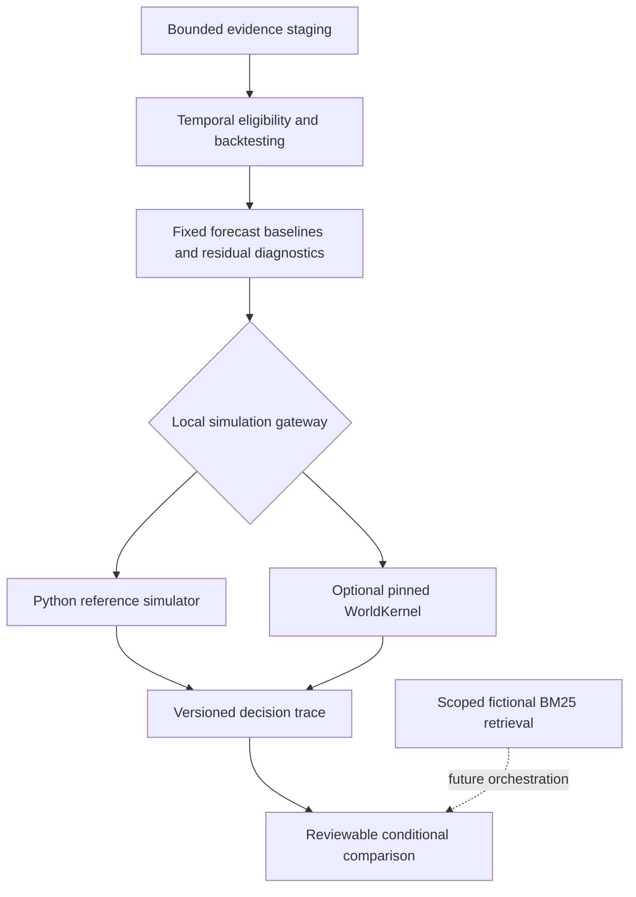

# MirrorMind

**Evidence-driven decision intelligence | AI engineering, forecasting and simulation**

MirrorMind is a Python research and engineering project for comparing decisions
using traceable evidence, time-aware forecasts and conditional simulations.
Retail inventory planning is its first reference domain, not a restriction on
the intended architecture.

**Status:** experimental, under active development. A reproducible synthetic
end-to-end workflow is implemented; empirical forecast validation, live LLM
orchestration and production deployment are not complete.

[Quick start](#quick-start) | [Architecture](#architecture) |
[Engineering evidence](#engineering-evidence) | [Roadmap](#roadmap) |
[Documentation](#documentation)

## What problem does it solve?

A decision system should distinguish **observed evidence**, **predictions**,
**simulated outcomes** and **human approval**. MirrorMind explores how to keep
these layers separate while making their inputs, assumptions, evaluation
cutoffs and outputs reproducible and inspectable.

The reference demonstration asks: how do three inventory replenishment
heuristics compare over a 28-day horizon under shared fictional demand and
explicit lead-time assumptions? The result reports conditional metrics and
sensitivity, not an instruction to place orders or an optimized policy.

## Architecture



FastAPI exposes a small typed experimental API. Shared contracts live in
`core/`, reusable capabilities in `modules/` and domain-specific
logic in `domains/`. Numerical calculations and simulation execution
are separate from future LLM orchestration. The optional
WorldKernel integration is an independent engine reached through a
versioned gateway, not an embedded agent or an HTTP simulation service.

| Area | Current evidence-backed scope |
| --- | --- |
| Evidence | Bounded CSV/XLSX staging, as-of selection, review metadata and local signed-checkpoint primitives |
| Forecasting | Fixed rolling baselines, matched temporal metrics, abstention and residual diagnostics on synthetic inputs |
| Simulation | Paired fictional policy comparison; optional pinned local WorldKernel execution with parity checks |
| Decision trace | Versioned outcomes, selected-engine provenance, artifact fingerprints and review contracts; no authenticated approval or business writes |
| Retrieval | In-memory BM25 on fictional documents, caller-declared scope filtering and excerpt digest validation; no live RAG or authenticated RBAC |
| Census research | Synthetic release-vintage evaluation with first-estimate targets and 1/3/6-month horizons |
| Agent orchestration | Planned; no live provider or agent execution in this baseline |

## Quick start

Python 3.11+ is required. From the repository root in a virtual environment:

```bash
python -m pip install -e ".[dev]"
python -m examples.m1_retail_decision_workflow --as-of 2011-01-26 --replications 2 --seed 317
python -m examples.m1_census_vintage_evaluation --split validation
python -m examples.m2_evidence_retrieval --query "inventory"
```

The examples emit structured JSON using fictional fixtures. They need no
API key, real dataset, hosted model or WorldKernel installation.
The default retail demonstration uses the Python reference simulator.
Inspect the decision trace, temporal diagnostics, simulation assumptions
and evidence citations rather than treating the results as business advice.

The real local WorldKernel path is optional. Its repository is currently
private, so external visitors cannot reproduce the exact pinned integration
without separately authorized access. The public default path does not
require that extra. Do not substitute an unrelated package or revision.

For authorized developers with the pinned dependency installed, the
engine path uses the same CLI with `--engine worldkernel`.

### Local API

```bash
uvicorn mirrormind.api:app --host 127.0.0.1 --port 8000
```

Open [interactive API documentation](http://127.0.0.1:8000/docs).
This is a development-only server, not a public deployment.

| Endpoint | Purpose |
| --- | --- |
| GET /health | Health response |
| GET /v1/capabilities | Declared capability status and limitations |
| POST /v1/scenarios/validate | Validate scenario contracts without execution |
| POST /v1/decision-workflows/retail/synthetic | Fictional decision comparison using the default simulator |

## Engineering evidence

At the reviewed baseline of 27 November 2026
([PR #67](https://github.com/GustavoMFDS/MirrorMind/pull/67),
commit `858211d`), the independent local gate passed **904 tests with
zero skips**, all six checks and examples lint, including the exact pinned
WorldKernel runtime. This is a dated local result, not a claim about every
later commit or GitHub Actions.

```bash
python -m pytest -q -rs
python -m ruff check src tests examples
python scripts/docs/catalog.py --check
python scripts/docs/coverage.py --check
python scripts/docs/evidence.py --check
python scripts/docs/capabilities.py --check
```

The public default environment may skip optional WorldKernel tests;
report actual results and skips rather than expecting the full baseline
count. See the [local quality gate](docs/engineering/LOCAL_QUALITY_GATE.md)
and [evidence map](docs/engineering/EVIDENCE_MAP.json).

Design practices include strict contracts, fail-closed resource bounds,
temporal leakage controls, paired comparisons, deterministic fingerprints,
adverse-case regression tests and source-linked engineering walkthroughs.
These controls are experimental and do not certify operational security.

## Roadmap

| Milestone | Status |
| --- | --- |
| M0 - foundations | API and contract foundation implemented |
| M1 - evidence, forecasting, simulation and decisions | Synthetic vertical slice integrated; empirical validation pending |
| M2 - applied AI | Initial fictional retrieval integrated; retrieval evaluation, typed tools and agents next |
| M3 - production engineering | Authentication, isolation, durable jobs and operation remain incomplete |
| M4 - generalization | Additional domains and broader evaluation planned |

See [master execution plan](docs/engineering/MASTER_EXECUTION_PLAN.md),
[backlog](docs/engineering/TASK_BACKLOG.md) and
[blockers](docs/engineering/BLOCKERS.md) for dependencies and acceptance limits.

## Documentation

Start with these source-backed guides:

- [Synthetic decision workflow](docs/engineering/M1_RETAIL_SYNTHETIC_DECISION_WORKFLOW.md)
- [Temporal forecasting evaluation](docs/engineering/M1_RETAIL_SYNTHETIC_EVALUATION.md)
- [Inventory policy simulation](docs/engineering/M1_RETAIL_POLICY_SIMULATION.md)
- [WorldKernel integration](docs/engineering/WORLDKERNEL_POLICY_WORLD.md)
- [Decision trace contracts](docs/engineering/DECISION_TRACE_RESULT.md)
- [Census vintage evaluation](docs/engineering/CENSUS_VINTAGE_EVALUATION.md)
- [Evidence retrieval](docs/engineering/M2_EVIDENCE_RETRIEVAL.md)

For implementation details, use the
[engineering knowledge hub](docs/engineering/README.md),
[system map](docs/engineering/SYSTEM_MAP.md),
[repository atlas](docs/engineering/REPOSITORY_ATLAS.md),
[capability ledger](docs/engineering/CAPABILITY_LEDGER.json),
[learning exercises](docs/engineering/LEARNING.md) and
[debugging guide](docs/engineering/DEBUGGING.md).
The [agent handoff](docs/engineering/CODEX_HANDOFF.md),
[AGENTS.md](AGENTS.md) and
[definition of done](docs/engineering/DEFINITION_OF_DONE.md)
describe the development and documentation process.

## Limitations, data and safety

This is experimental research software, not a production decision service.
No real-world forecast skill, causal effect, authenticated approval,
tenant isolation or automatic business action is established. Real-source
research is separately scoped; UCI event time is not verified publication
time, and synthetic Census vintages are not official release archives.
Original datasets, credentials and customer identifiers must stay out of
the repository, examples and logs. See [security and evidence handling](docs/SECURITY.md).

## License

This repository is public for visibility and review. A general software
license has not been selected; public visibility does not grant an
open-source license. Third-party components and data retain their own
applicable terms. See the [GitHub licensing guidance](https://docs.github.com/en/repositories/managing-your-repositorys-settings-and-features/customizing-your-repository/licensing-a-repository).
