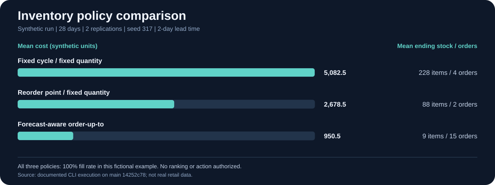
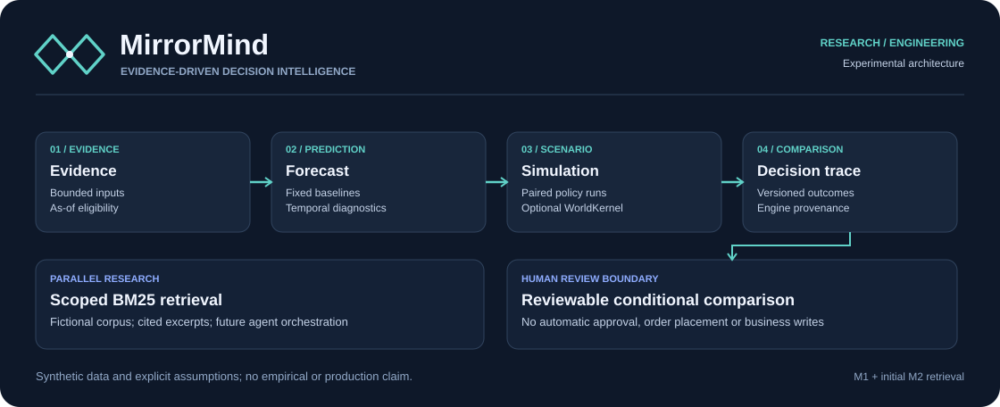

# MirrorMind

[](https://github.com/GustavoMFDS/MirrorMind/actions/workflows/ci.yml)
[](https://github.com/GustavoMFDS/MirrorMind/actions/workflows/docs.yml)
[](https://www.python.org/)
[](LICENSE)

[Português (Brasil)](README.pt-BR.md)

**An experimental framework for evidence-driven decision intelligence.**

Making better decisions takes more than generating predictions. We need to
know where our information comes from, which assumptions we are making, and
how different choices might affect future outcomes.

MirrorMind brings evidence, forecasting and simulation together in a
transparent, reproducible workflow. Its first application is inventory
planning in retail, with a modular architecture designed to support other
domains over time.

[Website](https://gustavomfds.github.io/MirrorMind/) · [Try the demo](#try-mirrormind) · [Research preview](https://github.com/GustavoMFDS/MirrorMind/releases/tag/v0.1.0-alpha.1) · [Architecture](#architecture) · [Quick start](#quick-start) · [Documentation](#documentation)

## Try MirrorMind

**[Open the online demo](https://gustavomfds.github.io/MirrorMind/demo.html)** or **[download the interactive demo](https://github.com/GustavoMFDS/MirrorMind/releases/download/v0.1.0-alpha.1/mirror-demo.html)** and open it in your browser. No installation, API key or server is needed. The report comes from a real execution of the Python workflow on synthetic data.

What happens if a retailer changes its replenishment rule? Our example
compares three policies over 28 days using the same fictional demand streams.
You can explore different delivery lead times, the forecast profile, the
assumptions behind each comparison and the complete decision trace.



In the example, the forecast-aware policy holds less stock but places more
orders. At the base two-day lead time, all three meet the simulated demand. This is an illustration of
trade-offs under stated assumptions, not a recommendation for a real retailer.

## What works today

| Area | Current capabilities |
| --- | --- |
| Evidence | Bounded CSV/XLSX readers, time-aware selection and local signed checkpoint primitives |
| Forecasting | Reference models, rolling backtests and historical residual diagnostics |
| Simulation | Seeded comparisons of inventory policies and delivery lead-time sensitivity |
| Decision trace | Versioned results, assumptions, engine provenance and evidence references |
| Retrieval | Local BM25 search over fictional documents with scope filtering and citation integrity checks |
| Census research | Synthetic release-vintage evaluation at one-, three- and six-month horizons |

The current release is a research preview, not a finished product. Live LLM
agents, empirical forecasting validation and production deployment are still
ahead. The [capability ledger](docs/engineering/CAPABILITY_LEDGER.json)
records the exact scope of each component.

## Architecture



The key design choice is to keep observed evidence, predictions, simulated
outcomes and human review distinct. Forecasts must respect what was available
at the time of evaluation. Simulations use explicit assumptions, and the
resulting decision trace records how a comparison was produced.

The Python reference simulator is the default. An optional local gateway
integrates the independently maintained WorldKernel engine at a pinned
revision. Its repository is private, so the public examples do not require it.

| Path | Responsibility |
| --- | --- |
| [src/mirrormind/core](src/mirrormind/core) | Shared contracts |
| [src/mirrormind/modules](src/mirrormind/modules) | Reusable capabilities |
| [src/mirrormind/domains](src/mirrormind/domains) | Domain-specific workflows |
| [src/mirrormind/api](src/mirrormind/api) | Typed FastAPI endpoints |
| [examples](examples) | Runnable demonstrations |
| [tests](tests) | Unit and integration tests |

## Quick start

Clone the repository, create and activate a virtual environment with Python
3.11 or newer, then run these commands from the repository root.

```bash
python -m pip install -e ".[dev]"
python -m examples.m1_retail_decision_workflow --as-of 2011-01-26 --replications 2 --seed 317
python -m examples.m2_portfolio_demo --as-of 2011-01-26 --replications 2 --seed 317 --output mirror-demo.html
```

Open the newly generated HTML file to explore the results. To change the
seed, date or replication count, generate another report with a new filename.
All examples below use synthetic data and need no hosted AI service.

<details>
<summary>More examples and the local API</summary>

```bash
python -m examples.m1_census_vintage_evaluation --split validation
python -m examples.m2_evidence_retrieval --query "inventory"
uvicorn mirrormind.api:app --host 127.0.0.1 --port 8000
```

The local development server exposes [interactive API docs](http://127.0.0.1:8000/docs),
including health, capabilities, scenario validation and synthetic retail comparison.

For developers with authorized access to the pinned WorldKernel extra, the
retail CLI also accepts `--engine worldkernel`. See the
[engine integration guide](docs/engineering/WORLDKERNEL_POLICY_WORLD.md).

</details>

## Research and engineering

A core goal is to make results inspectable, rather than merely impressive.
The project uses temporal leakage controls, deterministic fingerprints,
bounded inputs, paired simulation runs and regression tests for failure cases.

The first [public alpha](https://github.com/GustavoMFDS/MirrorMind/releases/tag/v0.1.0-alpha.1),
published on November 27, 2026 (commit `af97e345`), passed **912 local tests
with no skips** and all six local checks. Its
[official Python CI](https://github.com/GustavoMFDS/MirrorMind/actions/runs/46059515021)
passed 909 tests with three optional skips, and the
[documentation workflow](https://github.com/GustavoMFDS/MirrorMind/actions/runs/46059515074)
passed as well. The private optional WorldKernel runtime was tested locally,
not in public CI. These are release-specific results; the badges above reflect
current workflow status.

```bash
python -m pytest -q -rs
python -m ruff check src tests examples
```

See the [quality gate](docs/engineering/LOCAL_QUALITY_GATE.md),
[evidence map](docs/engineering/EVIDENCE_MAP.json) and
[release reproduction guide](docs/engineering/ALPHA_RELEASE.md) for details.

## Roadmap

| Stage | Direction |
| --- | --- |
| M0 — Foundations | API and shared contracts implemented |
| M1 — Decision intelligence | Synthetic end-to-end workflow; empirical evaluation pending |
| M2 — Applied AI | Retrieval prototype; evaluation, typed tools and agents next |
| M3 — Production engineering | Authentication, isolation and durable execution |
| M4 — Generalization | Additional domains and broader evaluation |

See the [execution plan](docs/engineering/MASTER_EXECUTION_PLAN.md),
[backlog](docs/engineering/TASK_BACKLOG.md) and [changelog](CHANGELOG.md).

## Documentation

- [Engineering hub](docs/engineering/README.md) — start here for source walkthroughs.
- [Synthetic decision workflow](docs/engineering/M1_RETAIL_SYNTHETIC_DECISION_WORKFLOW.md) — follow a complete experiment.
- [Interactive report](docs/engineering/PORTFOLIO_DEMO.md) — reproduce and inspect the demo.
- [System map](docs/engineering/SYSTEM_MAP.md) and [repository atlas](docs/engineering/REPOSITORY_ATLAS.md) — navigate the code.
- [Learning exercises](docs/engineering/LEARNING.md) and [debugging guide](docs/engineering/DEBUGGING.md) — explore the implementation.

## Limitations and contributions

MirrorMind does not establish real-world forecast accuracy, causal effects,
authenticated approval, tenant isolation or automatic business decisions.
The demos use synthetic data; UCI transaction dates do not verify historical
availability, and synthetic Census vintages are not official archives.
The optional private engine and external datasets are not redistributed.

Feedback and reproducible reports are welcome. See the
[contribution guide](CONTRIBUTING.md), [security policy](SECURITY.md)
and [research blockers](docs/engineering/BLOCKERS.md).

## License

The original MirrorMind code and documentation are licensed under
[Apache 2.0](LICENSE). Third-party software, datasets and WorldKernel retain
their own terms; see [third-party boundaries](docs/THIRD_PARTY.md).
