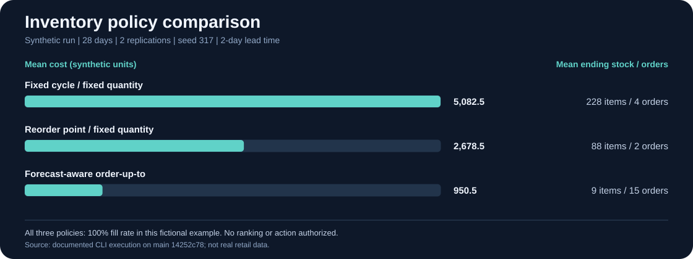

# MirrorMind

[](https://github.com/GustavoMFDS/MirrorMind/actions/workflows/ci.yml)
[](https://github.com/GustavoMFDS/MirrorMind/actions/workflows/docs.yml)
[](https://www.python.org/)
[](LICENSE)

[English](README.md)

**Um projeto experimental de inteligência de decisão orientada por evidências.**

Tomar decisões melhores exige mais do que gerar previsões. Precisamos
entender de onde vêm as informações, quais hipóteses estamos adotando e
como diferentes escolhas podem afetar os resultados.

O MirrorMind reúne evidências, previsão e simulação em um fluxo transparente
e reproduzível. Sua primeira aplicação é o planejamento de estoques no
varejo, mas a arquitetura modular foi pensada para atender outros domínios
ao longo do desenvolvimento.

[Site](https://gustavomfds.github.io/MirrorMind/) · [Experimente a demonstração](#experimente-o-mirrormind) · [Versão alfa](https://github.com/GustavoMFDS/MirrorMind/releases/tag/v0.1.0-alpha.1) · [Arquitetura](#arquitetura) · [Primeiros passos](#primeiros-passos) · [Documentação](#documentação)

## Experimente o MirrorMind

**[Baixe a demonstração interativa](https://github.com/GustavoMFDS/MirrorMind/releases/download/v0.1.0-alpha.1/mirror-demo.html)** e abra o arquivo no navegador. Não é necessário instalar nada, usar uma chave de API ou iniciar um servidor. O relatório foi gerado pelo próprio fluxo Python, com dados sintéticos.

O que acontece quando uma loja muda sua estratégia de reposição? O exemplo
compara três políticas ao longo de 28 dias, usando os mesmos cenários de
demanda fictícia. Você pode explorar diferentes prazos de entrega, o perfil
de previsão, as hipóteses da comparação e o registro completo da decisão.



No exemplo, a política baseada em previsão mantém menos itens em estoque,
mas faz mais pedidos. No cenário base, com prazo de entrega de dois dias, as três atendem à demanda simulada. Isso ilustra
diferenças entre estratégias sob determinadas hipóteses, não uma
recomendação para uma loja real.

## O que já funciona

| Área | Funcionalidades atuais |
| --- | --- |
| Evidências | Leitura de CSV/XLSX com limites, seleção por data de disponibilidade e registros locais assinados |
| Previsão | Modelos de referência, avaliação em janelas temporais e análise de erros históricos |
| Simulação | Comparação de políticas de estoque com sementes reproduzíveis e análise de prazos de entrega |
| Rastreabilidade | Resultados versionados, hipóteses, identificação do motor e referências às evidências |
| Busca | Recuperação local BM25 em documentos fictícios, filtro de escopo e verificação das citações |
| Pesquisa Census | Avaliação sintética de versões históricas de dados em horizontes de um, três e seis meses |

A versão atual é experimental. Agentes com modelos de linguagem reais,
validação empírica das previsões e implantação em produção ainda estão no
roadmap. O [catálogo de capacidades](docs/engineering/CAPABILITY_LEDGER.json)
detalha o escopo de cada componente.

## Arquitetura


A principal escolha de arquitetura é manter separados os dados observados,
as previsões, os resultados simulados e a revisão humana. As previsões
respeitam a disponibilidade das informações na data de avaliação. As
simulações usam hipóteses explícitas, e o registro da decisão permite
entender como a comparação foi produzida.

O simulador de referência em Python é utilizado por padrão. Há também uma
integração local opcional com uma revisão específica do WorldKernel, motor
desenvolvido de forma independente. Seu repositório é privado, mas nenhum
dos exemplos públicos depende dele.

| Caminho | Responsabilidade |
| --- | --- |
| [src/mirrormind/core](src/mirrormind/core) | Contratos compartilhados |
| [src/mirrormind/modules](src/mirrormind/modules) | Componentes reutilizáveis |
| [src/mirrormind/domains](src/mirrormind/domains) | Fluxos específicos de cada domínio |
| [src/mirrormind/api](src/mirrormind/api) | API tipada com FastAPI |
| [examples](examples) | Demonstrações executáveis |
| [tests](tests) | Testes unitários e de integração |

## Primeiros passos

Clone o repositório, crie e ative um ambiente virtual com Python 3.11 ou
superior e execute os comandos abaixo na raiz do projeto.

```bash
python -m pip install -e ".[dev]"
python -m examples.m1_retail_decision_workflow --as-of 2011-01-26 --replications 2 --seed 317
python -m examples.m2_portfolio_demo --as-of 2011-01-26 --replications 2 --seed 317 --output mirror-demo.html
```

Abra o novo arquivo HTML no navegador. Para alterar a semente, a data de
referência ou o número de repetições, gere outro relatório com um nome
diferente. Os exemplos usam dados sintéticos e não exigem serviços de IA.

<details>
<summary>Mais exemplos e API local</summary>

```bash
python -m examples.m1_census_vintage_evaluation --split validation
python -m examples.m2_evidence_retrieval --query "inventory"
uvicorn mirrormind.api:app --host 127.0.0.1 --port 8000
```

O servidor local de desenvolvimento oferece
[documentação interativa da API](http://127.0.0.1:8000/docs), com rotas de
disponibilidade, capacidades, validação de cenários e comparação sintética.

Desenvolvedores com acesso autorizado à revisão fixada do WorldKernel
podem usar o argumento `--engine worldkernel` no exemplo de varejo.
Veja o [guia de integração](docs/engineering/WORLDKERNEL_POLICY_WORLD.md).

</details>

## Pesquisa e engenharia

Um dos objetivos do projeto é produzir resultados que possam ser
investigados e reproduzidos, não apenas números impressionantes. Por isso,
a implementação inclui controles contra vazamento temporal, identificadores
de integridade determinísticos, limites de entrada, simulações pareadas e
testes de regressão para casos de falha.

A primeira [versão alfa pública](https://github.com/GustavoMFDS/MirrorMind/releases/tag/v0.1.0-alpha.1),
publicada em 27 de novembro de 2026 (commit `af97e345`), teve **912 testes
locais aprovados, sem testes ignorados**, além das seis verificações locais.
O [CI oficial de Python](https://github.com/GustavoMFDS/MirrorMind/actions/runs/46059515021)
aprovou 909 testes, com três testes opcionais ignorados, e o
[workflow de documentação](https://github.com/GustavoMFDS/MirrorMind/actions/runs/46059515074)
também passou. O WorldKernel privado foi testado localmente, não no CI
público. Esses resultados correspondem à versão publicada; os badges no topo
mostram o estado atual dos workflows.

```bash
python -m pytest -q -rs
python -m ruff check src tests examples
```

Consulte as [verificações de qualidade](docs/engineering/LOCAL_QUALITY_GATE.md),
o [mapa de evidências](docs/engineering/EVIDENCE_MAP.json) e o
[guia de reprodução da versão](docs/engineering/ALPHA_RELEASE.md).

## Roadmap

| Etapa | Direção |
| --- | --- |
| M0 — Fundação | API e contratos compartilhados implementados |
| M1 — Inteligência de decisão | Fluxo sintético completo; avaliação empírica pendente |
| M2 — IA aplicada | Protótipo de busca; avaliação, ferramentas tipadas e agentes a seguir |
| M3 — Engenharia de produção | Autenticação, isolamento e execução persistente |
| M4 — Generalização | Novos domínios e avaliação mais ampla |

Veja o [plano de execução](docs/engineering/MASTER_EXECUTION_PLAN.md),
a [fila de tarefas](docs/engineering/TASK_BACKLOG.md) e o
[histórico de alterações](CHANGELOG.md).

## Documentação

Os guias de engenharia permanecem em inglês.

- [Central de engenharia](docs/engineering/README.md) — ponto de partida para estudar o código.
- [Fluxo de decisão sintético](docs/engineering/M1_RETAIL_SYNTHETIC_DECISION_WORKFLOW.md) — acompanhe um experimento completo.
- [Relatório interativo](docs/engineering/PORTFOLIO_DEMO.md) — reproduza e explore a demonstração.
- [Mapa do sistema](docs/engineering/SYSTEM_MAP.md) e [atlas do repositório](docs/engineering/REPOSITORY_ATLAS.md) — navegue pelo código.
- [Exercícios](docs/engineering/LEARNING.md) e [guia de depuração](docs/engineering/DEBUGGING.md) — entenda a implementação.

## Limitações e contribuições

O MirrorMind ainda não comprova precisão de previsões reais, efeitos causais,
aprovação autenticada, isolamento entre clientes ou decisões comerciais
automáticas. Os exemplos usam dados sintéticos. As datas de transação da UCI
não comprovam a disponibilidade histórica dos dados, e as versões sintéticas
do Census não são arquivos oficiais. O motor privado opcional e os conjuntos
de dados externos não são redistribuídos.

Sugestões e relatos reproduzíveis são bem-vindos. Consulte o
[guia de contribuições](CONTRIBUTING.md), a [política de segurança](SECURITY.md)
e os [bloqueios de pesquisa](docs/engineering/BLOCKERS.md).

## Licença

O código e a documentação originais do MirrorMind utilizam a
[Apache 2.0](LICENSE). Software de terceiros, conjuntos de dados e WorldKernel
mantêm seus próprios termos; veja os [limites de licenciamento](docs/THIRD_PARTY.md).
