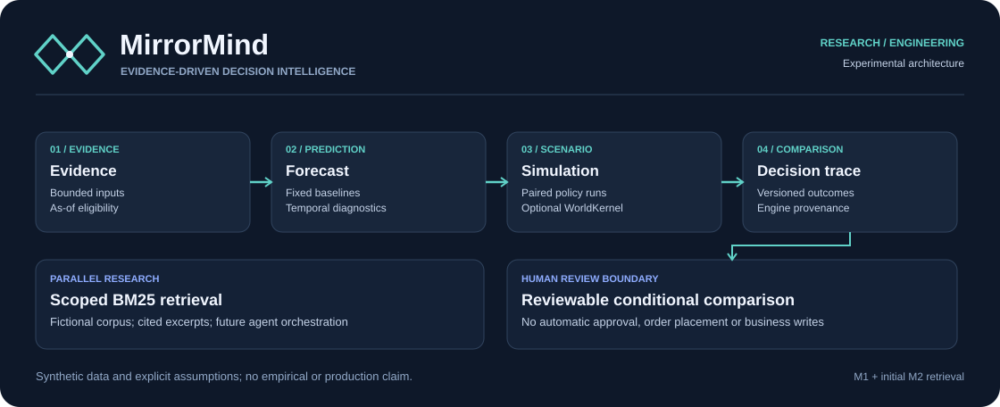
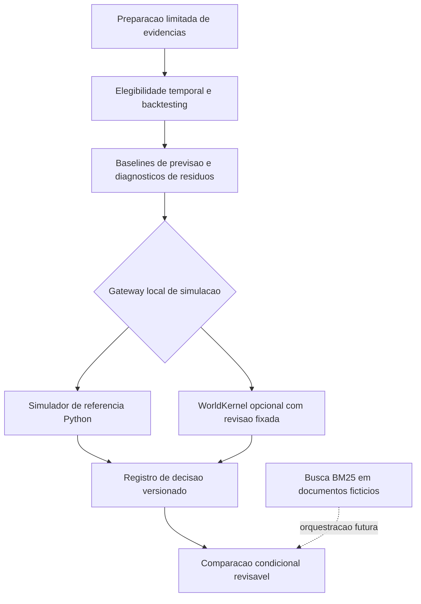

# MirrorMind

[](https://github.com/GustavoMFDS/MirrorMind/actions/workflows/ci.yml)
[](https://github.com/GustavoMFDS/MirrorMind/actions/workflows/docs.yml)
[](LICENSE)

[English](README.md)

**Inteligência de decisão orientada por evidências | Engenharia de IA, previsão e simulação**

O MirrorMind é um projeto de pesquisa e engenharia em Python para comparar
decisões usando evidências rastreáveis, previsões com controle temporal e simulações
condicionais. O planejamento de estoque no varejo é o primeiro domínio de
referência, não uma limitação da arquitetura pretendida.

**Estado:** experimental, em desenvolvimento ativo. O fluxo sintético de ponta
a ponta é reproduzível; validação empírica, orquestração com LLMs reais e
implantação em produção ainda não foram concluídas.

## Qual problema o projeto resolve?

Um sistema de apoio à decisão deve separar **evidências observadas**,
**previsões**, **resultados simulados** e **aprovação humana**. O MirrorMind
explora como manter essas camadas distintas, com entradas, premissas, cortes
temporais de avaliação e resultados inspecionáveis e reproduzíveis.

A demonstração de referência compara três regras de reposição de estoque ao
longo de 28 dias, sob demanda fictícia compartilhada e premissas explícitas
de prazo de entrega. O relatório apresenta métricas condicionais e sensibilidade,
não uma instrução de compra ou uma política otimizada.

## Arquitetura



<details>
<summary>Diagrama em Mermaid</summary>



</details>

A API experimental usa FastAPI e contratos tipados. Os contratos compartilhados
estão em `core/`, capacidades reutilizáveis em `modules/` e a lógica específica
de domínio em `domains/`. Os cálculos numéricos e a simulação são separados
da futura orquestração por LLM. O WorldKernel é um motor independente, acessado
por um gateway versionado, não um agente embutido nem um serviço HTTP de simulação.

| Área | Escopo atual sustentado por evidências |
| --- | --- |
| Evidências | Leitura limitada de CSV/XLSX, seleção as-of, metadados de revisão e checkpoints assinados locais |
| Previsão | Baselines fixos, métricas temporais pareadas, abstenção e diagnósticos de resíduos em dados sintéticos |
| Simulação | Comparação pareada de políticas fictícias e execução local opcional no WorldKernel com paridade |
| Rastreabilidade | Resultados versionados, proveniência do motor, fingerprints e contratos de revisão; sem aprovação autenticada ou escritas comerciais |
| Recuperação | BM25 em memória sobre documentos fictícios, escopo declarado pelo chamador e validação de digest de excertos; sem RAG ao vivo ou RBAC autenticado |
| Pesquisa Census | Avaliação sintética de vintages com alvos de primeira publicação e horizontes de 1, 3 e 6 meses |
| Orquestração de agentes | Planejada; sem provedor real nem execução de agentes nesta baseline |

## Início rápido

Requer Python 3.11 ou superior. Na raiz do repositório, em um ambiente virtual:

```bash
python -m pip install -e ".[dev]"
python -m examples.m1_retail_decision_workflow --as-of 2011-01-26 --replications 2 --seed 317
python -m examples.m1_census_vintage_evaluation --split validation
python -m examples.m2_evidence_retrieval --query "inventory"
```

Os exemplos geram JSON estruturado a partir de fixtures fictícias. Não exigem
chave de API, dataset real, modelo hospedado ou instalação do WorldKernel.
O exemplo de varejo usa por padrão o simulador Python de referência.
A integração real com o WorldKernel é opcional e seu repositório ainda
é privado. Desenvolvedores com acesso autorizado à dependência fixada podem
usar o mesmo comando com `--engine worldkernel`. Não substitua a revisão
fixada por um pacote arbitrário.

### Exemplo de resultado: comparação condicional de estoque

O primeiro comando foi executado na main `14252c78`, com seed 317,
duas replicações, horizonte de 28 dias e prazo de entrega base de dois dias.

| Política | Custo médio (unidades sintéticas) | Taxa de atendimento | Estoque final médio (itens) | Pedidos médios |
| --- | ---: | ---: | ---: | ---: |
| Ciclo fixo / quantidade fixa | 5.082,5 | 100% | 228 | 4 |
| Ponto de reposição / quantidade fixa | 2.678,5 | 100% | 88 | 2 |
| Reposição até alvo baseada na previsão | 950,5 | 100% | 9 | 15 |


A terceira regra mantém menos estoque, mas gera mais pedidos. As diferenças
decorrem de premissas e custos fictícios e não demonstram superioridade
no mundo real. O relatório inclui sensibilidade a prazos de um e três dias,
referências das premissas e proveniência do motor escolhido. Nenhum ranking
ou ação é autorizado.

```json
{
  "decision_status": "comparison_only_no_policy_selection_or_authorization",
  "action_authorized": false,
  "writes_performed": false,
  "ingestion_authorized": false
}
```

### Demonstração interativa offline

Gere um novo relatório HTML local a partir do fluxo sintético:

```bash
python -m examples.m2_portfolio_demo --as-of 2011-01-26 --replications 2 --seed 317 --output mirror-demo.html
```

Abra o arquivo gerado no navegador. Explore os cenários de prazo de entrega já calculados, previsões, evidências e a rastreabilidade completa. Não exige servidor nem serviço externo. [Guia do relatório](docs/engineering/PORTFOLIO_DEMO.md).

### API local

```bash
uvicorn mirrormind.api:app --host 127.0.0.1 --port 8000
```

Acesse a [documentação interativa](http://127.0.0.1:8000/docs).
Servidor apenas para desenvolvimento, não implantação pública.

| Endpoint | Finalidade |
| --- | --- |
| GET /health | Verificação de disponibilidade |
| GET /v1/capabilities | Capacidades declaradas e limitações |
| POST /v1/scenarios/validate | Validação de cenário sem execução |
| POST /v1/decision-workflows/retail/synthetic | Comparação fictícia com simulador padrão |

## Evidências de engenharia

Na baseline de 27 de novembro de 2026 ([PR #67](https://github.com/GustavoMFDS/MirrorMind/pull/67),
commit `858211d`), o gate local independente aprovou **904 testes, zero skips**,
os seis verificadores e o lint dos exemplos, incluindo o WorldKernel na
revisão fixada. O [CI público](https://github.com/GustavoMFDS/MirrorMind/actions/runs/46054365093)
e o [workflow documental](https://github.com/GustavoMFDS/MirrorMind/actions/runs/46054365104)
também passaram na main `14252c78`. São evidências datadas, não garantias de
commits futuros.

```bash
python -m pytest -q -rs
python -m ruff check src tests examples
python scripts/docs/catalog.py --check
python scripts/docs/coverage.py --check
python scripts/docs/evidence.py --check
python scripts/docs/capabilities.py --check
```

O ambiente público pode ignorar testes opcionais do WorldKernel; informe os
resultados reais e skips. Consulte o [gate local](docs/engineering/LOCAL_QUALITY_GATE.md)
e o [mapa de evidências](docs/engineering/EVIDENCE_MAP.json).
Contratos estritos, limites fail-closed, controle de vazamento temporal,
comparações pareadas, fingerprints determinísticos e testes adversariais
não certificam segurança operacional.

## Roadmap

| Milestone | Estado |
| --- | --- |
| M0 - Fundação | API e contratos implementados |
| M1 - Evidências, previsão, simulação e decisões | Fluxo sintético integrado; validação empírica pendente |
| M2 - IA aplicada | Recuperação fictícia inicial integrada; avaliação, ferramentas tipadas e agentes a seguir |
| M3 - Engenharia de produção | Autenticação, isolamento, jobs duráveis e operação incompletos |
| M4 - Generalização | Outros domínios e avaliação mais ampla planejados |

[Plano mestre](docs/engineering/MASTER_EXECUTION_PLAN.md) |
[Backlog](docs/engineering/TASK_BACKLOG.md) |
[Bloqueios](docs/engineering/BLOCKERS.md).

## Documentação

Os guias técnicos permanecem em inglês:

- [Fluxo de decisão sintético](docs/engineering/M1_RETAIL_SYNTHETIC_DECISION_WORKFLOW.md)
- [Avaliação temporal](docs/engineering/M1_RETAIL_SYNTHETIC_EVALUATION.md)
- [Simulação de políticas de estoque](docs/engineering/M1_RETAIL_POLICY_SIMULATION.md)
- [Integração WorldKernel](docs/engineering/WORLDKERNEL_POLICY_WORLD.md)
- [Contratos de rastreabilidade](docs/engineering/DECISION_TRACE_RESULT.md)
- [Avaliação de vintages Census](docs/engineering/CENSUS_VINTAGE_EVALUATION.md)
- [Recuperação de evidências](docs/engineering/M2_EVIDENCE_RETRIEVAL.md)

Para explorar a implementação: [central de engenharia](docs/engineering/README.md),
[mapa do sistema](docs/engineering/SYSTEM_MAP.md),
[atlas do repositório](docs/engineering/REPOSITORY_ATLAS.md),
[catálogo de capacidades](docs/engineering/CAPABILITY_LEDGER.json),
[exercícios](docs/engineering/LEARNING.md) e
[guia de depuração](docs/engineering/DEBUGGING.md).
O [handoff](docs/engineering/CODEX_HANDOFF.md), [AGENTS.md](AGENTS.md)
e a [definição de pronto](docs/engineering/DEFINITION_OF_DONE.md)
descrevem o processo de desenvolvimento.

## Limitações, dados e segurança

Software experimental de pesquisa, não serviço de decisão em produção.
Não comprova qualidade preditiva real, efeitos causais, aprovação autenticada,
isolamento de clientes ou ações comerciais automáticas. A pesquisa com dados reais
tem autorizações separadas; a data da transação UCI não comprova data de
publicação, e as vintages Census sintéticas não são arquivos oficiais.
Dados brutos, credenciais e identificadores de clientes devem ficar fora
do repositório, dos exemplos e dos logs. Veja
[segurança e tratamento de evidências](docs/SECURITY.md).

[Guia de contribuições](CONTRIBUTING.md) | [Política de segurança](SECURITY.md)

## Licença

O código e a documentação originais do MirrorMind são licenciados sob a
[Apache License 2.0](LICENSE). Software e dados de terceiros, bem como o motor
independente WorldKernel, mantêm seus próprios termos aplicáveis. Consulte os
[limites de licenciamento e dados de terceiros](docs/THIRD_PARTY.md).
