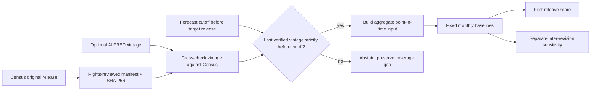

# Aggregate Census/ALFRED vintage research protocol

**Status:** owner-approved second research lane; the synthetic evaluator is
published separately in open PR #63. Protocol and regression fixtures use no
Census/FRED data or API key. This study follows the UCI event-time pilot and
is independent of product-level claims.

## Research question and boundary

Can a local monthly forecast evaluator reconstruct the aggregate information available before a scheduled U.S. retail release and score its next-period estimates without leaking later revisions? Candidate source is the U.S. Census Bureau's historical Advance Monthly Retail Trade Survey releases. A secondary machine-readable route is Census-sourced FRED/ALFRED series `RSAFS`, only if source terms, series rights, free access and archive evidence are acceptable after review.

This can test release-aware evaluation on aggregate retail dollar sales. It cannot validate item/SKU demand, a company's inventory, replenishment policy, causal intervention or the operational readiness of M1. Do not use M5, confidential microdata, commercial third-party series or paid services.

## Source proposal and permissions

| Candidate | Use and current public evidence | Conditions before any source acquisition |
| --- | --- | --- |
| Census MARTS historical releases (preferred candidate) | The Census data index links advance reports from October 1953 in PDF or Excel and annual revision reports from 1996. The current annual revision index exposes tables from January 1992 through August 2026. The proposal selects national total retail and food-services sales. Current release text says figures are seasonally adjusted but not price-adjusted; describing them as nominal/current-dollar values is an inference to verify against the exact selected table. These indexes establish candidate artifacts, not month-by-month completeness or rights. | Select the exact table, series definition, and date window; inspect original release headers and notices; record publication boundary, timezone, retrieval time and byte digest; approve applicable terms, attribution, local retention and outputs. Preserve first-release and revised files as distinct vintages. |
| FRED/ALFRED `RSAFS` (deferred candidate) | FRED identifies `RSAFS` as Census Bureau Advance Retail Sales: Retail Trade and Food Services. ALFRED exposes date-granular real-time periods; FRED's current API documentation requires a registered API key. | Do not call the API or retain API results under this proposal. Current FRED Services terms prohibit API use in connection with storing, caching or archiving FRED content, while series rights can remain with third parties. Any future route needs written permission that covers the required local retention/archive, applicable series-owner rights, an authorized key, and required notices. A key or API response is not a data license. |

The preferred candidate is the direct Census archive, subject to source-specific rights and retention review. The proposed measure is national retail and food-services total sales; current Census release text says its sales figures are seasonally adjusted but not price-adjusted. Treating that as nominal/current-dollar data is an inference that must be checked against the chosen table. The API terms for FRED/ALFRED are an additional constraint: FRED access does not override third-party rights, and the current terms restrict API-associated storage, caching, and archiving. Because the approved research method needs immutable local artifacts for reproducibility, ALFRED API retrieval is deferred unless written permissions explicitly cover that handling. No account or key is authorized or present.

The source definition must be versioned with each vintage. Census methodology states that, as of the April 2025 annual revision, nonemployers were removed from the estimates and historical series to align with the Annual Integrated Economic Survey. This is a documented series-definition change. Record the methodology/population edition with the taxonomy, adjustment, and unit; do not pool first estimates across a definition boundary until the reviewer accepts a comparability analysis or a segmented result.

## Proposed source manifest

Do not store source values or archive files in Git. Keep locally approved artifacts outside the repository. A reviewed manifest entry should contain:

| Field | Contract |
| --- | --- |
| `publisher`, `series_id`, `definition`, `methodology_edition`, `unit`, `adjustment` | Exact source owner, population/coverage and taxonomy edition, stable series definition and units; one compatible candidate series per manifest version |
| `reference_period` | Month measured; never treated as publication time |
| `release_id`, `published_at`, `timezone`, `release_kind` | Exact initial/advance/monthly/annual revision identity and official publication boundary; missing or contradictory boundaries reject the vintage |
| `source_uri`, `retrieved_at`, `snapshot_sha256`, `file_format` | Exact original release artifact identity and local retrieval evidence |
| `value`, `status` | Aggregate published value and whether it is a first estimate, revision or annual revision |
| `rights_review_id`, `privacy_review_id`, `retention_due_at` | Opaque references to separately approved review records; a manifest is not itself permission |

Each release is immutable. Corrections create a new vintage record; they never overwrite an earlier value. Keep source bytes private, do not log values alongside identifiable information, and delete files and derived local artifacts at the approved retention deadline. FRED API keys, if later approved, belong only in local secret storage and never in Git, CI or fixtures.

## Temporal protocol

1. Before fetching values, inventory the official release calendar and archive. Record known missing periods and the exact candidate series. If an interval is incomplete, preserve the gap and abstain; do not manufacture a release or silently switch to revised current data.
2. Pre-register a chronological fit/validation/locked-holdout calendar before examining scores. Census annual-revision tables currently identify January 1992 onward through August 2026, but this is only an inventory span: it does not establish completeness of the original first-release archive or comparability across methodology editions. Freeze the exact origin interval only after archive completeness, source rights, and the 2025 population-definition change have been reviewed. If the proposed interval fails the predeclared completeness or comparability rule, stop the empirical pilot rather than reselecting a favorable window.
3. For each target month `m`, issue the forecast at the day-before boundary for the official first-estimate release of `m`. Use only aggregate values in the latest verified vintage whose publication date is strictly before that boundary. ALFRED vintages are date-granular; never assign a same-day vintage an invented intraday time. Cross-check the first-release target value against the original Census release artifact.
4. Build each rolling origin independently from its then-available vintage. Annual and monthly revisions may enter only after their actual release boundary and strictly after the known first-estimate publication date for that reference month. An earlier revision is contradictory; a same-day first-estimate/revision pair is ambiguous under date-only timestamps. If the archive fragment has no first-estimate anchor, exclude and count its revisions instead of using them as features; preserve the month as missing so the history gate can abstain. Preserve first estimates and revised values as separate labels.
5. Primary target is the first advance estimate for the target month. Report latest annual-revision values as a separate sensitivity analysis, never pooled with first-release scores. This separates prediction of the published first estimate from prediction against subsequently revised history. Report definition editions separately; if first-estimate targets span incompatible coverage or taxonomy editions, split the scores or abstain instead of treating the values as one unchanged series.
6. Evaluate horizons 1, 3 and 6 months from each origin, with lag-12 seasonal naive and trailing-12-month mean baselines. Both methods share matched targets per horizon. Use context-independent exact arithmetic for means and additive metrics; bound numeric precision/exponents and fail closed on float overflow, non-finite output or positive-metric underflow. Report per-horizon MAE, RMSE, zero-safe WAPE, coverage and separate abstention counts. Do not select a winner when fewer than two matched origins exist.
7. A source timestamp that is only a date is treated conservatively: use the last verified vintage strictly before the release date and score the first release only after that release is independently recorded. Missing, ambiguous or contradictory vintage metadata means abstain.

### Normalized period-close invariant

The local normalized-record contract rejects any first estimate or revision
whose date falls inside or before its `reference_month`; the earliest accepted
date is the first day of the following month. This is a source-neutral lower
bound that prevents incomplete-month values from entering a monthly vintage.
The Census Bureau says MARTS estimates are released approximately ten business
days after the reference month ends ([methodology](https://www.census.gov/retail/marts/how_surveys_are_collected.html)). The local rule does not check
that exact schedule or authenticate a timestamp. Before an empirical run,
cross-check every publication date against the reviewed source artifact and
official calendar; the selector must still abstain on uncertain same-day order.

## Reproducibility, failure and controls

No remote request is part of tests. The current preparation implementation is
the pure normalized-record selector in
[`census_vintages.py`](../../src/mirrormind/domains/retail/census_vintages.py).
It accepts a bounded in-memory tuple, selects the latest record per reference
month strictly before a target release date, preserves selected release IDs
and digest strings, and rejects same-day ambiguity. It performs no file or
network access. Its 64-character digest validation checks syntax and release
metadata consistency only; it cannot verify source bytes or an approved
manifest. See the
[adapter walkthrough](CENSUS_VINTAGE_ADAPTER.md) and
[synthetic fixture card](datasets/SYNTHETIC_CENSUS_VINTAGES.md).

A future source-specific file adapter must accept an explicit reviewed
manifest, verify exact source bytes and schema before building normalized
records, and keep raw artifacts outside Git. Keep any network connector
separate from parsing so unit tests can use generated records and no live
account is required. The current selector's receipt always marks source
provenance unverified and ingestion/forecast flags false.

The synthetic evaluation implementation in
[census_evaluation.py](../../src/mirrormind/domains/retail/census_evaluation.py)
reuses the selector at each fixed date-only origin. It compares lag-12
seasonal naive and trailing-12-month mean at horizons 1, 3 and 6 against
later first-estimate labels, while preserving reason-specific abstention and
per-origin lineage. The generated example has disjoint validation and holdout
origins, but it is not an empirical locked holdout. See the
[evaluation walkthrough](CENSUS_VINTAGE_EVALUATION.md) and
[synthetic model card](model_cards/SYNTHETIC_CENSUS_VINTAGE_EVALUATION.md).

The normalized-selector tests cover absent months, conflicting release
metadata, malformed digest syntax, same-day ambiguity, revisions after the
cutoff and deterministic abstention. Synthetic evaluation tests additionally
cover later-revision noninterference, target labels, matched baselines,
missing history, zero metric denominators and split replay. Future
source-parser/evaluator tests must cover changed bytes, missing release-boundary
metadata, missing ALFRED vintages and disagreement with original Census
releases. A complete local check does not establish rights or official CI. No
data adapter should call FRED until free account/API access, each series'
terms and the owner-approved retention manifest are in place.

## Primary-source recheck — 2026-11-26 (metadata only)

The official Census [Advance MARTS archive](https://www.census.gov/retail/marts/historic_releases.html)
lists historical monthly releases and explicitly identifies missing releases;
the documented archive gaps are before 1992. The separate [annual revision archive](https://www.census.gov/retail/mrts/historic_releases.html)
currently lists the 2026 report with sales tables from January 1992 through
August 2026. These indexes make 1992 onward an inventory span, but they do not
prove every original first-release file is available, consistent or complete
for the selected series.
The official [MARTS methodology](https://www.census.gov/retail/marts/how_surveys_are_collected.html)
states that advance estimates are released about ten business days after the
reference month closes and revised one month later. This supports the
normalized period-close lower bound, but does not authenticate an archived
file's exact publication timestamp or revision history.
The [release schedule](https://www.census.gov/retail/release_schedule.html)
publishes a time of day for scheduled release dates; the timezone and exact
timestamp for each historical artifact still need source-level verification.

The [2022 annual-revision archive](https://www.census.gov/retail/mrts/historic_releases.html)
carries a correction notice: its sales spreadsheet was replaced at 12:45 p.m.
on the release date after a 10:00 a.m. release. This demonstrates that an
official archive can be corrected within a day. Preserve distinct file
versions, hashes and timestamps if permission is granted; do not treat a
date-only vintage as ordered against a same-day update. The current date-only
selector must abstain on that ambiguity. This notice is metadata evidence, not
proof that the original file bytes remain available.

The current Census [Advance MARTS methodology](https://www.census.gov/retail/marts/how_surveys_are_collected.html)
also records a population-definition change: since the April 2025 annual
revision, nonemployers are excluded and removed from the historical series.
Treat this as a required version boundary in the source manifest and evaluation
review; historical archive coverage by itself is not proof that first-release
targets on either side are comparable.

FRED's current [API terms](https://fred.stlouisfed.org/docs/api/terms_of_use.html)
require a registered key and place responsibility for third-party series rights
on the user. They also prohibit use of the API in connection with storing,
caching, or archiving FRED content. The [API key documentation](https://fred.stlouisfed.org/docs/api/fred/v2/api_key.html)
requires a key for requests, and the [real-time-period documentation](https://fred.stlouisfed.org/docs/api/fred/realtime_period.html)
defines date-granular historical knowledge periods. These conditions conflict
with the immutable local archive needed by this reproducible pilot. Defer
FRED/ALFRED API access unless written permissions expressly cover retained
research artifacts and the underlying series rights. The direct Census archive
remains the preferred no-credential candidate, subject to its own series and
retention review.

This was a metadata-only source review. No Census release file, FRED API
response, credential or UCI workbook was downloaded or processed. A search
preview for the public FRED `RSAFS` table and the current Census release HTML
incidentally displayed published aggregate values; none was transcribed into
repository artifacts, retained, or used in an evaluation. This is not a pilot
run and does not establish source approval.

## Current primary references checked 2026-11-26

- U.S. Census [monthly retail data](https://www.census.gov/retail/data.html), [historical release archive](https://www.census.gov/retail/historic_releases.html), [Advance MARTS archive](https://www.census.gov/retail/marts/historic_releases.html), [annual revision archive](https://www.census.gov/retail/mrts/historic_releases.html), [MARTS methodology](https://www.census.gov/retail/marts/how_surveys_are_collected.html), and [release schedule](https://www.census.gov/retail/release_schedule.html).
- St. Louis Fed [RSAFS series record](https://fred.stlouisfed.org/series/RSAFS), [FRED Services terms](https://fred.stlouisfed.org/legal/terms/), [FRED API terms](https://fred.stlouisfed.org/docs/api/terms_of_use.html), [API key documentation](https://fred.stlouisfed.org/docs/api/fred/v2/api_key.html), [real-time-period documentation](https://fred.stlouisfed.org/docs/api/fred/realtime_period.html), [`series/vintagedates`](https://fred.stlouisfed.org/docs/api/fred/series_vintagedates.html), and [`series/observations`](https://fred.stlouisfed.org/docs/api/fred/series_observations.html).

These pages establish that archives/API features exist and describe their conditions. They do not establish the exact series license, a complete period for this study, a specific downloaded snapshot, or owner authorization. The current Census release page exposed a published figure inline; it was not transcribed or retained. No source file, API response or credential was acquired, and no evaluation was run.
