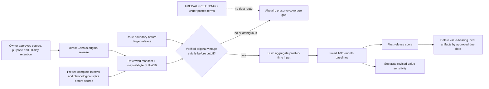

# Aggregate Census/ALFRED vintage research protocol

**Status:** owner-approved second research lane; the synthetic evaluator is
published separately in open PR #63. Protocol and regression fixtures use no
Census/FRED data or API key. This study follows the UCI event-time pilot and
is independent of product-level claims. Direct Census acquisition remains
pending artifact-specific review and owner approval. FRED/ALFRED retrieval is
NO-GO under the currently posted service terms unless the Federal Reserve
Bank of St. Louis authorizes the intended use in writing or revised terms
expressly resolve the restrictions below; source-owner permission is separate.

## Research question and boundary

Can a local monthly evaluator reconstruct the aggregate information available before a scheduled U.S. retail release and score its next-period first estimate without leaking later revisions? The preferred candidate is the U.S. Census Bureau's original historical Advance Monthly Retail Trade Survey (MARTS) release files. The proposed outcome is the national “Retail and Food Services” total, seasonally adjusted; the exact table row, unit/scale, adjustment label and methodology edition must be verified against each selected release before the series is frozen. It is a nominal sales-dollar series if the source table confirms that unit, not an item-demand measure.

This can test release-aware evaluation on aggregate retail dollar sales. It cannot validate item/SKU demand, a company's inventory, replenishment policy, causal intervention or the operational readiness of M1. Do not use M5, confidential microdata, commercial third-party series or paid services.

## Source proposal and permissions

| Candidate | Proposed use and verified public metadata | Conditions before any source acquisition |
| --- | --- | --- |
| Direct Census MARTS original releases — preferred | The official [historical-release index](https://www.census.gov/retail/marts/historic_releases.html) serves Excel/PDF releases and lists known missing releases: May 1954, January 1956, August 1956, December 1958, January 1970, December 1973 and August 1991; Advance Retail Sales was not produced from March 1970 through January 1972. The [current schedule](https://www.census.gov/retail/release_schedule.html) gives 8:30 a.m. for the Advance Monthly Retail Trade Report. The current methodology describes early national retail and food-services estimates, released about ten business days after reference-month close and revised one month later by MRTS. | Owner/rightsholder review must approve the exact table/artifacts, applicable source notices and attribution, research-only use, local storage, retention/deletion and outputs. The schedule page prints a clock time but does not state a timezone in its table; establish each historical publication boundary from an authoritative release artifact or use a conservative date-only cutoff. Inventory first-release completeness before fixing the study interval. The annual-revision archive is not proof that every original first release is preserved. |
| FRED/ALFRED `RSAFS` — NO-GO via FRED services under current terms | The FRED series page identifies `RSAFS` as Census-sourced Advance Retail Sales. That metadata is useful for discovery only; it does not establish rights to archive values or prove the series is byte-equivalent to each original release. | FRED's current [Services Terms](https://fred.stlouisfed.org/legal/terms/) explicitly apply to ALFRED and the API. They prohibit storing, caching or archiving FRED Services/Content; the API terms also prohibit API access in connection with software/AI development and API-associated storage/cache/archive use. The series owner may impose separate restrictions. Do not request an API key, fetch values, or use ALFRED as the local vintage archive unless the St. Louis Fed authorizes the intended service/API use in writing or revised terms expressly allow it, and any separate series-owner rights are cleared. |

The FRED series record currently marks its chart data as copyrighted while naming Census as the source. FRED's posted terms state that service access does not override a series owner's rights. Direct Census artifacts therefore remain a separate candidate requiring their own artifact-level review; the FRED restriction is not evidence that Census's original files have the same restriction. No legal conclusion about those direct files is inferred here.

## Concrete owner decision required before a Census download

The following is the proposed authorization package. Each item remains
pending until explicitly approved and recorded; approval for UCI does not
carry over to Census.

| Decision | Concrete proposal for review | Evidence to retain before processing |
| --- | --- | --- |
| Source and target | Direct Census MARTS historical release files only; national retail and food-services total, seasonally adjusted, one stable table row per release. Exclude FRED/ALFRED retrieval. Verify the exact row name, dollar unit/scale and seasonal-adjustment status from original headers before freezing the manifest. | Exact publisher index and release links, table/header transcription in the private review record, methodology edition and a source-specific rights review ID. |
| Purpose and redistribution | Non-commercial internal research and temporal-method evaluation only; provide Census attribution in any report; do not publish source files or row-by-row values, redistribute them, or imply Census endorsement. Any wider publication/use requires a separate rights check. | Written owner confirmation that the exact artifacts and proposed output use are acceptable under the applicable Census notices/terms. |
| Privacy and storage | Aggregate published values only; no respondent identifiers, microdata, UCI linkage, or attempts to infer a respondent. Store approved original files and parsed values in a designated access-controlled local directory, outside Git, CI, logs, prompts and external services. Verify the storage location and deletion procedure before download. Census methodology describes confidentiality and disclosure-avoidance review for underlying respondent data; this does not itself grant downstream reuse rights. | Named local path recorded privately (never in Git), access check, retention due date, and a tested deletion checklist. |
| Retention proposal | Retain source files, parsed values and the value-bearing manifest locally for 30 calendar days from approved acquisition; delete those artifacts and local backups at the due date. Keep only citation/rights metadata, retrieval timestamps, file SHA-256 values and sanitized audit outcomes. Retain derived aggregate scores only if the source review explicitly permits it; otherwise delete them too. | Owner approval of this period and the permitted persistent outputs. No retention clock starts because no Census artifact has been acquired. |
| Temporal method | First-advance estimate is the primary label; latest strictly prior verified original release is the only history at each origin. Use date-only strict-before cutoffs when no orderable publication timestamp is available. Preserve gaps and abstain. Split chronological origins before scoring and lock the final holdout. | A source inventory with first-release coverage, corrections, original-byte hashes, schedule/timezone evidence, methodology edition and a pre-registered split. |

Until these decisions are approved, continue with synthetic fixtures only. Do
not interpret a public download link, an API term, a previous UCI approval or
an installed parser as permission to acquire Census files.

The source definition must be versioned with each vintage. Census methodology states that, as of the April 2025 annual revision, nonemployers were removed from the estimates and historical series to align with the Annual Integrated Economic Survey. This is a documented series-definition change. Record the methodology/population edition with the taxonomy, adjustment, and unit; do not pool first estimates across a definition boundary until the reviewer accepts a comparability analysis or a segmented result.

## Proposed source manifest

Do not store source values or archive files in Git. Keep locally approved artifacts outside the repository. A reviewed manifest entry should contain:

| Field | Contract |
| --- | --- |
| `publisher`, `series_id`, `definition`, `methodology_edition`, `unit`, `adjustment` | Exact source owner, population/coverage and taxonomy edition, stable series definition and units; one compatible candidate series per manifest version |
| `reference_period` | Month measured; never treated as publication time |
| `release_id`, `published_at`, `timezone`, `release_kind` | Exact initial/advance/monthly/annual revision identity and official publication boundary; missing or contradictory boundaries reject the vintage |
| `source_uri`, `retrieved_at`, `snapshot_sha256`, `file_format` | Exact original release artifact identity and local retrieval evidence |
| `value`, `status` | Aggregate published value and whether it is a first estimate, revision or annual revision |
| `rights_review_id`, `privacy_review_id`, `retention_due_at` | Opaque references to separately approved review records; a manifest is not itself permission |

Each release is immutable. Corrections create a new vintage record; they never overwrite an earlier value. Keep source bytes private, do not log values alongside identifiable information, and delete files and derived local artifacts at the approved retention deadline. FRED API keys, if later approved, belong only in local secret storage and never in Git, CI or fixtures.

## Temporal protocol

1. After owner approval, inventory the original-release index and historical schedule without selecting dates based on score. Record one expected monthly first release, each available original artifact, corrections and known gaps. The archive's known gaps remain missing; the annual-revision index is not substituted for first-release evidence. Stop if completeness fails the pre-registered eligibility rule.
2. Use January 1992 as an inventory start candidate because the annual-revision archive documents that range, not because it proves first-release coverage. End at the latest month whose original first-release artifact and publication boundary are verified. Freeze this interval and a minimum-coverage rule before computing metrics; if either fails, report no empirical result rather than choosing a favorable subperiod.
3. Pre-register the chronological origins using the source inventory before scoring: first 60% of eligible origins for protocol/model development, next 20% for validation, final 20% as a locked holdout. The current evaluator has no fitted parameters; the development segment documents the permitted method and is not an additional training claim. No change to methods, cutoffs or exclusions is allowed after inspecting holdout scores. Require at least 60 matched holdout origins per horizon before uncertainty intervals; below that, report descriptive metrics and abstain from declaring a winner.
4. For each origin, forecast before the target's official first-estimate release. The current Census schedule states 8:30 a.m. for the advance report but does not print a timezone in its schedule table. Record the exact official release date/time/timezone when an authoritative artifact supplies it. If only a date is verified, set the issue boundary to that date and admit only records with `published_on < issue_date`; never invent intraday ordering. A same-day correction with no orderable timestamp or preserved original hash is ambiguous and the origin abstains.
5. Build each rolling origin independently from its then-visible vintage. Only original releases published strictly before issue enter history. Monthly and annual revisions enter future origins only after their independently verified publication boundary. A revision cannot replace the first-estimate target label.
6. Primary outcome is the first advance estimate for each target month. Keep later MRTS/annual revisions as a separate, explicitly labeled sensitivity analysis; do not pool revised values with first-estimate scores. Census says MARTS estimates are revised one month later by MRTS. The April 2025 removal of nonemployers is a methodology/population boundary: either report pre/post-edition periods separately or obtain a reviewed comparability justification before pooling them.
7. Evaluate horizons 1, 3 and 6 months from each eligible origin with the implemented fixed baselines: lag-12 seasonal naive and trailing-12-month mean. Use matched target/origin pairs for both methods and report per-horizon MAE, RMSE, zero-safe WAPE, coverage and abstention reasons. Do not tune on the locked holdout or select a winner with fewer than two matched origins.
8. For a later empirical claim, pre-register paired uncertainty estimation that preserves temporal dependence: a moving-block bootstrap with 12-month blocks over holdout origin errors, applied to paired score differences against each fixed baseline. Require at least five complete 12-month holdout blocks (60 matched origins per horizon); otherwise publish descriptive results only and make no winner/accuracy claim. This proposal does not implement or validate the bootstrap.

### Normalized period-close invariant

The local normalized-record contract rejects any first estimate or revision
whose date falls inside or before its `reference_month`; the earliest accepted
date is the first day of the following month. This is a source-neutral lower
bound that prevents incomplete-month values from entering a monthly vintage.
The Census Bureau says MARTS estimates are released approximately ten business
days after the reference month ends ([methodology](https://www.census.gov/retail/marts/how_surveys_are_collected.html)). The local rule does not check
that exact schedule or authenticate a timestamp. Before an empirical run,
cross-check every publication date against the reviewed source artifact and
official calendar; the selector must still abstain on uncertain same-day order.

## Reproducibility, failure and controls

No remote request is part of tests. The current preparation implementation is
the pure normalized-record selector in
[`census_vintages.py`](../../src/mirrormind/domains/retail/census_vintages.py).
It accepts a bounded in-memory tuple, selects the latest record per reference
month strictly before a target release date, preserves selected release IDs
and digest strings, and rejects same-day ambiguity. It performs no file or
network access. Its 64-character digest validation checks syntax and release
metadata consistency only; it cannot verify source bytes or an approved
manifest. See the
[adapter walkthrough](CENSUS_VINTAGE_ADAPTER.md) and
[synthetic fixture card](datasets/SYNTHETIC_CENSUS_VINTAGES.md).

A future source-specific file adapter must accept an explicit reviewed
manifest, verify exact source bytes and schema before building normalized
records, and keep raw artifacts outside Git. Keep any network connector
separate from parsing so unit tests can use generated records and no live
account is required. The current selector's receipt always marks source
provenance unverified and ingestion/forecast flags false.

The synthetic evaluation implementation in
[census_evaluation.py](../../src/mirrormind/domains/retail/census_evaluation.py)
reuses the selector at each fixed date-only origin. It compares lag-12
seasonal naive and trailing-12-month mean at horizons 1, 3 and 6 against
later first-estimate labels, while preserving reason-specific abstention and
per-origin lineage. The generated example has disjoint validation and holdout
origins, but it is not an empirical locked holdout. See the
[evaluation walkthrough](CENSUS_VINTAGE_EVALUATION.md) and
[synthetic model card](model_cards/SYNTHETIC_CENSUS_VINTAGE_EVALUATION.md).

The normalized-selector tests cover absent months, conflicting release
metadata, malformed digest syntax, same-day ambiguity, revisions after the
cutoff and deterministic abstention. Synthetic evaluation tests additionally
cover later-revision noninterference, target labels, matched baselines,
missing history, zero metric denominators and split replay. Future
source-parser/evaluator tests must cover changed bytes, missing release-boundary
metadata, missing ALFRED vintages and disagreement with original Census
releases. A complete local check does not establish rights or official CI. No
data adapter should call FRED until free account/API access, each series'
terms and the owner-approved retention manifest are in place.

## Primary-source recheck — 2026-11-26 (metadata only)

The official Census [Advance MARTS archive](https://www.census.gov/retail/marts/historic_releases.html)
lists historical monthly releases and explicitly identifies missing releases;
the documented archive gaps are before 1992. The separate [annual revision archive](https://www.census.gov/retail/mrts/historic_releases.html)
currently lists the 2026 report with sales tables from January 1992 through
August 2026. These indexes make 1992 onward an inventory span, but they do not
prove every original first-release file is available, consistent or complete
for the selected series.
The official [MARTS methodology](https://www.census.gov/retail/marts/how_surveys_are_collected.html)
states that advance estimates are released about ten business days after the
reference month closes and revised one month later. This supports the
normalized period-close lower bound, but does not authenticate an archived
file's exact publication timestamp or revision history.
The [release schedule](https://www.census.gov/retail/release_schedule.html)
publishes a time of day for scheduled release dates; the timezone and exact
timestamp for each historical artifact still need source-level verification.

The [2022 annual-revision archive](https://www.census.gov/retail/mrts/historic_releases.html)
carries a correction notice: its sales spreadsheet was replaced at 12:45 p.m.
on the release date after a 10:00 a.m. release. This demonstrates that an
official archive can be corrected within a day. Preserve distinct file
versions, hashes and timestamps if permission is granted; do not treat a
date-only vintage as ordered against a same-day update. The current date-only
selector must abstain on that ambiguity. This notice is metadata evidence, not
proof that the original file bytes remain available.

The current Census [Advance MARTS methodology](https://www.census.gov/retail/marts/how_surveys_are_collected.html)
also records a population-definition change: since the April 2025 annual
revision, nonemployers are excluded and removed from the historical series.
Treat this as a required version boundary in the source manifest and evaluation
review; historical archive coverage by itself is not proof that first-release
targets on either side are comparable.

FRED's current [API terms](https://fred.stlouisfed.org/docs/api/terms_of_use.html)
require a registered key and place responsibility for third-party series rights
on the user. They also prohibit use of the API in connection with storing,
caching, or archiving FRED content. The [API key documentation](https://fred.stlouisfed.org/docs/api/fred/v2/api_key.html)
requires a key for requests, and the [real-time-period documentation](https://fred.stlouisfed.org/docs/api/fred/realtime_period.html)
defines date-granular historical knowledge periods. These conditions conflict
with the immutable local archive needed by this reproducible pilot. Do not add
a FRED/ALFRED data route under the currently posted terms. Reconsider only if
the St. Louis Fed authorizes the intended service/API use in writing or changes
its terms, and separate series-owner rights cover development and retention.
The direct Census archive remains the preferred no-credential candidate,
subject to its own artifact-specific rights and retention review.

This was a metadata-only source review. No Census release file, FRED API
response, credential or UCI workbook was downloaded or processed. A search
preview for the public FRED `RSAFS` table and the current Census release HTML
incidentally displayed published aggregate values; none was transcribed into
repository artifacts, retained, or used in an evaluation. This is not a pilot
run and does not establish source approval.

### FRED/ALFRED terms clarification — 2026-11-26

The current [FRED Services Terms](https://fred.stlouisfed.org/legal/terms/)
apply to FRED, ALFRED and the FRED API. Their general prohibitions include
storing, caching or archiving FRED Services/Content. The API-specific terms
also prohibit using the API to access FRED content in connection with software
or AI development, and separately prohibit API-associated storage, caching
and archiving. The `RSAFS` page names Census as the source and displays a
copyright notice for chart data; FRED also states that access does not override
third-party source rights. These are direct terms-page findings, not an
inference about whether the underlying Census release files have identical
restrictions.

Decision for this project: do not use FRED/ALFRED as the acquisition or
retention route for MirrorMind development or this vintage study under the
currently posted terms. Reconsider only after written authorization from the
St. Louis Fed or revised terms explicitly allow the intended software-
development and archival-retention use, plus separate clearance of any
underlying series-owner rights. Prefer direct Census files only after their
exact artifact notices, attribution and local retention are separately
approved. No Census data file, FRED response, API key or account was acquired.

### Proposed evaluation and retention decision — 2026-11-26

The concrete owner proposal is direct Census MARTS original releases for the
national seasonally adjusted retail and food-services total, subject to
verification of exact table row and units. Candidate interval begins at
January 1992 for inventory purposes and ends at the latest complete original
first-release month, not merely the annual-revision table span. Freeze a
chronological 60% development / 20% validation / 20% locked-holdout partition
before scoring. Use first-advance targets, fixed lag-12 and trailing-12-month
baselines at horizons 1/3/6, date-only strict-before availability, preserved
gaps, and a separate revision sensitivity. Require 60 matched holdout origins
per horizon for a 12-month moving-block bootstrap comparison; otherwise report
descriptive metrics only and select no winner. These are proposed criteria,
not executed evaluation evidence.

Proposed retention is 30 calendar days for approved local source files, parsed
values and the value-bearing manifest, followed by deletion of those artifacts
and local backups. Retain only citation/rights metadata, retrieval timestamps,
file hashes and sanitized audit results; retain aggregate metrics only when
the rights review permits. The owner must approve exact artifacts, purpose,
storage and outputs, retention period, temporal split and publication-boundary
policy before any download. Until then, tests remain synthetic and no
Census-data adapter is enabled.

## Current primary references checked 2026-11-26

- U.S. Census [monthly retail data](https://www.census.gov/retail/data.html), [historical release archive](https://www.census.gov/retail/historic_releases.html), [Advance MARTS archive](https://www.census.gov/retail/marts/historic_releases.html), [annual revision archive](https://www.census.gov/retail/mrts/historic_releases.html), [MARTS methodology](https://www.census.gov/retail/marts/how_surveys_are_collected.html), and [release schedule](https://www.census.gov/retail/release_schedule.html).
- St. Louis Fed [RSAFS series record](https://fred.stlouisfed.org/series/RSAFS), [FRED Services terms](https://fred.stlouisfed.org/legal/terms/), [FRED API terms](https://fred.stlouisfed.org/docs/api/terms_of_use.html), and [API observation documentation](https://fred.stlouisfed.org/docs/api/fred/series_observations.html). FRED/ALFRED is currently excluded as a data route for this research because its posted terms cover AI/software development and retention; API endpoint documentation was reviewed but no endpoint or API key was used.

These pages establish the direct archive index, release-schedule metadata and
currently posted service terms. They do not establish an artifact-specific
license, complete first-release interval, timezone for every historical
release, a downloaded snapshot, approved local retention or owner
authorization. The current Census release page exposed a published figure
inline; it was not transcribed or retained. No source file, API response or
credential was acquired, and no evaluation was run.
