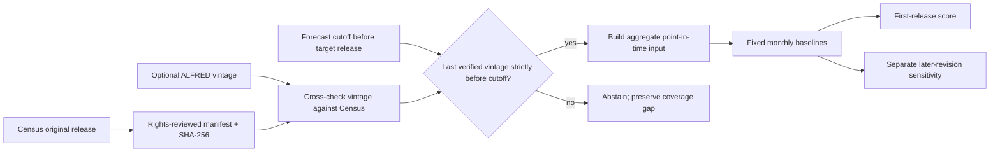

# Aggregate Census/ALFRED vintage research protocol

**Status:** owner-approved second research lane, protocol preparation only; no Census/FRED data or API key was acquired. This study follows the UCI event-time pilot and is independent of product-level claims.

## Research question and boundary

Can a local monthly forecast evaluator reconstruct the aggregate information available before a scheduled U.S. retail release and score its next-period estimates without leaking later revisions? Candidate source is the U.S. Census Bureau's historical Advance Monthly Retail Trade Survey releases. A secondary machine-readable route is Census-sourced FRED/ALFRED series `RSAFS`, only if source terms, series rights, free access and archive evidence are acceptable after review.

This can test release-aware evaluation on aggregate retail dollar sales. It cannot validate item/SKU demand, a company's inventory, replenishment policy, causal intervention or the operational readiness of M1. Do not use M5, confidential microdata, commercial third-party series or paid services.

## Source proposal and permissions

| Candidate | Use and current public evidence | Conditions before any source acquisition |
| --- | --- | --- |
| Census MARTS historical releases | Official historical releases provide archived publications and the release schedule distinguishes reference periods from release dates. The archive notes specific missing early releases. Use an aggregate, published series only. | Recheck the exact table and date range; capture original release URLs, release header/timezone, retrieval time and byte digest; inspect notices and applicable use/redistribution terms; approve attribution, retention and outputs. Do not treat the current revised series as an old release. |
| FRED/ALFRED `RSAFS` (candidate) | FRED identifies `RSAFS` as Census Bureau Advance Retail Sales: Retail Trade and Food Services. ALFRED exposes vintage dates and historical observation states. | API key is required; FRED account registration is currently described as free, but no account/key is authorized or present. Review current API terms and this series' source notes/rights. A FRED key or API response does not grant third-party series rights. Require cross-checks against original Census release files and adequate vintage coverage. |

The FRED API terms explicitly warn that a series may be third-party owned and that access through FRED does not override its restrictions. Before non-personal use, the series owner's permission may be needed. Therefore prefer the direct official Census release files; ALFRED is optional, not an automatic substitute for source clearance.

## Proposed source manifest

Do not store source values or archive files in Git. Keep locally approved artifacts outside the repository. A reviewed manifest entry should contain:

| Field | Contract |
| --- | --- |
| `publisher`, `series_id`, `definition`, `unit`, `adjustment` | Exact source owner and stable series definition; one candidate series per manifest version |
| `reference_period` | Month measured; never treated as publication time |
| `release_id`, `published_at`, `timezone`, `release_kind` | Exact initial/advance/monthly/annual revision identity and official publication boundary; missing or contradictory boundaries reject the vintage |
| `source_uri`, `retrieved_at`, `snapshot_sha256`, `file_format` | Exact original release artifact identity and local retrieval evidence |
| `value`, `status` | Aggregate published value and whether it is a first estimate, revision or annual revision |
| `rights_review_id`, `privacy_review_id`, `retention_due_at` | Opaque references to separately approved review records; a manifest is not itself permission |

Each release is immutable. Corrections create a new vintage record; they never overwrite an earlier value. Keep source bytes private, do not log values alongside identifiable information, and delete files and derived local artifacts at the approved retention deadline. FRED API keys, if later approved, belong only in local secret storage and never in Git, CI or fixtures.

## Temporal protocol

1. Before fetching values, inventory the official release calendar and archive. Record known missing periods and the exact candidate series. If an interval is incomplete, preserve the gap and abstain; do not manufacture a release or silently switch to revised current data.
2. Pre-register a chronological fit/validation/locked-holdout calendar before examining scores. Candidate pilot period is 1992-01 onward because Census annual-revision tables identify that historical range; exact origin intervals are not accepted until monthly archive and vintage completeness are independently checked. If the candidate period fails the predeclared completeness rule, stop the empirical pilot rather than reselecting a favorable window.
3. For each target month `m`, issue the forecast at the day-before boundary for the official first-estimate release of `m`. Use only aggregate values in the latest verified vintage whose publication date is strictly before that boundary. ALFRED vintages are date-granular; never assign a same-day vintage an invented intraday time. Cross-check the first-release target value against the original Census release artifact.
4. Build each rolling origin independently from its then-available vintage. Annual and monthly revisions may enter only after their actual release boundary. Preserve first estimates and revised values as separate labels.
5. Primary target is the first advance estimate for the target month. Report latest annual-revision values as a separate sensitivity analysis, never pooled with first-release scores. This separates prediction of the published first estimate from prediction against subsequently revised history.
6. Evaluate horizons 1, 3 and 6 months from each origin, with lag-12 seasonal naive and trailing-12-month mean baselines. Both methods share matched targets per horizon. Report per-horizon MAE, RMSE, zero-safe WAPE, coverage and separate abstention counts. Do not select a winner when fewer than two matched origins exist.
7. A source timestamp that is only a date is treated conservatively: use the last verified vintage strictly before the release date and score the first release only after that release is independently recorded. Missing, ambiguous or contradictory vintage metadata means abstain.

## Reproducibility, failure and controls

No remote request is part of tests. The current preparation implementation is
the pure normalized-record selector in
[`census_vintages.py`](../../src/mirrormind/domains/retail/census_vintages.py).
It accepts a bounded in-memory tuple, selects the latest record per reference
month strictly before a target release date, preserves selected release IDs
and digest strings, and rejects same-day ambiguity. It performs no file or
network access. Its 64-character digest validation checks syntax and release
metadata consistency only; it cannot verify source bytes or an approved
manifest. See the
[adapter walkthrough](CENSUS_VINTAGE_ADAPTER.md) and
[synthetic fixture card](datasets/SYNTHETIC_CENSUS_VINTAGES.md).

A future source-specific file adapter must accept an explicit reviewed
manifest, verify exact source bytes and schema before building normalized
records, and keep raw artifacts outside Git. Keep any network connector
separate from parsing so unit tests can use generated records and no live
account is required. The current selector's receipt always marks source
provenance unverified and ingestion/forecast flags false.

The synthetic evaluation implementation in
[census_evaluation.py](../../src/mirrormind/domains/retail/census_evaluation.py)
reuses the selector at each fixed date-only origin. It compares lag-12
seasonal naive and trailing-12-month mean at horizons 1, 3 and 6 against
later first-estimate labels, while preserving reason-specific abstention and
per-origin lineage. The generated example has disjoint validation and holdout
origins, but it is not an empirical locked holdout. See the
[evaluation walkthrough](CENSUS_VINTAGE_EVALUATION.md) and
[synthetic model card](model_cards/SYNTHETIC_CENSUS_VINTAGE_EVALUATION.md).

The normalized-selector tests cover absent months, conflicting release
metadata, malformed digest syntax, same-day ambiguity, revisions after the
cutoff and deterministic abstention. Synthetic evaluation tests additionally
cover later-revision noninterference, target labels, matched baselines,
missing history, zero metric denominators and split replay. Future
source-parser/evaluator tests must cover changed bytes, missing release-boundary
metadata, missing ALFRED vintages and disagreement with original Census
releases. A complete local check does not establish rights or official CI. No
data adapter should call FRED until free account/API access, each series'
terms and the owner-approved retention manifest are in place.

## Current primary references checked 2026-11-25

- U.S. Census [monthly retail data](https://www.census.gov/retail/data.html), [historical release archive](https://www.census.gov/retail/historic_releases.html), [Advance MRTS archive](https://www.census.gov/retail/marts/historic_releases.html), and [release schedule](https://www.census.gov/retail/release_schedule.html).
- St. Louis Fed [RSAFS series record](https://fred.stlouisfed.org/series/RSAFS), [free account description](https://fred.stlouisfed.org/help/account/fred-account-features/register), [API terms](https://fred.stlouisfed.org/docs/api/terms_of_use.html), [`series/vintagedates`](https://fred.stlouisfed.org/docs/api/fred/series_vintagedates.html), and [`series/observations`](https://fred.stlouisfed.org/docs/api/fred/series_observations.html).

These pages establish that archives/API features exist and describe their conditions. They do not establish the exact series license, a complete period for this study, a specific downloaded snapshot, or owner authorization. No API key, series value or Census release artifact was acquired for this proposal.
