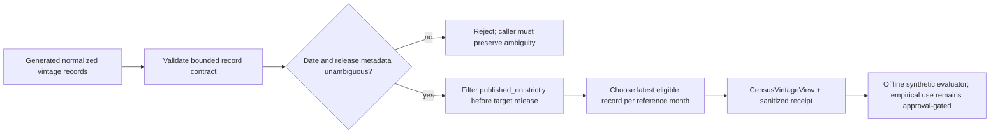

# Synthetic Census/ALFRED vintage adapter

## Purpose and research boundary

This guide explains the first executable slice of the approved aggregate
Census/ALFRED research lane: selecting a point-in-time view from normalized,
caller-supplied monthly release records. It is deliberately a pure in-memory
contract. It does **not** download or parse Census archives, call FRED/ALFRED,
read files, use a credential, score forecasts, or authorize ingestion.

The adapter is prepared against fictional records only. The proposed research
series and temporal protocol remain in
[`CENSUS_ALFRED_VINTAGE_PROTOCOL.md`](CENSUS_ALFRED_VINTAGE_PROTOCOL.md).
The UCI Online Retail event-time pilot remains a separate first research lane:
its `InvoiceDate` is not publication time and cannot be used to validate the
historical availability behavior implemented here.

## Architecture and responsibilities



| Component | Responsibility | Boundary |
| --- | --- | --- |
| [`CensusVintageRecord`](../../src/mirrormind/domains/retail/census_vintages.py) | Frozen normalized value plus reference month, public release date, release kind/ID and source snapshot digest | A caller assertion; no source file or publication is authenticated |
| `select_census_vintage_as_of` | Validates one bounded series, rejects ambiguity and chooses the newest eligible record per month | Does not parse source formats, fill missing months or compute forecast metrics |
| `CensusVintageView` | Holds selected typed records and emits a count/digest/release-ID receipt | Receipt does not contain values and never sets authorization/forecast flags true |
| `tests/unit/test_census_vintages.py` | Reproduces cutoff, revision, abstention and malformed-input behavior | All records are constructed in memory and fictional |

The selected view is a prep layer. The experimental
[census_evaluation.py](../../src/mirrormind/domains/retail/census_evaluation.py)
reuses it for synthetic fixed-baseline evaluation; no user-facing product or
API calls the selector.

## Contract and algorithm

### Input record

```python
@dataclass(frozen=True, slots=True)
class CensusVintageRecord:
    series_id: str
    reference_month: date
    value: Decimal
    published_on: date
    release_kind: Literal[
        "first_estimate", "monthly_revision", "annual_revision"
    ]
    release_id: str
    snapshot_sha256: str
```

Each `reference_month` must be the first day of a calendar month. `value` must
be a finite, non-negative `Decimal`, appropriate to the aggregate retail
amounts proposed by this pilot. The schema is versioned in receipts as
`mirrormind.census.aggregate_vintage_view.v1`.

`release_id` identifies an immutable publication artifact. Multiple monthly
records may share one release ID and digest. Within one release ID, publication
date and digest must remain consistent; the release kind belongs to the
observation and can differ within an artifact that publishes a first estimate
and revisions together.

### Selection

```python
select_census_vintage_as_of(
    records: tuple[CensusVintageRecord, ...],
    *,
    series_id: str,
    target_release_on: date,
) -> CensusVintageView
```

The function first checks the exact tuple type and the 50,000-record bound,
then validates every record. It rejects mixed series, malformed dates or
digests, unsupported release kinds, non-finite/negative values, conflicting
metadata for one release ID, and two records for the same reference month on
the same publication date. Each month may have only one first-estimate record;
when one exists, every monthly or annual revision must have a strictly later
publication date. Earlier revisions fail chronology validation. A same-day
first-estimate/revision pair fails the ambiguity guard because releases cannot
be ordered within a day.

For each reference month `m`, the selection rule is:

```text
selected(m) = arg max(record.published_on)
              over records where record.reference_month == m
              and record.published_on < target_release_on
```

The strict inequality excludes a release on the forecast target's release
date. A target month with no earlier record remains absent. It is never
zero-filled. The resulting records are sorted by reference month, making
replay deterministic.

The selector itself remains a generic latest-release view and can return a
revision for a month without a first-estimate row in an incomplete archive.
The Census evaluator has a stricter modeling boundary: it excludes and counts
such unanchored revisions so they cannot silently satisfy forecast history.
Do not infer that the normalized release set is complete or that an absent
anchor means a real publisher never issued one.

`CensusVintageView.receipt()` reports the schema, unverified source status,
exclusive cutoff, timestamp precision, selected row count, release IDs,
snapshot digest strings and false authorization/forecast flags. It omits
values. The typed `view.records` still carries values for a future local
evaluation; callers must not log or publish source rows without a separate
review.

## Reproducible synthetic example

```python
from datetime import date
from decimal import Decimal

from mirrormind.domains.retail.census_vintages import (
    CensusVintageRecord,
    select_census_vintage_as_of,
)

rows = (
    CensusVintageRecord(
        series_id="RSAFS",
        reference_month=date(2020, 4, 1),
        value=Decimal("100.0"),
        published_on=date(2020, 5, 15),
        release_kind="first_estimate",
        release_id="synthetic-release-may",
        snapshot_sha256="a" * 64,
    ),
    CensusVintageRecord(
        series_id="RSAFS",
        reference_month=date(2020, 4, 1),
        value=Decimal("101.0"),
        published_on=date(2020, 6, 15),
        release_kind="monthly_revision",
        release_id="synthetic-release-june",
        snapshot_sha256="b" * 64,
    ),
)
view = select_census_vintage_as_of(
    rows, series_id="RSAFS", target_release_on=date(2020, 7, 15)
)
assert view.records[0].value == Decimal("101.0")
assert view.receipt()["ingestion_authorized"] is False
```

The record values and IDs above are invented. A 64-character string is only
checked for lowercase SHA-256 syntax; the adapter has no source bytes to hash
and does not prove that a digest refers to Census or ALFRED.

Run the focused regressions:

```powershell
.\.venv\Scripts\python.exe -m pytest -q tests/unit/test_census_vintages.py
```

The full exact-head gate is separate and must use a committed clean revision.
See [`LOCAL_QUALITY_GATE.md`](LOCAL_QUALITY_GATE.md); local results are not
GitHub Actions evidence.

## Failure, security and privacy behavior

Invalid records raise `ValueError` before the view is returned. The caller
must keep the exact offending input available locally for diagnosis; error
messages do not echo values, release IDs or digests. Same-day ambiguity is
rejected rather than resolved by input ordering. Missing periods are explicit
absence, not zero. The result reports `caller_supplied_not_source_verified`,
`ingestion_authorized=false` and `forecast_eligible=false` for both populated
and empty views.

There is no network, filesystem or secret-store access in the module. Tests
use generated records. The adapter is not an authorization system, byte
integrity verifier, time-zone parser, publisher authenticator, revision
completeness proof or hostile-input sandbox. Before a source-specific parser
is added, review exact Census table or ALFRED series terms, archive coverage,
release boundary, byte digest, attribution, retention/deletion and privacy.
FRED/ALFRED is not an automatic substitute for the original Census release.

## Regression evidence

Evidence-map claims for the primary temporal-selection and privacy boundary
regressions are `MM-CEN-001` and `MM-CEN-002`, respectively. `MM-CEN-013`
records the additional rule that an anchored revision must follow its first
estimate. The machine-checked selectors below are the tests attached to those
claims.

| Test selector | What it proves | What it does not prove |
| --- | --- | --- |
| `tests/unit/test_census_vintages.py::test_selects_latest_revision_per_month_strictly_before_target_release` | A later eligible revision replaces the first estimate; post-cutoff revisions are excluded; release metadata is preserved | The supplied dates or digest correspond to a real publication |
| `tests/unit/test_census_vintages.py::test_same_day_first_estimate_is_excluded_and_receipt_is_unverified` | Date-only same-day records abstain; receipt remains unverified and unauthorized | Actual intraday release time or account-level permission |
| `tests/unit/test_census_vintages.py::test_revision_before_known_first_estimate_is_rejected` | A revision cannot predate a known first-estimate release | Does not verify an authentic publisher schedule |
| `tests/unit/test_census_vintages.py::test_missing_reference_months_remain_absent_and_replay_is_deterministic` | Gaps remain missing and repeated selection returns equal records/receipts | Real archive completeness or metrics on a holdout |
| `tests/unit/test_census_vintages.py::test_duplicate_period_and_publication_date_is_rejected_as_ambiguous` | Conflicting same-day values fail closed instead of relying on row order | That all ambiguity types in a real publisher archive are covered |
| `tests/unit/test_census_vintages.py::test_release_id_cannot_bind_conflicting_publication_metadata` | One immutable release ID cannot silently change date or digest | Byte-level source integrity; adapter only validates digest syntax |
| `tests/unit/test_census_vintages.py::test_invalid_normalized_vintage_record_is_rejected` | Invalid period, value, release kind and digest are rejected | Rights, provenance or API response authenticity |

## Learning exercises

1. Move the fictional monthly revision to the target release date. Explain why
   the earlier first estimate becomes selected instead of the same-day value.
2. Add two values for one reference month and publication date. Observe the
   ambiguity error; explain why source order is not a safe tie-breaker.
3. Remove one month from the input and inspect the receipt. Explain why the
   adapter preserves the gap rather than inserting zero.
4. Change the value while keeping the snapshot digest string unchanged. Note
   that the adapter cannot detect the inconsistent bytes; identify where a
   future byte-reading adapter must verify the digest before parsing.
5. Compare this adapter with `uci_event_time.py`. Trace why
   `InvoiceDate` cannot populate `published_on` and why UCI event-time scores
   cannot establish point-in-time Census behavior.

## Diagnosis and evolution

- `reference_month must be the first day`: normalize month identifiers in a
  source-specific parser only after confirming the source's convention; do
  not round arbitrary dates silently.
- `ambiguous publication date`: inspect the release artifacts and obtain a
  finer-grained verified timestamp or preserve the abstention. Do not infer
  ordering from an ALFRED date or row position.
- `conflicting release metadata`: compare immutable artifact manifests and
  assign a new release ID when the publication or bytes changed.
- `no selected observations`: inspect the exclusive target boundary and
  archive coverage; do not move the origin after seeing scores.
- `snapshot_sha256` validation: current contract checks syntax only. A future
  source parser must bind the exact received bytes to a reviewed manifest and
  keep raw artifacts outside Git and automated fixtures.

Future work may add a source-version-specific parser and chronological
baseline evaluator only after B-01/B-02 approvals, archive completeness review,
locked holdout declaration and independent source cross-check. Keep UCI
event-time results separate from aggregate Census release-vintage metrics.
