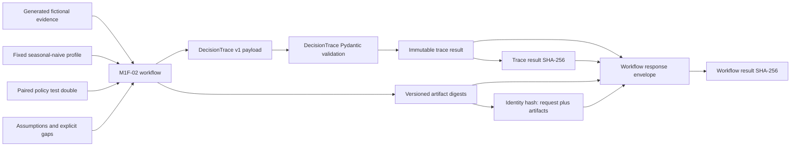

# Versioned decision trace result contract

**Status:** `decision_trace_result_contract` remains `interface_only` as a
general product capability. The M1F-02 synthetic workflow now creates one
fictional, non-authorizing `DecisionTrace` through the local policy test double
and exposes it through an experimental route. No producer authenticates its
references, executes WorldKernel, persists a trace or authorizes a business
action.

## Purpose and boundary

`ScenarioSpec` in [`core/contracts.py`](../../src/mirrormind/core/contracts.py)
describes and validates a possible simulation request. It is an input contract.
[`DecisionTrace`](../../src/mirrormind/core/decision_trace.py) is a separate
output contract for a reviewable comparison. Keeping them separate prevents a
validated request from being mistaken for a calculated result. The
[`M1F-02 workflow`](M1_RETAIL_SYNTHETIC_DECISION_WORKFLOW.md) is one synthetic
producer: it uses generated evidence, a fixed baseline and a local policy test
double. Its typed output exercises this contract but does not establish a
general decision-evaluation capability.

The trace gives later M1 components a versioned envelope for observations,
forecasts, conditional outcomes, assumptions, missing evidence, costs and
human review. It does not rank alternatives or choose an action. A human review
status is a record of a caller-supplied decision, not an authorization to write
to a business system.

## Architecture and data flow



The trace model itself has no HTTP, storage, cryptographic signer, model
registry or engine. M1F-02 adds a separate experimental HTTP route and hashes
for the outer workflow response; those hashes do not add authentication or
provenance. Each producer must establish its own evidence. The trace validates
local structure and caller-declared references only.

| Component | Responsibility |
| --- | --- |
| `EvidenceReference` | Names a source, snapshot, provenance record and declared availability time |
| `ObservedFact` | Stores one scalar fact, unit, observation time and evidence references |
| `ForecastEstimate` | Stores one estimate plus model-card and observed-fact references |
| `ModelingAssumption` | Keeps a conditional premise explicit and separately addressable |
| `ConditionalOutcome` / `OutcomeMetric` | Stores a scenario result with engine-contract, forecast and assumption references, seed and run count |
| `MissingEvidence` | Identifies a gap and the local fact, forecast or outcome it limits |
| `CostMeasurement` | Distinguishes metered, declared and unavailable cost; unknown is `null`, never zero |
| `HumanReview` | Records pending/not-requested/approved/rejected review and, for a decision, reviewer, time and result digest |
| `DecisionTrace` | Validates version, time boundaries, unique IDs, typed references, bounded collections, review chronology and digest binding |

## Contract and invariants

The external schema label is `mirrormind.decision_trace.v1`. Python callers
construct it with `DecisionTrace.model_validate(payload)`; Pydantic rejects
unknown fields. Top-level arrays are tuples in the validated object, and all
nested models are frozen. The result is not a JSON Schema endpoint.

- **Time:** cutoff, creation, evidence availability, observation and review
  decision times require timezone offsets. Creation cannot precede cutoff;
  an approved/rejected review cannot predate trace creation. Datetime
  comparison uses the represented instants, so equivalent offsets remain valid.
  Observations cannot occur after cutoff; evidence cannot become available
  after cutoff or before its referenced observation.
- **References:** each ID is unique across the trace. Fact evidence references,
  forecast fact references, outcome forecast/assumption references and missing
  evidence targets must resolve to records of the expected local type. The
  trace is limited to 1,000 records in total, each top-level section is capped
  at 1,000 items before cross-reference validation, and each reference/metric
  tuple is capped at 100 entries. The validator builds an evidence-ID map once,
  then resolves each fact reference in constant expected time instead of
  scanning the evidence tuple again.
- **Separation:** forecast values are not observations. Outcome metrics are
  numeric conditional results and cannot be reclassified as observed facts by
  this schema.
- **Costs:** `metered` and `declared` require an amount and a source/basis
  reference. `unavailable` requires both amount and source reference to be
  absent. A measured zero remains distinguishable from an unknown amount.
- **Review:** pending review cannot include a decision time or result digest.
  Approved/rejected review requires reviewer reference, timezone-aware time and
  the digest of the exact result content. A digest mismatch rejects the trace.
- **Digest:** `result_sha256` hashes sorted-key, compact UTF-8 JSON from the
  result fields, excludes `human_review`, writes `Decimal` values as
  context-independent fixed-point strings, canonicalizes zero to `0`, removes
  insignificant fractional zeroes, and uses ISO timestamps. This preserves
  the v1 digest for ordinary values while preventing ambient Decimal precision
  from rounding distinct costs into the same digest. The review object can
  therefore refer to the digest without hashing itself. This is
  integrity-by-recomputation only, not a signature.

Reference strings are opaque caller assertions. The validator does not open a
dataset card, model card, source URI or engine contract. It cannot prove that
the record exists, is permitted, is authentic, was produced by the named model
or engine, or was available at the declared time. These remain explicit gates
for M1B, M1C and M1E.

### M1F-02 workflow-level identity and digest

The synthetic workflow wraps this trace in a separate
`mirrormind.synthetic_retail_decision_workflow.v1` response. It hashes each of
five major artifacts (evaluation, uncertainty, forecast evidence receipt,
forecast and simulation) together with that artifact's schema-version label.
`decision_identity_sha256` then hashes the workflow schema, validated request
and artifact-digest map. This makes the trace identity sensitive to request
fields such as replication count; revision 1 is scoped to that content identity
and is not a persisted revision history.

`trace_sha256` remains the trace's own `result_sha256`. The outer
`workflow_result_sha256` covers the complete response, including all artifact
digests, identity and trace, excluding only the outer digest field itself. An
abstention has artifact and workflow digests but a null decision identity
because no trace exists. These hashes support deterministic replay and
change-detection by recomputation. They are not signatures, producer
authentication, provenance, approval or transport protections. The experimental
HTTP route has no authentication, request body-size limit, rate limit or
concurrency control; schema collection bounds do not supply those controls.
See the [M1F-02 walkthrough](M1_RETAIL_SYNTHETIC_DECISION_WORKFLOW.md) for the
service flow and independent digest regressions.

## Reproduce the fictional example

Run from the repository root with the project environment:

```powershell
.\.venv\Scripts\python.exe examples\m1_decision_trace_contract.py
.\.venv\Scripts\python.exe -m pytest -q tests\unit\test_decision_trace.py
```

The first command prints a fixed fictional trace and its computed result
digest. It contains one declared cost and one unavailable cost, so the example
does not imply real metering. The second command tests the same
`build_synthetic_trace()` fixture and adverse references. Repeated calls to
`render_example()` produce byte-for-byte identical JSON under the same
Pydantic/Python serialization behavior.

To record a human decision against the exact result, first build a pending
trace, then provide its digest when validating the reviewed payload:

```python
pending = build_synthetic_trace()
payload = pending.model_dump(mode="json")
payload["human_review"] = {
    "status": "approved",
    "reviewer_ref": "reviewer-demo-001",
    "decided_at": "2026-11-24T14:05:00-03:00",
    "reviewed_result_sha256": pending.result_sha256,
}
reviewed = DecisionTrace.model_validate(payload)
```

Changing any result field after review changes `result_sha256`; the old review
then fails validation. `approved` still grants no tool permission or external
action. A real review workflow must authenticate the reviewer and separately
authorize any write.

## Failure behavior and safety

| Invalid input | Contract response | What this does not establish |
| --- | --- | --- |
| Unknown or duplicate local ID | Pydantic `ValidationError` | That an external referenced record exists |
| Missing evidence reference or future availability | Validation error | Source permission, truthful publisher timestamp or data completeness |
| Forecast/outcome points to missing facts, forecasts or assumptions | Validation error | Forecast quality or actual engine execution |
| Naive timestamp, observation after cutoff or review before creation | Validation error | Correctness of caller-declared timestamps or reviewer identity |
| More than 1,000 records total, more than 1,000 in one section, or more than 100 references/metrics in one record | Validation error | A transport-level request-body or concurrency limit |
| `unavailable` cost has a numeric amount | Validation error | That metered/declared costs are accurate or enforce a budget |
| Approved/rejected review is incomplete or digest is stale | Validation error | Identity, signature, authorization or non-repudiation |
| Extra arbitrary field/object payload | Validation error or scalar type error | Sanitization of free-text references or privacy of scalar values |

Callers must minimize payloads and avoid raw customer records, credentials,
private source text or direct identifiers. The model contains free-text
question/assumption/gap fields and scalar values; type safety is not data-loss
prevention. The immutable models prevent accidental post-validation field
assignment, not deliberate construction of a new trace.

## Tests and evidence

[`tests/unit/test_decision_trace.py`](../../tests/unit/test_decision_trace.py)
is pure local contract validation; it does not call the HTTP app, storage,
providers or a simulator.

| Test | Proves | Does not prove |
| --- | --- | --- |
| `test_valid_trace_keeps_decision_evidence_categories_separate` | The contract fixture validates with distinct typed sections, metered/declared/unavailable cost states and a SHA-256 result | It does not verify a real evidence, forecast or engine producer; M1F-02's separate tests cover its local synthetic producer |
| `test_synthetic_example_json_is_reproducible` | The fictional rendered JSON and digest repeat deterministically | Cross-version/toolchain byte identity |
| `test_unknown_local_references_are_rejected` | A forecast cannot refer to an absent fact | External reference existence |
| `test_outcome_requires_known_forecasts_and_assumptions` | Outcome links must resolve to both local input categories | A real engine produced the outcome |
| `test_duplicate_record_identifiers_are_rejected_across_sections` | Ambiguous cross-section IDs fail closed | External identity uniqueness |
| `test_future_or_naive_evidence_times_are_rejected` | Cutoff, timezone and observation/availability order are checked | Publisher clocks or historical vintages |
| `test_missing_evidence_must_point_to_a_record_it_limits` | Gap records identify a local affected record | Completeness of a source |
| `test_unavailable_cost_cannot_be_encoded_as_zero` | Missing cost cannot silently become a measured zero | Actual cost metering or quotas |
| `test_metered_cost_requires_a_meter_reference` | A metered amount has a local meter reference | That the referenced meter is genuine |
| `test_approved_review_requires_identity_time_and_result_digest` | A decision status requires a complete review record | Reviewer authentication or permission |
| `test_review_digest_binds_approval_to_exact_result_content` | A changed result cannot reuse an earlier approval digest | Cryptographic signature or external audit retention |
| `test_terminal_review_cannot_precede_trace_creation` and `test_terminal_review_accepts_creation_boundary_and_equivalent_timezone` | Both terminal states enforce chronological order while accepting an exact/equivalent instant | Reviewer authentication or trusted clocks |
| `test_result_digest_is_lossless_and_independent_of_decimal_context` | Distinct costs remain distinct and the v1 digest is stable across active Decimal precision; zero/trailing-zero forms canonicalize | Cross-language serialization or independent provenance |
| `test_trace_record_sections_have_a_maximum_size`, `test_total_trace_records_are_bounded_across_sections` and `test_trace_reference_lists_have_a_maximum_size` | Per-section, aggregate-record and per-record collection bounds reject oversized payloads | HTTP body-size, rate or concurrency enforcement |
| `test_trace_models_are_immutable_after_validation` | Assignment to a validated top-level model fails | Deep immutability of arbitrary external objects |

The evidence map links `MM-DTRACE-001`, `MM-DTRACE-002`, `MM-DTRACE-003`,
  `MM-DTRACE-004`, `MM-DTRACE-005`, `MM-DTRACE-006` and `MM-DTRACE-007` to the synthetic
contract, chronology, canonicalization and collection-bound regressions.
Together these selectors cover the negative/equality chronology cases and
aggregate, per-section and per-record bounds.
Their limitations retain the caller-asserted-reference and no-execution
boundary.

The workflow-level claims `MM-MF-001` through `MM-MF-007` are separately
linked to the service, API and CLI tests in the [reviewed evidence map](EVIDENCE_MAP.json).
In particular, `test_trace_identity_includes_replications_and_exact_replay_is_stable`,
`test_versioned_artifact_and_workflow_digests_bind_the_complete_response` and
`test_profile_aware_policy_modeling_caveats_are_bound_into_trace` cover the
review corrections; they do not change the general interface-only capability
status.

## Learning exercises

1. Follow `DecisionTrace.check_trace_references_and_cutoff` and predict which
   validation error appears if a forecast names an absent fact. Change only
   that reference in the synthetic fixture and run its focused test.
2. Compute the result digest before approval. Change a metric without changing
   the review digest; explain why the trace must fail. Then change only the
   reviewer metadata and confirm the result digest remains stable.
3. Change the unavailable token cost to measured zero with a meter reference.
   Explain why zero and unavailable are different claims.
4. Run the digest test under precision 3 and 50; explain why `Decimal.normalize()`
   would round through the active context and why fixed-point formatting does
   not. Compare the digests for `12.3400`, `12.34`, `0.000` and `0`.
5. Set an approved/rejected decision one second before creation, then set it to
   the same instant with another timezone offset. Explain how timestamp
   comparison uses instants rather than the written offset.
6. Exceed a section/reference bound and trace the Pydantic error to the model
   field. Explain why these schema bounds do not replace an HTTP body limit.
7. Identify which additional verifiers M1F-02 needs before producing a real
   trace: approved source evidence, evaluated forecast, actual simulation
   receipt, authenticated reviewer, cost metering and action-specific
   authorization.
8. Compare `trace_sha256`, `decision_identity_sha256` and
   `workflow_result_sha256` in the M1F-02 response. Mutate a nested simulation
   value and determine which digests become stale. Explain why none of them
   proves who created or approved the result, and why model collection bounds
   do not cap an HTTP request body or concurrent requests.

## Diagnosis, maintenance and evolution

For a `ValidationError`, inspect the failing test in
[`test_decision_trace.py`](../../tests/unit/test_decision_trace.py), then trace
the nested record class and `DecisionTrace.check_trace_references_and_cutoff`.
Check whether the failure is a field cardinality limit, aggregate record limit,
cutoff violation, unknown reference, duplicate ID, review chronology or digest
mismatch before inspecting payload values. The evidence map cites the exact
regression function for each reviewed claim. Keep reference validation
fail-closed; do not relax it to make incomplete producer data pass. Use a new
schema version for incompatible changes, add a migration/translation contract
explicitly and include the schema version in the digest. Add new sections only
when their provenance, null semantics, temporal rules and review binding are
defined. Never promote
`decision_evaluation` from this schema alone.

See the [M1F-01 change request](changes/M1F_01_DECISION_TRACE_CONTRACT.md),
[decision trace review template](DECISION_TRACE_TEMPLATE.md),
[M1 execution plan](M1_EXECUTION_PLAN.md),
[capability ledger](CAPABILITY_LEDGER.json),
[debugging guide](DEBUGGING.md) and
[learning guide](LEARNING.md).
