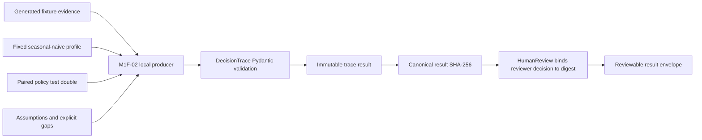

# Versioned decision trace result contract

**Status:** `decision_trace_result_contract` remains `interface_only` as a
schema boundary. M1F-02 now produces it for one experimental synthetic retail
comparison. That producer uses generated bytes and a Python test double; it
does not authenticate references, persist traces, run WorldKernel, rank
policies or authorize business writes.

## Purpose and boundary

`ScenarioSpec` in [`core/contracts.py`](../../src/mirrormind/core/contracts.py)
describes and validates a possible simulation request. It is an input contract.
[`DecisionTrace`](../../src/mirrormind/core/decision_trace.py) is a separate
output contract for a later reviewable comparison. Keeping them separate
prevents a validated request from being mistaken for a calculated result.

The trace is a versioned envelope for observations, forecasts, conditional
outcomes, assumptions, missing evidence, costs and human review. M1F-02 is one
producer for this envelope. It does not rank alternatives or choose an action.
A human review status is a record of a caller-supplied decision, not an
authorization to write to a business system.

## Architecture and data flow



The HTTP route `POST /v1/decision-workflows/retail/synthetic` and CLI both call
the same local producer; there is no raw trace CRUD endpoint, storage,
cryptographic signer, model registry or WorldKernel call. Each producer must
establish its own evidence. The trace validates local structure and declared
references only.

| Component | Responsibility |
| --- | --- |
| `EvidenceReference` | Names a source, snapshot, provenance record and declared availability time |
| `ObservedFact` | Stores one scalar fact, unit, observation time and evidence references |
| `ForecastEstimate` | Stores one estimate plus model-card and observed-fact references |
| `ModelingAssumption` | Keeps a conditional premise explicit and separately addressable |
| `ConditionalOutcome` / `OutcomeMetric` | Stores a scenario result with engine-contract, forecast and assumption references, seed and run count |
| `MissingEvidence` | Identifies a gap and the local fact, forecast or outcome it limits |
| `CostMeasurement` | Distinguishes metered, declared and unavailable cost; unknown is `null`, never zero |
| `HumanReview` | Records pending/not-requested/approved/rejected review and, for a decision, reviewer, time and result digest |
| `DecisionTrace` | Validates version, time boundaries, unique IDs, typed references, review binding and immutable envelope |

## Contract and invariants

The external schema label is `mirrormind.decision_trace.v1`. Python callers
construct it with `DecisionTrace.model_validate(payload)`; Pydantic rejects
unknown fields. Top-level arrays are tuples in the validated object, and all
nested models are frozen. The result is not a JSON Schema endpoint.

- **Time:** cutoff, creation, evidence availability, observation and review
  decision times require timezone offsets. Creation cannot precede cutoff.
  Observations cannot occur after cutoff; evidence cannot become available
  after cutoff or before its referenced observation.
- **References:** each ID is unique across the trace. Fact evidence references,
  forecast fact references, outcome forecast/assumption references and missing
  evidence targets must resolve to records of the expected local type.
- **Separation:** forecast values are not observations. Outcome metrics are
  numeric conditional results and cannot be reclassified as observed facts by
  this schema.
- **Costs:** `metered` and `declared` require an amount and a source/basis
  reference. `unavailable` requires both amount and source reference to be
  absent. A measured zero remains distinguishable from an unknown amount.
- **Review:** pending review cannot include a decision time or result digest.
  Approved/rejected review requires reviewer reference, timezone-aware time and
  the digest of the exact result content. A digest mismatch rejects the trace.
- **Digest:** `result_sha256` hashes sorted-key, compact UTF-8 JSON from the
  result fields, excludes `human_review`, normalizes decimal values and uses
  ISO timestamps. The review object can therefore refer to the digest without
  hashing itself. This is integrity-by-recomputation only, not a signature.

Reference strings are opaque caller assertions. The validator does not open a
dataset card, model card, source URI or engine contract. It cannot prove that
the record exists, is permitted, is authentic, was produced by the named model
or engine, or was available at the declared time. These remain explicit gates
for M1B, M1C and M1E.

## Reproduce the fictional example

Run from the repository root with the project environment:

```powershell
.\.venv\Scripts\python.exe examples\m1_decision_trace_contract.py
.\.venv\Scripts\python.exe -m pytest -q tests\unit\test_decision_trace.py
```

The first command prints a fixed fictional trace and its computed result
digest. It contains one declared cost and one unavailable cost, so the example
does not imply real metering. The second command tests the same
`build_synthetic_trace()` fixture and adverse references. Repeated calls to
`render_example()` produce byte-for-byte identical JSON under the same
Pydantic/Python serialization behavior.

To record a human decision against the exact result, first build a pending
trace, then provide its digest when validating the reviewed payload:

```python
pending = build_synthetic_trace()
payload = pending.model_dump(mode="json")
payload["human_review"] = {
    "status": "approved",
    "reviewer_ref": "reviewer-demo-001",
    "decided_at": "2026-11-24T14:05:00-03:00",
    "reviewed_result_sha256": pending.result_sha256,
}
reviewed = DecisionTrace.model_validate(payload)
```

Changing any result field after review changes `result_sha256`; the old review
then fails validation. `approved` still grants no tool permission or external
action. A real review workflow must authenticate the reviewer and separately
authorize any write.

## Failure behavior and safety

| Invalid input | Contract response | What this does not establish |
| --- | --- | --- |
| Unknown or duplicate local ID | Pydantic `ValidationError` | That an external referenced record exists |
| Missing evidence reference or future availability | Validation error | Source permission, truthful publisher timestamp or data completeness |
| Forecast/outcome points to missing facts, forecasts or assumptions | Validation error | Forecast quality or actual engine execution |
| Naive timestamp or observation after cutoff | Validation error | Correctness of caller-declared timestamps |
| `unavailable` cost has a numeric amount | Validation error | That metered/declared costs are accurate or enforce a budget |
| Approved/rejected review is incomplete or digest is stale | Validation error | Identity, signature, authorization or non-repudiation |
| Extra arbitrary field/object payload | Validation error or scalar type error | Sanitization of free-text references or privacy of scalar values |

Callers must minimize payloads and avoid raw customer records, credentials,
private source text or direct identifiers. The model contains free-text
question/assumption/gap fields and scalar values; type safety is not data-loss
prevention. The immutable models prevent accidental post-validation field
assignment, not deliberate construction of a new trace.

## Tests and evidence

[`tests/unit/test_decision_trace.py`](../../tests/unit/test_decision_trace.py)
is pure local contract validation; it does not call the HTTP app, storage,
providers or a simulator.

| Test | Proves | Does not prove |
| --- | --- | --- |
| `test_valid_trace_keeps_decision_evidence_categories_separate` | The synthetic contract fixture validates with distinct typed sections, metered/declared/unavailable cost states and a SHA-256 result | A real evidence, forecast or engine producer is implemented |
| `test_synthetic_example_json_is_reproducible` | The fictional rendered JSON and digest repeat deterministically | Cross-version/toolchain byte identity |
| `test_unknown_local_references_are_rejected` | A forecast cannot refer to an absent fact | External reference existence |
| `test_outcome_requires_known_forecasts_and_assumptions` | Outcome links must resolve to both local input categories | A real engine produced the outcome |
| `test_duplicate_record_identifiers_are_rejected_across_sections` | Ambiguous cross-section IDs fail closed | External identity uniqueness |
| `test_future_or_naive_evidence_times_are_rejected` | Cutoff, timezone and observation/availability order are checked | Publisher clocks or historical vintages |
| `test_missing_evidence_must_point_to_a_record_it_limits` | Gap records identify a local affected record | Completeness of a source |
| `test_unavailable_cost_cannot_be_encoded_as_zero` | Missing cost cannot silently become a measured zero | Actual cost metering or quotas |
| `test_metered_cost_requires_a_meter_reference` | A metered amount has a local meter reference | That the referenced meter is genuine |
| `test_approved_review_requires_identity_time_and_result_digest` | A decision status requires a complete review record | Reviewer authentication or permission |
| `test_review_digest_binds_approval_to_exact_result_content` | A changed result cannot reuse an earlier approval digest | Cryptographic signature or external audit retention |
| `test_trace_models_are_immutable_after_validation` | Assignment to a validated top-level model fails | Deep immutability of arbitrary external objects |

Claim `MM-DTRACE-001` in the evidence map cites the contract test and states
its structural limit. The separate
[M1F-02 workflow guide](M1_RETAIL_SYNTHETIC_DECISION_WORKFLOW.md) cites the
synthetic producer tests; neither claim establishes real-data or engine
execution.

## Learning exercises

1. Follow `DecisionTrace.check_trace_references_and_cutoff` and predict which
   validation error appears if a forecast names an absent fact. Change only
   that reference in the synthetic fixture and run its focused test.
2. Compute the result digest before approval. Change a metric without changing
   the review digest; explain why the trace must fail. Then change only the
   reviewer metadata and confirm the result digest remains stable.
3. Change the unavailable token cost to measured zero with a meter reference.
   Explain why zero and unavailable are different claims.
4. Identify which additional verifiers are still needed before a real-data
   trace can support a decision: approved source evidence, evaluated forecast,
   actual simulation receipt, authenticated reviewer, cost metering and
   action-specific authorization.

## Diagnosis, maintenance and evolution

For a `ValidationError`, inspect the failing test in
[`test_decision_trace.py`](../../tests/unit/test_decision_trace.py), then trace
the nested record class and `DecisionTrace.check_trace_references_and_cutoff`.
Keep reference validation fail-closed; do not relax it to make incomplete
producer data pass. Use a new schema version for incompatible changes, add a
migration/translation contract explicitly and include the schema version in
the digest. Add new sections only when their provenance, null semantics,
temporal rules and review binding are defined. Never promote
`decision_evaluation` from this schema alone.

See the [M1F-01 change request](changes/M1F_01_DECISION_TRACE_CONTRACT.md),
[M1F-02 workflow](M1_RETAIL_SYNTHETIC_DECISION_WORKFLOW.md),
[decision trace review template](DECISION_TRACE_TEMPLATE.md),
[M1 execution plan](M1_EXECUTION_PLAN.md),
[capability ledger](CAPABILITY_LEDGER.json),
[debugging guide](DEBUGGING.md) and
[learning guide](LEARNING.md).
