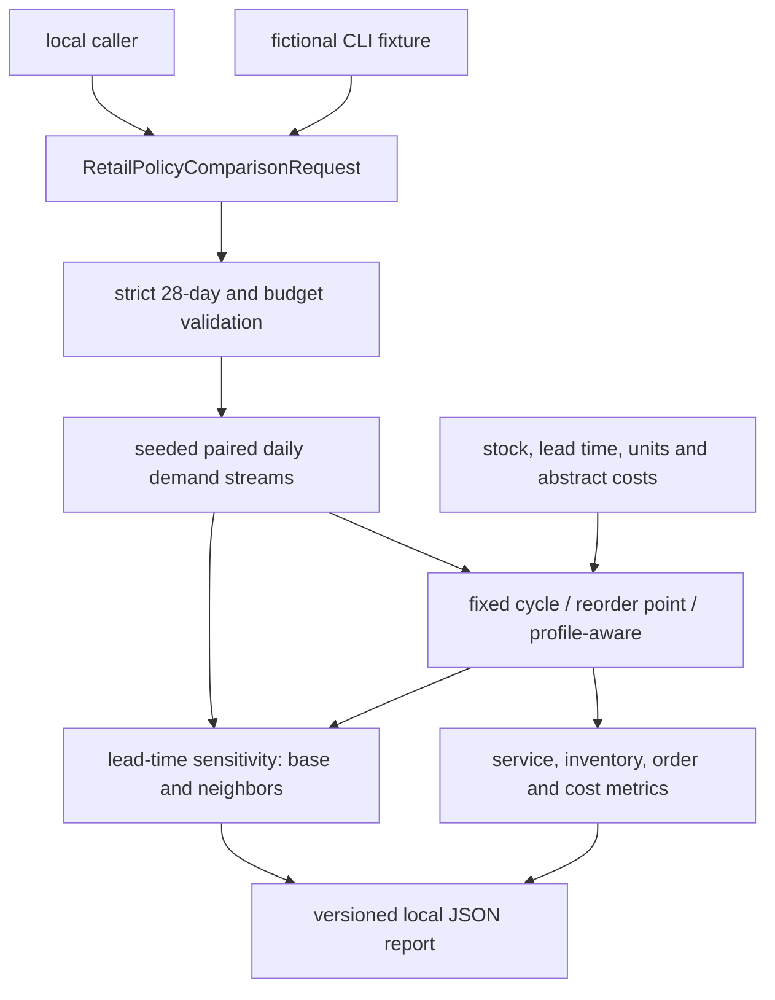

# M1 synthetic retail replenishment policy comparison

This guide explains the experimental local test double for comparing three
inventory replenishment rules over a fixed 28-day horizon. It advances the
synthetic slice of M1E-03. It does not satisfy M1E-02: no WorldKernel package
is loaded, no external engine runs, and no real stock or demand is observed.

## Purpose and boundary

The comparison answers a narrow engineering question: given one caller-
supplied expected-demand profile and a declared set of inventory and cost
assumptions, how do three simple rules behave on the same generated daily
demand streams? The result is conditional arithmetic for inspection. It does
not pick a winner, recommend an action, authenticate inputs or assert that a
retailer would experience these outcomes.

The capability is `local_retail_policy_test_double` with status
`experimental`. `GET /v1/capabilities` advertises that local capability, but
there is no simulation HTTP route. The general `worldkernel_adapter` remains
`planned`; actual engine execution stays behind B-04 and the
[WorldKernel gateway gate](WORLDKERNEL_GATEWAY_GATE.md).

## Components and responsibilities

| Component | Responsibility | Boundary |
| --- | --- | --- |
| [`policy_simulation.py`](../../src/mirrormind/domains/retail/policy_simulation.py) | Validates a strict 28-day request, builds paired streams, applies the three policy rules, aggregates metrics, and runs a lead-time sweep | Pure in-process arithmetic; no file, network, database, forecast, or engine access |
| [`m1_retail_policy_test_double.py`](../../examples/m1_retail_policy_test_double.py) | Creates one stable fictional profile and prints a JSON result | The fixture demonstrates the API; it does not represent observed demand |
| [`test_retail_policy_simulation.py`](../../tests/unit/test_retail_policy_simulation.py) | Checks repeatability, paired stream identity, metrics, input rejection and sensitivity reuse | These are local implementation tests, not business validation |
| [`test_retail_policy_simulation_cli.py`](../../tests/integration/test_retail_policy_simulation_cli.py) | Runs the CLI twice and checks identical labeled output and the no-engine/no-selection boundary | Does not call a web server or WorldKernel |
| [`system.py`](../../src/mirrormind/api/routes/system.py) | Lists the experimental capability in the existing metadata route | Reports a label only; does not expose or invoke the test double |



## Contract and input checks

`RetailPolicyComparisonRequest` and `RetailPolicyAssumptions` are frozen,
extra-forbidden Pydantic models with strict integer fields. The profile must
contain exactly 28 integer item counts in `0..1000` and at least one positive
day. A request supports at most 250 replications and is checked against the
50,000-transition local ceiling before streams are generated. Unknown fields,
coercible strings, booleans in integer fields, unsupported units, and out-of-
range assumptions fail during validation.

| Input | Contract | Meaning |
| --- | --- | --- |
| `demand_profile_units` | 28 nonnegative integers | Caller-declared expected daily demand in items; it is not a fitted or served forecast |
| `initial_stock_units` | 0–10,000 items | On-hand stock at the start of day 1 |
| `lead_time_days` | 1–28 days | A day-end order arrives at the start of the day `lead_time_days` later |
| `fixed_order_quantity_units` | 1–10,000 items | Fixed-cycle and reorder-point purchase amount |
| `reorder_point_units` | 0–10,000 items | Reorder threshold on inventory position (on hand plus pipeline) |
| `review_period_days` | 1–28 days | Fixed-cycle spacing; day 1 is a review day |
| `safety_stock_units` | 0–10,000 items | Added to the profile-aware order-up-to target |
| Cost coefficients | 0–10,000 synthetic units each | Procurement/item, holding/item/day, fixed/order and unmet-demand/item coefficients; no currency is implied |
| `replications`, `seed` | 1–250, bounded integer seed | Number of paired streams and deterministic starting seed |

The result includes the full caller-declared profile and assumptions so a human
can reproduce the arithmetic. Its `input_status` remains
`caller_supplied_assumptions_not_authenticated`. The CLI adds
`fixture_label="fictional_demo"`; that label does not authenticate any other
caller's values.

## Data and execution flow

1. The caller constructs the two request models. Pydantic rejects unknown or
   wrong-type fields; a model validator checks the fixed horizon, profile
   values and maximum transition count.
2. `_build_demand_streams` creates one sequence for each replication. For each
   expected daily count it uniformly draws one multiplier from
   `{75%, 100%, 125%}` with `random.Random(seed + replication)`, rounds to an
   integer item count, then
   hashes the seed, replication index and sequence using canonical JSON and
   SHA-256.
3. The same immutable stream tuple is passed to each policy and every lead-time
   sensitivity scenario. Each policy report repeats its stream digest per
   replication. Equal digests are the observable pairing check.
4. `_simulate_replication` starts with on-hand stock and an empty purchase
   pipeline. At each day boundary it receives due orders, fulfills as much
   demand as stock permits, records unfulfilled demand as a lost-sales proxy,
   charges end-of-day holding cost, then evaluates the policy and places an
   order. A purchase placed at the end of zero-based day `d` arrives at the
   start of day `d + L`, where `L` is lead time; arrivals outside the 28-day
   horizon stay in the reported pipeline. The profile-aware target sums
   expected demand at indices `[d + 1, d + L)`: intervening demand after the
   order day and before receipt. This half-open interval excludes demand on
   the arrival day. With a one-day lead time, receipt is the next morning, so
   the interval is empty; when safety stock and inventory position are both
   zero, the policy orders zero even if expected arrival-day demand is
   positive. This is the implemented toy heuristic, not a standard or
   optimized order-up-to policy. The result exposes this limitation in
   `modeling_caveats`. The boundary remains covered by
   `test_profile_aware_target_stops_before_arrival_day`, and
   `test_one_day_zero_safety_stock_exclusion_is_exposed_as_caveat` asserts the
   concrete case and its output metadata.
5. `_aggregate_policy` returns exact metric totals across replications and
   per-replication means. It retains each stream digest alongside that run's
   metrics. Fill rate uses the combined fulfilled / total-demand denominator,
   rounded to basis points; no-demand denominators are represented as `null`.
6. `_lead_time_scenarios` evaluates the base lead time and the bounded values
   one day shorter and one day longer (deduplicated at the 1- and 28-day
   boundaries). It reuses the same streams, so the sensitivity sweep changes
   lead time while holding the generated demand sequence fixed.
7. `compare_synthetic_retail_policies` assembles the versioned result and
   explicitly reports no WorldKernel execution, policy selection or action
   authorization.

## Policy rules

| Policy ID | Day-end rule | What it illustrates |
| --- | --- | --- |
| `fixed_cycle_quantity` | On day indices divisible by `review_period_days`, order the fixed quantity regardless of current stock | Calendar-based ordering frequency |
| `reorder_point_fixed_quantity` | If on-hand plus pipeline is at or below `reorder_point_units`, order the fixed quantity | Threshold replenishment with a fixed lot |
| `forecast_aware_order_up_to` | Sum caller-supplied expected demand after the order day and before the receipt day, add safety stock, and order the nonnegative gap to inventory position | A profile-aware rule; it does not consume a trained or evaluated forecast |

All policies use integer items. Demand is served before the day's ordering
decision. Unmet units are not backordered or recovered. Procurement cost is
charged when an order is placed, including quantities still in the pipeline at
day 28. Holding cost is charged on end-of-day on-hand units. Total cost is the
sum of procurement, holding, fixed order and unmet-demand proxy costs.

## Output and interpretation

The result schema is `mirrormind.retail.policy_comparison.v1`. Every lead-time
scenario has the same three ordered policy IDs and contains:

- `replication_results`: replication index, seed, paired demand digest, and
  that replication's aggregate demand, inventory, service, ordering and cost
  metrics. Recreate the daily stream from the included profile, seed and
  implementation version when a step-level replay is needed.
- `aggregate_metrics_across_replications`: exact integer sums for units,
  days, orders and synthetic cost components, plus combined fill rate in basis
  points.
- `mean_metrics_per_replication`: the mean synthetic total cost, stockout
  days, ending stock, pending order quantity and order count.
- `ranking: null` and `ranking_status: "not_computed"` to prevent the report
  from silently selecting a policy.
- `modeling_caveats`: explicit limits on the profile-aware rule's half-open
  protection window and its toy status. Consumers, including a future
  decision trace, must retain these caveats with the comparison. Their
  presence does not prove downstream persistence; that contract is verified
  separately by the integrated workflow tests.

One recorded run of the documented CLI produced the following base two-day
lead-time summary. It is an arithmetic check on the fictional fixture, not a
business result:

| Policy | Mean total synthetic cost units | Unmet units across 12 replications | Fill rate |
| --- | ---: | ---: | ---: |
| Fixed-cycle quantity | 1,911.00 | 303 | 93.07% |
| Reorder-point fixed quantity | 2,655.00 | 0 | 100.00% |
| Profile-aware order-up-to | 1,258.75 | 217 | 95.04% |

These values depend on the fixture, seeded multiplier choices, policy
definitions and abstract costs. They do not establish that the profile is a
forecast, that any cost coefficient is realistic, or that the lowest fixture
cost policy should be selected.

## Reproduce the example

From the repository root:

```bash
python -m examples.m1_retail_policy_test_double
python -m pytest -q tests/unit/test_retail_policy_simulation.py
python -m pytest -q tests/integration/test_retail_policy_simulation_cli.py
```

The CLI prints one stable compact JSON object. To inspect only the base
scenario, parse the output and read the row whose `is_base_assumption` is
`true`; the output itself includes all replication digests and the sensitivity
scenarios for independent replay.

## Tests and what they establish

| Test | Evidence | Limitation |
| --- | --- | --- |
| `test_three_policies_share_each_reproducible_demand_stream` | Two calls return identical objects; each policy and sensitivity scenario has the same digest per replication; all three policies and lead times are present | Does not validate policy quality or real demand |
| `test_seed_changes_paired_exogenous_stream_digests` | Changing the seed changes the demand stream digests | A seed does not make assumptions empirically representative |
| `test_policy_rules_can_produce_distinct_conditional_outcomes` | The three decision rules can yield distinct fixture costs under the same exogenous streams | A lower conditional synthetic cost does not establish a business winner |
| `test_profile_aware_target_stops_before_arrival_day` | A one-day lead time has no intervening demand; a two-day lead time covers only the next day's demand before receipt | Tests the local day-boundary convention, not a retail service standard |
| `test_one_day_zero_safety_stock_exclusion_is_exposed_as_caveat` | Reproduces positive expected arrival-day demand with a zero order at one-day lead and verifies that the result states why and rejects an optimization claim | Documents the current toy rule; does not establish a conventional protection period or business quality |
| `test_inventory_mass_balance_holds_for_every_policy_replication` | Checks initial stock plus received and pending purchases equals fulfilled demand plus ending stock and pending purchases for each policy run | Fixture conservation under the local event order only; not evidence for actual inventory operations |
| `test_summary_reports_inventory_service_and_synthetic_cost_components` | Units and stock/service/order/cost totals are present and cost components add to total cost | Cost coefficients are caller assertions, not an accounting model |
| `test_invalid_profile_and_unsupported_units_fail_closed` | Wrong-length profiles, unsupported item units and replication counts over the local budget are rejected | Does not validate organizational unit governance |
| `test_out_of_range_profile_stock_cost_and_seed_fail_validation` | Daily demand, initial stock, a cost coefficient, and seed values beyond the contract bounds are rejected | Bounds do not establish that accepted assumptions are realistic |
| `test_sensitivity_reuses_the_same_paired_streams` | Lead-time comparisons hold exogenous demand fixed | One-factor sensitivity does not explore every joint assumption |
| `test_policy_test_double_does_not_import_worldkernel` | A clean subprocess imports the module while rejecting WorldKernel imports | Does not prove any independently installed engine is compatible |
| `test_synthetic_policy_cli_replays_paired_comparison` | The no-argument fictional CLI prints byte-identical JSON twice and states the no-engine/no-selection boundary | Does not exercise HTTP, WorldKernel, source permissions or deployment |

Curated claim `MM-SIM-001` cites
`tests/unit/test_retail_policy_simulation.py::test_three_policies_share_each_reproducible_demand_stream`.
`MM-SIM-002` cites
`test_one_day_zero_safety_stock_exclusion_is_exposed_as_caveat`, and
`MM-SIM-003` cites
`test_inventory_mass_balance_holds_for_every_policy_replication` in the same
unit test file. The capability ledger separately cites the end-to-end CLI
integration test.

## Safety, failures and limitations

- Invalid request models raise Pydantic `ValidationError`; a non-model passed
  to `compare_synthetic_retail_policies` raises `TypeError`. The CLI converts
  ordinary invalid configuration into a generic exit code 2 message.
- No demand profile or cost is inferred when absent: the request must supply a
  complete 28-day profile and all assumptions. Missing days are not zeros.
- There is no random library state shared across policies. Each replication's
  stream is generated once before any policy runs, and the digest includes
  that exact sequence.
- No identifiers, customer data, source paths, credentials, network calls or
  persistent writes are accepted by this interface. Callers should still
  avoid placing sensitive information into arbitrary logs around it.
- A successful result is not an actual engine result. The test double does not
  implement WorldKernel's exchange, enforce worker-level quotas, measure
  wall-clock cost, recover from process failure or validate remote payloads.
- The forecast-aware policy reads future entries of the supplied expected
  profile. That profile is available as an explicit scenario assumption; it
  must not be confused with information actually observed at a forecast
  cutoff.
- The profile-aware target excludes arrival-day demand by design. In the
  one-day/zero-safety-stock case it can place no order under positive
  expected demand. The result repeats this caveat; consumers must not label
  the rule standard, optimal or operationally safe.
- Costs omit taxes, discounts, capacity, backorders, spoilage, cash timing and
  multiple product interactions. Unmet demand is a proxy, not observed lost
  sales or service-level measurement.

## Diagnosis and maintenance

If validation fails, inspect the exact profile length, numeric types, declared
units, and `RetailPolicyAssumptions` limits before changing the model. If
repeated output differs, compare request seed and values first, then compare
the per-replication digest lists; every policy and lead-time scenario should
reuse those values. If a policy result changes unexpectedly, trace
`_order_quantity` for its decision and `_simulate_replication` for the daily
receipt, demand, fulfillment, cost and ordering sequence.

When changing demand generation, order timing, cost semantics or policy rules,
update this guide, the change request, unit regressions, example fixture,
capability/evidence ledgers and generated symbol catalog together. Keep the
WorldKernel request mapper strict: unsupported state must not be silently
discarded to make this local request appear executable by the external
engine. M1E-02 must separately add a pinned compatible runtime, request/result
validation, operator-owned resource enforcement and missing-engine/failure
tests.

## Learning and investigation

1. Trace `run_synthetic_policy_demo()` to
   `compare_synthetic_retail_policies`, `_build_demand_streams`,
   `_aggregate_policy` and `_simulate_replication`.
2. Before running the unit tests, predict which policies will create more
   orders and which assumptions drive stockout days. Check the exact output
   after you state your prediction.
3. Change only `lead_time_days` from 2 to 1 and then 3. Explain why each policy
   retains the same demand digest while its receipt schedule can change.
4. Set `safety_stock_units` to zero and explain how the profile-aware target
   changes. Do not call the profile an actual forecast.
5. Set initial stock to zero and inspect the first order arrival. Explain why
   a day-end order with one-day lead time cannot fulfill day-one demand.
6. Propose one test that would catch a future edit accidentally using a
   realized demand draw to choose an earlier order. State why a passing test
   still would not establish future-information validity for real data.
