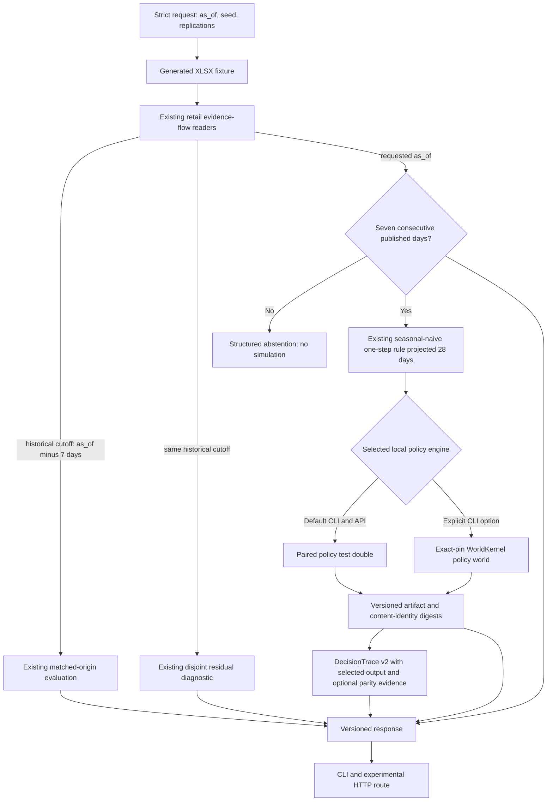

# M1F-02 — synthetic retail decision workflow

This guide follows one complete **fictional** retail comparison through the
same service used by the local CLI and experimental HTTP route. It is a
reproducible learning and integration slice. It is not an authorized retail
forecast, a recommendation, an engine result, or the completed M1 product.

See the scoped [M1F-02 change request](changes/M1F_02_SYNTHETIC_DECISION_WORKFLOW.md),
the [synthetic forecast model card](model_cards/SYNTHETIC_RETAIL_DECISION_WORKFLOW.md),
and the existing [decision trace contract](DECISION_TRACE_RESULT.md).

## 1. User-visible behavior

The service returns one versioned result containing:

1. A sanitized evidence-flow receipt and a historical fixed-split evaluation.
2. A release-aware residual diagnostic, explicitly marked as an uncalibrated
   heuristic and kept separate from forecast values.
3. A 28-day `seasonal_naive_lag7` profile from seven consecutive published
   fictional product-days before the requested `as_of` date.
4. Three conditional policy outcomes over paired synthetic demand streams and
   the existing lead-time sensitivity cases, using the test double by default
   or the explicit local WorldKernel option.
5. A v2 M1F-01 `DecisionTrace` linking facts, profile forecasts, assumptions,
   conditional outcomes, input evidence, execution evidence and unavailable
   runtime costs. The v1 contract remains available to existing callers.

If any required day is missing or its declared release date is after `as_of`,
the result is an abstention. It contains no forecast or trace and does not call
the policy test double. Missing counts are never replaced with zero.

## 2. Architecture and responsibilities



| Component | Responsibility | Trust boundary |
| --- | --- | --- |
| `synthetic_fixtures.py` | Create canonical in-memory workbook bytes and invented release dates; build the existing `RetailUciEvidenceFlow` | Fixture metadata and dates are caller declarations; they do not verify publisher claims |
| `evaluation_flow.py` | Reuse the fixed release-aware backtest for a historical diagnostic | The evaluation is not an empirical skill claim and is not used to select the forecast method |
| `residual_envelope.py` | Reuse the disjoint fixed calibration/holdout diagnostic | Output remains `heuristic_envelope_not_prediction_interval`; no interval is attached to the forecast |
| `baselines.py::project_seasonal_naive_lag7` | Repeatedly invoke the existing one-step seasonal-naive rule to form 28 integer steps | Seven complete published fixture values are mandatory; this does not fit or validate a predictive model |
| `policy_simulation.py` | Define strict inputs, shared day transitions and aggregation for three rules | Synthetic inputs and costs; no source evidence or policy ranking |
| `worldkernel_policy_world.py` | Register a fixed trusted handler that applies one demand draw to policy and lead-time states | Code-owned name/version; no user-provided handler code |
| `worldkernel_policy_mapping.py` and `worldkernel_policy_gateway.py` | Map the policy request, execute through the pinned worker, and verify all results against the reference rules | Explicit local opt-in only; not exposed to HTTP |
| `synthetic_decision_workflow.py` | Orchestrate cutoffs, abstention, selected comparator, trace construction and deterministic result digests | Comparator injection is trusted local composition and absent from HTTP; hashes provide no authentication or authorization |
| `api/routes/decisions.py` | Expose one bounded local route calling the same service | No file upload, URL fetch, database, writes, tool selection or action authority |
| `examples/m1_retail_decision_workflow.py` | Provide a deterministic command-line entrypoint | Uses generated fixture data only |

The service generates canonical fictional workbook bytes once per request, then
creates two independent evidence-flow instances using fresh streams and their
respective cutoff dates. No cache or parsed result is shared across requests.
The historical diagnostics end seven calendar days before the forecast cutoff.
For the default `as_of=2011-01-26`, both evaluation cutoffs are 2011-01-19 and
their seven-target window is 2011-01-13 through 2011-01-19. The forecast feature
window is 2011-01-20 through 2011-01-26. This keeps the reported retrospective
metrics out of the forecast's seven input facts. The method is fixed in advance;
the returned metrics do not choose a winning model.

## 3. Execution path and algorithms

### 3.1 Fixture and evidence flow

`build_synthetic_evidence_flow` creates an XLSX workbook in memory. Its positive
invoice-line counts follow a seven-day pattern; day 27 is declared late, day 33
is missing, and day 35 is declared unpublished until the following day. The
workbook reader projects only the allowed transaction fields. The composed
flow checks the declared calendar and release tuple and returns aggregate
receipts. `InvoiceDate` remains an event date, never a publication timestamp.

The service's `_eligible_observation_rows` joins each projected product-day to
its declared release, filters both `observed_on <= as_of` and
`available_on <= as_of`, then checks that the selected row count equals the
existing aggregate release audit. The join is needed because the audit receipt
intentionally omits identifiers and per-day values. No later event or late
release is used in the forecast facts.

### 3.2 Historical diagnostics

`evaluate_retail_evidence_flow` reuses
`backtest_declared_retail_releases`. The diagnostic cutoff is fixed at
`as_of - 7 days`; the holdout is seven calendar targets ending there. Each
origin retains the existing release-aware status, matched-baseline rules and
abstentions. `evaluate_retail_residual_envelopes` uses the same historical
cutoff with a fixed 21-day calibration target window and a seven-day holdout.
The result keeps the exact disjoint-window flag and counts, while leaving
`nominal_coverage` and `calibrated_prediction_interval` unset.

These diagnostics describe only the generated fixture. The holdout does not
choose the forecast method and its scores are not copied into the trace as
future performance evidence.

### 3.3 Forecast profile

The requested cutoff must be between 2011-01-26 and 2011-02-04. This leaves a
historical diagnostic window and a potential seven-day forecast feature
window inside the fixture. For each forecast run, the service requires one
positive projected count and one release declaration for every calendar day
from `as_of - 6 days` through `as_of`, with every release available by the
cutoff.

`project_seasonal_naive_lag7` calls the existing `_predict` one-step function
repeatedly. Each next value is the value seven positions earlier, so the
last complete week repeats four times over the fixed 28-day horizon. Inputs
must be exactly seven nonnegative integers; horizon must be an integer from 1
through 366. The public workflow fixes the horizon at 28. It does not train,
select a model from holdout results, impute missing days, or produce intervals.

### 3.4 Paired conditional policy outcomes

The service builds `RetailPolicyComparisonRequest` with the profile and the
same explicit fixture assumptions documented in the M1E-03 guide. By default,
`compare_synthetic_retail_policies` creates one seeded demand stream per
replication and reuses that stream for all three policies and lead-time
scenarios. `--engine worldkernel` instead injects the trusted local gateway;
the gateway executes the fixed registered handler and checks all engine states
against the test double as a parity oracle. Returned metrics come from engine
states. `selected_result_source` records which engine supplied those metrics.
`policy_test_double_invoked` records the actual call separately. In WorldKernel
mode the test double ran only as a parity oracle. The service limits
replications to 198 because
`28 days × 3 policies × 3 lead-time cases × replications` must remain within
the existing 50,000-transition budget.

Each base and sensitivity result becomes a `ConditionalOutcomeV2`. Its forecast
references point to all 28 profile records; its assumption references point to
the full assumption register. The policy comparator also reports explicit
`modeling_caveats`. `_build_trace` turns each caveat into a typed
`ModelingAssumption`; only the profile-aware outcome references the caveat
because the caveat describes how that forecast is consumed. In particular, its
one-day-lead target interval excludes arrival-day demand. The result therefore
does not establish a standard or optimized replenishment rule. The trace and
response preserve `ranking=None` and record the selected `engine_execution`:
`worldkernel_not_invoked` on the default API/CLI path or `worldkernel_invoked`
on the explicit local CLI path. Synthetic cost units are not currency or
measured operating costs.

### 3.5 Decision trace

`_build_trace` creates an immutable `DecisionTrace` v2. Each selected
product-day becomes an input `EvidenceReference` and `ObservedFact`; each future
profile step becomes a `ForecastEstimate` with references to the exact seven
history facts and the model-card path. Nine conditional outcomes cover three
policies over three lead-time values. Every outcome links to exactly one
`selected_output` execution record whose engine contract must match
`engine_contract_ref`. In WorldKernel mode, each outcome also links a
`parity_oracle` record for the reference simulator. The two records must bind
the same selected-metric digest. The WorldKernel provenance reference contains
its package version, source commit, registered world/revision, result schema
and raw worker-result digest. The `execution_evidence` section records outputs
produced after the input cutoff without describing them as historical source
evidence. `DecisionTrace` v1 and its example remain unchanged.

`MissingEvidence` identifies absent source rights/vintages, empirical model
validation and calibrated uncertainty.
The default test-double trace also has a WorldKernel-execution gap; the
explicit engine trace omits that gap after the gateway validates the pinned
result. Compute and WorldKernel costs remain explicitly unavailable because
this slice does not measure them.

`result_sha256` binds the canonical v2 `DecisionTrace` result fields, including
selected-engine and parity records, but is not a
signature or review identity. The outer workflow separately computes
`artifact_digests` for the versioned evaluation, uncertainty, evidence receipt,
forecast and simulation values. `decision_identity_sha256` hashes the workflow
schema, validated request (including `as_of`, seed and replication count) and
those artifact digests. Thus two requests that differ only in replications do
not reuse the same trace identity. Exact replay of the same request and
artifacts produces the same identity; `revision=1` is a content identity
revision, not a persisted history counter. `workflow_result_sha256` then binds
the complete response envelope, including the trace and its digest, while
excluding only its own field. On abstention, artifact and workflow digests are
still present but `decision_identity_sha256` is null because no decision trace
was produced. These hashes detect content changes when recomputed; they do not
authenticate a producer, sign the payload, establish provenance or record
human approval.

The trace has `human_review.status="not_requested"`. Its `created_at` is a
deterministic **fixture logical timestamp** for replay; it is not a wall-clock
execution audit.

The v2 validator requires each execution record's timezone-aware
`produced_at` instant to be no later than `created_at`. Equal instants compare
equal even when their serialized offsets differ. The generated producer uses
equal logical timestamps for its selected and parity records; passing this
ordering check does not prove when the process ran.

## 4. Contracts and examples

### HTTP request

```json
{
  "as_of": "2011-01-26",
  "replications": 12,
  "seed": 317
}
```

`as_of` is an ISO calendar date. `replications` is an exact integer from 1 to
198, `seed` is an exact nonnegative integer bounded below the random stream
ceiling, and extra fields are rejected. The route does not accept source files,
URLs, commands or caller-provided policy code.

```http
POST /v1/decision-workflows/retail/synthetic
Content-Type: application/json
```

### CLI

```bash
python -m examples.m1_retail_decision_workflow --as-of 2011-01-26 --replications 12 --seed 317
```

Reproduce the intended late-publication abstention with
`--as-of 2011-01-27`; day 27 is not available until day 30, so the seven-day
feature window is incomplete. With `--as-of 2011-02-03`, the missing day 33
also prevents a complete window. Both return a structured abstention and no
policy result.

### Result envelope

`mirrormind.synthetic_retail_decision_workflow.v2` contains `status`, `as_of`,
`evaluation`, `uncertainty`, `forecast_evidence_receipt`, `forecast`,
`simulation`, `worldkernel_execution`, `artifact_digests`,
`decision_identity_sha256`, `trace`,
`trace_sha256`, `workflow_result_sha256`, `human_review`, `action_authorized`,
and `writes_performed`. On a successful fixture, status is
`synthetic_comparison_ready_experimental`. An incomplete history returns
`abstained_required_history_unavailable`, `trace=null`,
`worldkernel_execution=worldkernel_not_invoked`, and
`simulation.policy_test_double_invoked=false`,
`policy_test_double_result_selected=false`, no selected source and parity
status `not_run`.

On a successful default path, `simulation.selected_result_source` is
`policy_test_double`, `policy_test_double_invoked=true`,
`policy_test_double_result_selected=true`, and parity status is `not_run`. With
the explicit WorldKernel CLI option, the selected source is
`worldkernel_policy_world`; `policy_test_double_invoked=true` records the
reference call, while `policy_test_double_result_selected=false` records that
its metrics were not selected. `reference_parity.status=exact_match` and the
trace links both execution records to each outcome. Workflow schema v2 marks
the new fields. The v1 `DecisionTrace` contract and example remain compatible.

The response includes synthetic replication-level outputs for teaching and
replay, versioned digests for each major artifact, a decision identity for a
successful trace and a whole-envelope digest. Treat the result as fictional,
non-authorizing data. Do not use it as a business recommendation or an API
contract for real-data ingestion.

## 5. Failure handling, safety and limits

| Condition | Observable response | Why |
| --- | --- | --- |
| Missing product-day or release row in the last seven dates | `abstained_required_history_unavailable` with `missing_or_unprojected_days` | A calendar gap is not zero demand |
| One or more last-seven releases occur after cutoff | Same abstention with `unpublished_days` | Event time does not imply publication time |
| Invalid date, boolean seed/count, excessive count or unknown request key | Pydantic/route HTTP 422; CLI exits 2 with a generic message | Strict typed bounds run before simulation |
| No eligible forecast history | No forecasts, outcomes, trace, or policy invocation | Prevents an unsupported synthetic comparison |
| Local trace reference/cutoff inconsistency | Trace model validation fails; no successful result is emitted | Contract rejects dangling references and post-cutoff evidence |
| Default test-double mode | `engine_execution=worldkernel_not_invoked` | No optional runtime is needed; this remains the API default |
| WorldKernel absent, mismatched or failing after explicit opt-in | CLI exits with a sanitized error and emits no comparison result | Never fall back silently; see the [M1E-04 guide](WORLDKERNEL_POLICY_WORLD.md) |

The route is experimental and currently belongs to an API scaffold without
authentication, identity or tenant authorization. It has no explicit request
body-size limit, rate limit or concurrency control. Replication and horizon
bounds constrain the domain calculation but do not protect the HTTP transport
or shared service capacity. It uses only a fixed generated fixture, no
persistence and no business writes. It is not safe to expose as a public or
production endpoint. Source licensing, original availability, privacy
approval, real-data evaluation, forecast skill, uncertainty calibration,
realistic costs, production isolation, durable jobs, identity and human action
authorization remain outside this slice. Optional local WorldKernel execution
does not close those product gates.

## 6. Tests and what they prove

- `tests/unit/test_staged_rolling_baselines.py::test_seasonal_naive_profile_repeats_exact_last_week_for_28_steps`
  proves the 28 integer steps repeat the exact supplied seven-value tuple.
- `tests/unit/test_synthetic_decision_workflow.py::test_successful_workflow_produces_valid_trace_and_explicit_gaps`
  validates typed references, trace cutoff, seven input facts per forecast,
  nine outcomes, explicit gaps and non-authorization on the real generated
  fixture.
- `tests/unit/test_synthetic_decision_workflow.py::test_post_cutoff_fixture_mutation_does_not_change_forecast_or_comparison`
  mutates day 35 after the default forecast cutoff and checks the profile,
  policy outputs and historical scores remain fixed while snapshot lineage
  changes.
- `tests/unit/test_synthetic_decision_workflow.py::test_trace_identity_includes_replications_and_exact_replay_is_stable`
  reproduces the former identity collision for one versus two replications and
  verifies that different content has different identity while exact replay is
  stable.
- `tests/unit/test_synthetic_decision_workflow.py::test_versioned_artifact_and_workflow_digests_bind_the_complete_response`
  verifies schema-versioned artifact hashes and the outer digest; changing a
  nested simulation value makes the recorded workflow digest stale. This is
  integrity by recomputation, not authentication or a signature.
- `tests/unit/test_synthetic_decision_workflow.py::test_profile_aware_policy_modeling_caveats_are_bound_into_trace`
  checks that the comparator's profile-aware modeling caveat is represented in
  the trace and linked to the affected outcome.
- `tests/unit/test_synthetic_decision_workflow.py::test_trace_rejects_execution_evidence_from_a_different_engine_contract`
  rejects an outcome whose contract does not match its selected execution.
- `tests/unit/test_synthetic_decision_workflow.py::test_trace_rejects_dangling_execution_evidence_references`
  rejects outcome references to absent execution records.
- `tests/unit/test_synthetic_decision_workflow.py::test_trace_rejects_unreferenced_execution_evidence_records`
  rejects execution receipts that no conditional outcome uses.
- `tests/unit/test_synthetic_decision_workflow.py::test_trace_rejects_parity_evidence_with_a_different_selected_result_digest`
  rejects parity metadata that does not describe the selected result.
- `tests/unit/test_synthetic_decision_workflow.py::test_trace_rejects_execution_evidence_after_trace_creation`
  rejects evidence later than trace creation. Companion regressions accept an
  earlier instant and equal instants serialized with equivalent timezone
  offsets; none authenticates the fixture clock.
- `tests/unit/test_synthetic_decision_workflow.py::test_incomplete_or_late_history_abstains_without_running_policy_test_double`
  covers missing, late and unpublished cases while making a policy call fail
  the test immediately.
- `tests/integration/test_retail_synthetic_decision_workflow_cli.py::test_synthetic_decision_cli_replays_trace_and_paired_policy_comparison`
  replays the CLI twice and compares its complete serialized output.
- `tests/integration/test_api.py::test_synthetic_retail_decision_route_returns_the_shared_service_result`
  compares the HTTP response to the same validated service call;
  `test_synthetic_retail_decision_route_rejects_unbounded_request_fields`
  verifies unknown input is rejected.
- `tests/integration/test_api.py::test_live_api_claims_equal_reviewed_capability_ledger`
  checks the experimental capability set matches the reviewed ledger.
- `tests/integration/test_worldkernel_policy_world_engine.py::test_m1_cli_worldkernel_option_runs_end_to_end_with_synthetic_data`
  exercises the exact-pin engine option twice and checks engine-contract
  provenance, selected-output/parity roles and deterministic trace replay; it
  skips if the reviewed package is absent.
- `tests/integration/test_api.py::test_synthetic_retail_decision_route_returns_the_shared_service_result`
  confirms the HTTP route uses the default comparator and cannot select the
  local engine.

Curated claims: **MM-MF-001** successful trace separation;
**MM-MF-002** safe abstention before policy execution;
**MM-MF-003** post-cutoff mutation resistance;
**MM-MF-004** deterministic CLI replay;
**MM-MF-005** request-sensitive trace identity;
**MM-MF-006** complete result digest binding; and
**MM-MF-007** trace-bound policy-modeling caveats. See the reviewed
[evidence map](EVIDENCE_MAP.json) for exact test selectors and limitations.
The `MM-WKPW-004` claim additionally covers the selected-engine and parity
execution records.

All of these are local synthetic checks. They do not satisfy M1B-03,
M1C-03, M1D-02 or the broader M1E-04 service/security gate and do not by
themselves establish M1 completion.

## 7. Debugging and maintenance

Start with the returned `as_of`, historical `evaluation_cutoff`,
`forecast_evidence_receipt.release_audit`, and the seven required dates. Keep
missing and unpublished dates distinct. Check the source fixture and release
declarations before touching policy arithmetic. For a successful run, trace
`_eligible_observation_rows` into `project_seasonal_naive_lag7`, then compare
the profile and seed to `compare_synthetic_retail_policies`. Check one
`ConditionalOutcomeV2` at a time against its `lead_time_days`, `policy_id`,
`seed`, `runs`, forecast and assumption references, engine contract and
execution evidence references. For WorldKernel mode, compare the selected
output and parity-oracle digests, then inspect the package, commit, world,
revision and raw result digest in the selected provenance reference. Recompute
the trace digest with `DecisionTraceV2.result_sha256`, compare it with the artifact
digest map and recompute `workflow_result_sha256` after excluding only that
field. Compare each execution `produced_at` with `created_at` as an absolute
timezone-aware instant; reject a later value without claiming either timestamp
is a trusted wall clock. Do not treat any digest as a signature. For identity collisions,
compare the validated request and schema-versioned artifact digests before
tracing `_decision_identity_sha256`. For explicit engine runs, follow the
[WorldKernel policy-world guide](WORLDKERNEL_POLICY_WORLD.md), verify the
engine result digest and compare every policy row with the pinned run.

When changing a fixture release date, update the release-aware regressions and
explain how it affects both the historical diagnostic window and the current
forecast feature window. When changing horizon or policies, update the
transition bound, model card, trace outcome builder, tests and public
capability description together. Preserve the explicit
`worldkernel_not_invoked` label on the default path; never relabel a
test-double result as WorldKernel execution. Changes to the engine path must
pass the [versioned WorldKernel gateway gate](WORLDKERNEL_GATEWAY_GATE.md).

## 8. Learning exercises

1. Change the diagnostic cutoff by one day and draw its calibration, holdout
   and forecast-feature date sets. Explain why `as_of - 7 days` keeps the
   historical seven-target window before the forecast's last-seven input.
2. Make day 27 available only on day 30, then call the endpoint at 2011-01-27
   and 2011-01-30. Predict the abstention status before running each call.
3. Change `seed` while leaving `as_of` fixed. Confirm the trace inputs and
   forecast profile stay fixed while simulation stream digests change.
4. Change one abstract cost assumption and identify exactly which outcome
   metrics change. Explain why the new synthetic result does not establish a
   real cost or policy ranking.
5. Add a new trace gap without adding its `blocks_refs`. Observe the
   `DecisionTrace` validation failure, then decide which forecast or outcome
   record the missing evidence actually limits.
6. Replay the same request with `replications=1` and `replications=2`. Compare
   `decision_identity_sha256` and `trace_id`, then replay one request exactly.
   Explain why revision 1 is scoped to a content identity rather than a
   history store.
7. Change one nested simulation value in a copied response and recompute
   `workflow_result_sha256`. Compare it with `trace_sha256`; explain why a
   trace digest alone cannot bind the whole workflow envelope and why neither
   digest authenticates its producer.
8. Copy a trace and move one execution `produced_at` after `created_at`, then
   before it and to the same instant using a different timezone offset. Predict
   validation for each case. Explain why this checks chronology but not the
   fixture clock's authenticity.
