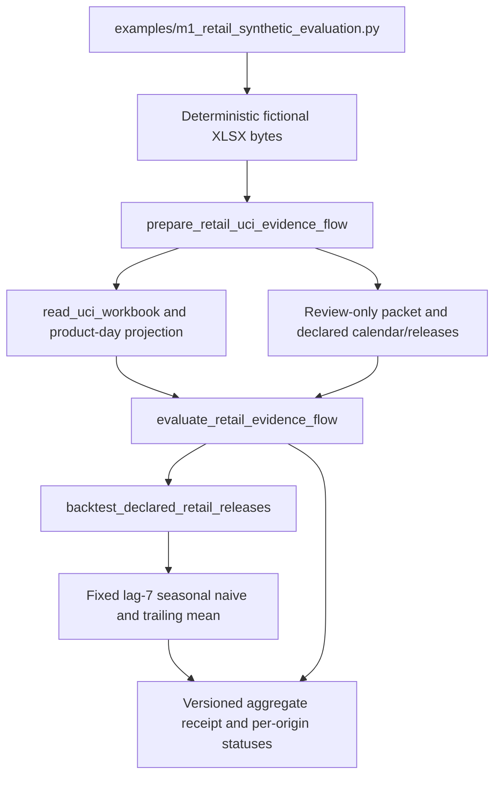

# M1 local retail evidence-to-evaluation flow

## Purpose and boundary

This guide explains how a caller-declared UCI-shaped workbook can travel
through the existing local evidence preflight and into a fixed-split retail
baseline evaluation. It fills the synthetic M1C-01 composition gap. The
capability is experimental: it does not authorize data use, prove a release
date, produce an operational forecast or recommend an inventory action.

The runnable example generates a fictional workbook in memory. Its
[dataset card](datasets/SYNTHETIC_RETAIL_RELEASE_EVALUATION.md) records the
fixture and release assumptions; its
[model card](model_cards/SYNTHETIC_RETAIL_RELEASE_EVALUATION.md) records
the fixed baselines, split, metrics and absence of calibrated uncertainty.
No actual UCI workbook is read.

## Architecture and responsibilities



| Component | Responsibility | Important limit |
| --- | --- | --- |
| [`uci_workbook.py`](../../src/mirrormind/domains/retail/uci_workbook.py) | Bounds and hashes caller-opened XLSX bytes, validates the expected workbook shape, and delegates row projection | Hash equality is not source identity, rights or publisher availability |
| [`evidence_flow.py`](../../src/mirrormind/domains/retail/evidence_flow.py) | Combines the workbook projection, review-only metadata, declared calendar and release audit | Dates and review references remain caller assertions; receipt flags stay false |
| [`evaluation_flow.py`](../../src/mirrormind/domains/retail/evaluation_flow.py) | Checks the evaluation cutoff matches the evidence flow audit and builds the aggregate result | It does not acquire data, authorize processing or persist results |
| [`release_backtest.py`](../../src/mirrormind/domains/retail/release_backtest.py) | Validates every declared product-day release, evaluates the fixed holdout and emits one date/status record per target | Positive invoice-line units are a proxy, not complete demand |
| [`baselines.py`](../../src/mirrormind/modules/forecasting/baselines.py) | Supplies fixed prediction and scoring helpers reused by the release backtest | No training, tuning, intervals, model registry or serving endpoint |
| [Example CLI](../../examples/m1_retail_synthetic_evaluation.py) | Builds a stable fictional XLSX, declares its synthetic release schedule and prints JSON | Only the generated fixture is synthetic by construction; general flows remain unverified |

## Data and execution flow

1. The example creates 34 positive invoice-line rows over 35 calendar dates.
   It omits one event day, assigns a late release to one history value and
   marks the final holdout target as unpublished at the evaluation cutoff.
2. The fixture sets fixed workbook properties, resets the `modified` XML
   field that openpyxl fills with the current time, sorts ZIP members and
   normalizes ZIP timestamps and compression before computing SHA-256. This
   stabilizes generated bytes under the same toolchain. It still proves only
   byte identity.
3. `prepare_retail_uci_evidence_flow` delegates to the bounded XLSX reader,
   creates a review-only packet, compares the declared calendar, and audits
   explicit releases at the supplied origin. `InvoiceDate` is event time;
   no availability time is derived from it.
4. `evaluate_retail_evidence_flow(flow, stock_code=..., evaluation_on=...,
   holdout_days=...)` first requires an exact `date` and requires it to equal
   `flow.release_audit.origin_on`. A mismatch fails before evaluation.
5. The wrapper delegates to `backtest_declared_retail_releases`. That helper
   revalidates the complete release set, selects the fixed final N calendar
   targets ending at `evaluation_on`, and uses the immediately preceding day
   as each forecast origin.
6. A target is scored only when its positive product-day exists, it was
   declared available by the final evaluation cutoff, and all seven
   consecutive prior calendar dates were declared available at that
   target's origin. Missing target, unpublished target and unavailable
   history receive distinct statuses. None are zero-filled.
7. Seasonal-naive lag seven and trailing mean each score the same eligible
   origins. With at least two targets, the helper returns MAE, RMSE, signed
   bias and WAPE. Fewer than two targets yields null metrics and no winner.
8. The versioned result joins the sanitized evidence-flow receipt, split
   boundaries, aggregate metrics and per-origin `target_on` / `origin_on` /
   `status` records. It returns neither identifiers nor raw observations;
   `ingestion_authorized` and `forecast_eligible` are false.

## Contracts and algorithm

### Python entrypoint

```python
evaluate_retail_evidence_flow(
    flow: RetailUciEvidenceFlow,
    *,
    stock_code: str,
    evaluation_on: date,
    holdout_days: int = 7,
) -> dict[str, object]
```

`flow` is the typed result of the M1B-02 workbook preflight. The wrapper
accepts no stream and does not repeat parsing. `stock_code`, date validation
and the 2–30 day holdout limit are checked by the existing retail backtest.
The output uses schema `mirrormind.retail.evidence_evaluation.v1` and exposes:

- `status`: `local_retail_evidence_evaluation_unverified` when metrics exist,
  otherwise `local_retail_evidence_evaluation_abstained`;
- `split`: fixed last-N-calendar-day boundaries and requested origin count;
- `evidence_receipt`: M1B-02 aggregate review, projection, calendar and release
  receipts, including the generated-byte digest;
- `baseline_evaluation`: the reused metrics, aggregate abstentions and the
  lower-MAE label, with a generic unverified status;
- `origin_receipts`: the chronological per-target date/status records;
- false authorization and forecast-eligibility flags.

The wrapper rewrites the lower-level helper's fixture-oriented status label
to an unverified generic status. A caller can supply a flow whose provenance
is unknown; this output must not label arbitrary caller data as fictional.
The synthetic CLI itself is fictional by construction.

### Prediction and metrics

For the seven historical values `(x[t-7], ..., x[t-1])`, seasonal naive
returns `x[t-7]`; trailing mean returns their arithmetic average. For the
same scored targets `y[t]` and predictions `p[t]`:

- MAE = mean `abs(p[t] - y[t])`;
- RMSE = square root of mean `(p[t] - y[t]) ** 2`;
- bias = mean `p[t] - y[t]`;
- WAPE = sum absolute error / sum positive target units, or null for a zero
  denominator.

Metrics are conditional on matched, eligible synthetic origins. The returned
lower-MAE label is not a statistical model-selection decision.

## Reproduce the example

Install the development extra in the repository's documented environment,
then run:

```bash
uv run --no-sync --extra dev python -m examples.m1_retail_synthetic_evaluation --holdout-days 7
python -m pytest -q tests/integration/test_retail_synthetic_evaluation.py
```

The verified example output for the current fixture has a seven-day split,
two scored origins, three unavailable-history abstentions, one missing
target and one unpublished target. Its synthetic seasonal-naive MAE is 0.0
and trailing-mean MAE is 0.5 because the fixture repeats a weekly pattern.
Those values are test-fixture arithmetic, not a real forecast-quality claim.
The integration test runs the CLI in two fresh Python processes and compares
the complete JSON output, including the normalized fixture digest.

## Tests and what they establish

| Test | What it proves | What it does not prove |
| --- | --- | --- |
| `test_synthetic_cli_is_reproducible_and_returns_sanitized_origin_receipts` | Full generated-workbook-to-evaluation CLI runs twice with identical JSON; split, seven statuses, matched output shape, redaction and false authorization flags | Stable fictional bytes and exact fixture arithmetic are not source authenticity, empirical skill or a complete demand calendar |
| `test_evaluation_rejects_mismatched_release_audit_cutoff` | A preflight audited at another cutoff cannot be relabeled during evaluation | Matching caller-declared dates does not authenticate them |
| `test_unpublished_target_mutation_does_not_change_scores_or_origin_receipts` | Changing the final target that is unavailable by the cutoff leaves scored metrics and status receipts unchanged, while the evidence digest changes | No general causal or real-source leakage guarantee follows beyond this fixture and code path |
| `test_unpublished_holdout_abstains_without_metrics_or_winner` | With every declaration after cutoff, no metric or winner is fabricated; missing and unpublished targets remain distinct | No accuracy or uncertainty evidence |
| [`test_missing_late_and_unpublished_days_abstain_and_models_share_origins`](../../tests/unit/test_retail_release_backtest.py) | The underlying evaluator scores both baselines on the same eligible origins and enforces its abstention partition | Unit fixture behavior is not an empirical holdout |

Curated claim **MM-REVAL-001** maps to
`tests/integration/test_retail_synthetic_evaluation.py::test_synthetic_cli_is_reproducible_and_returns_sanitized_origin_receipts`.

The live capability list is covered by
`tests/integration/test_api.py::test_live_api_claims_equal_reviewed_capability_ledger`.
The exact PR #53 head `210f0f382938a67e518df688cc4e19c03d3d7af6` passed this
HTTP test within the canonical 700-test gate. An earlier restricted-sandbox
attempt stalled before the endpoint ran; see [B-07](BLOCKERS.md).

## Safety, failures and maintenance

- A mismatched `evaluation_on` raises `ValueError`; construct the evidence
  flow and evaluate it with the same cutoff.
- Unknown product, malformed dates, missing/duplicate releases and invalid
  horizons fail through existing validators. Do not repair the inputs by
  inferring availability from `InvoiceDate`.
- `local_retail_evidence_evaluation_abstained` is a valid result. Read
  `origin_receipts` to distinguish a missing target, an unpublished target
  and an unavailable seven-day history.
- The workbook is generated in memory, bounded by the existing XLSX reader,
  and never saved or sent to a provider. Receipts contain dates, counts,
  declaration status and a content digest, but not product or customer IDs.
- When changing release rules, edit the existing `declared_releases.py` or
  `release_backtest.py` helper and its unit tests. Change the new wrapper only
  when composition, result schema or cutoff agreement changes. If a
  baseline, split, eligibility rule or score changes, version the fixture
  protocol and update both cards and all cited tests.
- No prediction interval is estimated. Do not imply calibrated uncertainty,
  real-source rights, complete demand or an operational recommendation.

## Learning and investigation

1. Trace the call from `main()` through `build_synthetic_evidence_flow()` to
   `prepare_retail_uci_evidence_flow()` and the new evaluator.
2. Predict the seven origin statuses before running the integration test.
   Which date is missing, which history release is late, and why is the final
   target not scored?
3. Change `future_units` while keeping its release after the cutoff. Confirm
   the data digest changes but `baseline_evaluation` and `origin_receipts`
   remain identical.
4. Set `all_unpublished=True`. Explain why all six present targets are
   withheld and the missing seventh target is not counted as a zero.
5. Explain why a zero synthetic MAE does not justify selecting seasonal naive
   for any real retailer. Identify the dataset rights, publisher vintages,
   complete calendar, untouched empirical holdout and uncertainty evidence
   still needed.
