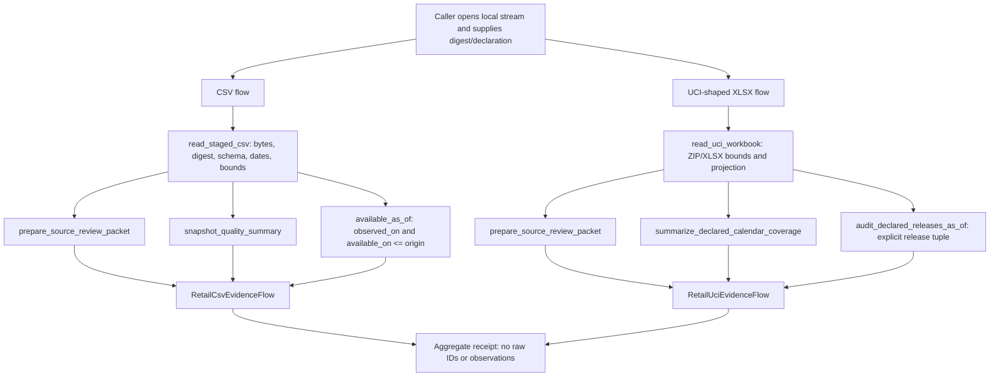

# M1b local synthetic retail evidence flow

**Status:** experimental, in-memory preflight. The functions compose local
parsers and caller-declared dates; they do not authorize data use, verify a
publisher, perform forecasting or expose a data API. Current code is in
[`evidence_flow.py`](../../src/mirrormind/domains/retail/evidence_flow.py).
The scoped design and acceptance criteria are in
[`M1B_02_SYNTHETIC_EVIDENCE_FLOW.md`](changes/M1B_02_SYNTHETIC_EVIDENCE_FLOW.md).

## Why this composition exists

M1B-02 reuses earlier bounded primitives so an offline experiment can carry a
single typed result from file staging through review metadata and temporal
checks. Before this flow, CSV snapshots, source review packets, UCI workbook
projection, declared calendar checks and release audits were individually
usable, but their composition and non-authorizing caveats were left to every
caller. The new layer coordinates those functions; it intentionally contains
no second parser, calendar algorithm or publication inference.

The result is useful as a fixture boundary for M1C evaluation. A matching
SHA-256 only says that the supplied bytes equal the caller's expected bytes.
The review references, release dates and calendar are still unverified caller
assertions. The API labels the composite capability `experimental`.

## Architecture and data flow



### Component responsibilities

| Component | Responsibility and contract |
| --- | --- |
| `prepare_retail_csv_evidence_flow` | Accepts a caller-opened binary stream, expected lower-case SHA-256, `SourceReviewDeclaration`, exact inspection date, series identifier and canonical ISO origin. Returns `RetailCsvEvidenceFlow`. |
| `read_staged_csv` | Reads at most the existing 1 MiB byte budget and 10,000-row limit. Verifies byte digest before UTF-8/CSV structure, exact header, date order, unique series/day keys and bounded nonnegative units. Does not open paths or persist. |
| `prepare_source_review_packet` | Requires a daily-CSV declaration bound to the staged digest and bounded metadata references. Produces a packet with permission and forecast eligibility false. References are not authenticated. |
| `snapshot_quality_summary` | Counts observed date gaps, declared delayed rows and explicit zero rows; does not impute missing days or certify data quality. |
| `available_as_of` | Selects the chosen series only when both event date and declared availability date are at or before the origin. Empty selection remains empty. |
| `prepare_retail_uci_evidence_flow` | Accepts a caller-opened binary stream, expected digest, review declaration, inspection date, sorted exact calendar tuple, exact release tuple and origin date. Returns `RetailUciEvidenceFlow`. |
| `read_uci_workbook` | Applies existing compressed-size, ZIP-entry and row/group bounds, reads the supported `Online Retail` sheet, and delegates to the projection. It does not use customer or invoice values in the output projection. |
| `summarize_declared_calendar_coverage` | Checks that every projected product/event day occurs in the strictly increasing caller calendar, then reports declared-calendar gaps. It does not decide weekends or real opening hours. |
| `audit_declared_releases_as_of` | Requires exactly one explicit release per positive product/event day. At the requested origin it counts available, later-published and future-event product-days. `InvoiceDate` supplies event time only. |

The result dataclasses retain typed staged objects for local downstream
experiments. A CSV observation tuple and UCI projection/release tuple can
contain series or product identifiers. `receipt()` is the aggregate,
identifier-minimized view intended for status display; it does not include
source references, product IDs, invoice/customer fields or raw unit values.
The quality-summary mapping is read-only in the returned CSV result.

## Execution and decision rules

The two entrypoints are additive composition functions in
`mirrormind.domains.retail.evidence_flow`:

1. The caller opens a local stream and supplies a digest. MirrorMind never
   discovers a path, downloads a source or chooses an authority.
2. The format-specific reader consumes a bounded stream and verifies the
   caller's expected digest before accepting content.
3. The review packet binds the staged digest to the declared source type and
   metadata. It does not authenticate the declarations or grant permission.
4. CSV applies the declared two-date cutoff. UCI requires a caller-provided
   business calendar and one release declaration for every positive product
   day, then reports only aggregate cutoff counts.
5. The typed result stays in memory. The receipt explicitly reports
   `ingestion_authorized: false` and `forecast_eligible: false`.

For CSV, a row is selected exactly when
`observed_on <= origin_on` **and** `available_on <= origin_on`. A selected
zero is a real, explicit zero in the supplied fixture; an absent or late row
does not become zero. When no row qualifies, the receipt reports
`abstained_no_declared_rows_available_as_of_origin`.

For UCI-shaped data, `InvoiceDate` is an event date, never the release time.
The caller must separately provide `DeclaredProductRelease` values. The
release audit classifies each product/event day as available, withheld until
after the origin, or a future event. It exposes totals, not eligible rows.
Both selection rules are only as trustworthy as the supplied fixture and
declared timestamps.

## Reproducible use

The CSV fixture is invented and already tracked at
[`examples/staged-daily-observations.csv`](../../examples/staged-daily-observations.csv).
This minimal example produces units `[2, 0]` for `item-A` on origin
`2025-01-03`; the `2025-01-02` row is late-published until January 5.

```python
from datetime import date
from hashlib import sha256
from pathlib import Path

from mirrormind.domains.retail.evidence_flow import prepare_retail_csv_evidence_flow
from mirrormind.modules.evidence.intake_review import SourceReviewDeclaration

path = Path("examples/staged-daily-observations.csv")
data = path.read_bytes()
digest = sha256(data).hexdigest()
declaration = SourceReviewDeclaration(
    source_kind="daily_csv",
    source_record_ref="SRC-001",
    snapshot_sha256=digest,
    license_evidence_ref="LIC-001",
    permission_evidence_ref="PERM-001",
    privacy_review_ref="PRIV-001",
    intended_use="research_evaluation",
    retention_days=30,
    captured_on=date(2025, 1, 6),
    availability_evidence_ref="AVAIL-001",
)
with path.open("rb") as stream:
    flow = prepare_retail_csv_evidence_flow(
        stream,
        expected_sha256=digest,
        declaration=declaration,
        inspected_on=date(2025, 1, 6),
        series_id="item-A",
        origin_on="2025-01-03",
    )
assert [row.units for row in flow.declared_as_of_observations] == [2, 0]
assert flow.receipt()["forecast_eligible"] is False
```

The `SRC-001` etc. values above are syntactically valid example references,
not evidence that any source was licensed or reviewed. XLSX composition,
including generation of an in-memory workbook and release declarations, is
reproduced by
[`test_uci_flow_composes_calendar_and_release_cutoff_without_returning_identifiers`](../../tests/integration/test_retail_evidence_flow.py).

Run the complete composition regressions from the repository root:

```powershell
uv --cache-dir "$env:TEMP\uv-cache-mirrormind" run --no-sync --extra dev pytest -q tests/integration/test_retail_evidence_flow.py
```

## Failures, safety and limitations

Existing helpers reject malformed UTF-8/CSV and dates, wrong digests, excess
bytes/rows, duplicate keys, invalid declarations, source-format mismatch,
invalid XLSX ZIP structures, unsupported workbook schemas, missing calendar
days, absent/duplicate/unmatched releases, a release before its event, and
ambiguous origin types. The composition functions propagate those
fail-closed `ValueError`/`TypeError` failures rather than converting them
into empty evidence. UCI support remains an optional `openpyxl` dependency.

No code here verifies the URL or identity of the source, the license,
permission, privacy review, retention, official snapshot, publisher release
time, or whether positive invoice lines represent complete demand. No data is
written to disk, sent over a network, logged or returned by an API. The typed
result is not an access-control object; callers must not use it to bypass the
still-open source-rights and real-availability gates B-01/B-02. A synthetic
passing test cannot unblock M1B-03 or establish a forecast-quality claim.

## What the tests prove

Evidence is catalogued under `MM-FLOW-001` through `MM-FLOW-005` in
[`EVIDENCE_MAP.json`](EVIDENCE_MAP.json). The integration tests establish:

| Claim ID | Test function | Narrow claim |
| --- | --- | --- |
| `MM-FLOW-001` | `test_csv_flow_binds_review_quality_and_declared_asof_slice_without_authorizing` | CSV functions compose, late publication is excluded, explicit zero is retained and receipt metadata omits IDs/references. |
| `MM-FLOW-002` | `test_csv_flow_abstains_when_no_declared_observation_is_available_at_origin` | No eligible CSV row remains an empty selection and is reported as an abstention, not an imputed zero. |
| `MM-FLOW-003` | `test_uci_flow_composes_calendar_and_release_cutoff_without_returning_identifiers` | Generated XLSX projection, declared calendar and explicit release counts compose; withheld and future days remain excluded from the audit's available count and raw IDs are absent from receipt. |
| `MM-FLOW-004` | `test_uci_flow_rejects_missing_calendar_dates_and_release_declarations` | Calendar contradictions and incomplete release declarations fail closed. |
| `MM-FLOW-005` | `test_csv_flow_rejects_digest_and_review_declaration_mismatch` | Byte mismatch and review-packet digest mismatch fail closed. |

These tests do not verify production sources, rights, actual release history,
filesystem isolation, deployment, statistical forecasts or decisions. The
full-suite result and exact commit are reported in the PR and its local gate
receipt; neither is an official CI result.

## Learning and investigation exercises

1. Trace one CSV row from `read_staged_csv` through `available_as_of`. Change
   only `available_on` in a temporary fixture and predict whether the row is
   present at origins January 3 and January 5. Explain why its event date alone
   is insufficient.
2. Inspect `RetailCsvEvidenceFlow.receipt()` and the stored typed tuple. List
   which fields are omitted from the receipt and why the result itself still
   must not be treated as permission.
3. Remove one entry from `declared_releases` in the UCI test. Follow the error
   into `audit_declared_releases_as_of`; explain why copying `InvoiceDate` into
   an availability field would invalidate the historical claim.
4. Add a duplicate or out-of-order date to the declared calendar. Identify
   which existing validator rejects it and add a focused regression before
   proposing a different calendar policy.
5. Run `tests/integration/test_retail_evidence_flow.py`, then read its five
   functions alongside the corresponding evidence-map claim. State exactly
   what they fail to prove about real data.

## Diagnostics and evolution

When a local preflight fails, first inspect the generic validation error and
the input contract, then verify the locally calculated digest against the
caller-supplied expected digest. Do not print customer rows, source references
or workbook XML to diagnose a failure. Use the existing format-specific unit
tests to isolate parser behavior; use this integration test to isolate
composition behavior. The [debugging guide](DEBUGGING.md) gives the safe
reproduction sequence.

M1C-01 may consume the typed CSV selection or the UCI projection and explicit
release tuple in an offline evaluation, preserving the synthetic label and
per-origin abstentions. Do not connect this result to an API, agent, database
or real dataset. M1B-03 remains separate and requires reviewed source rights,
privacy, provenance and original availability evidence. If an authorized
source contract is later approved, add a source-specific adapter and tests;
do not weaken these strict parsers or reinterpret event timestamps as release
history.
