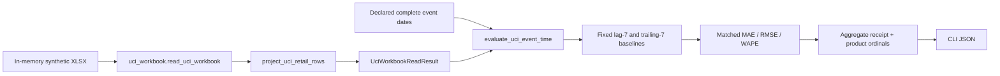

# M1 UCI event-time retrospective research path

**Status:** experimental, synthetic-only implementation; real-source acquisition and processing remain gated.

This guide explains the local event-time evaluator built for the owner-approved UCI Online Retail #352 research preparation. It demonstrates a reproducible, privacy-minimized product-day comparison on generated workbook bytes. It does not demonstrate source rights, historical publication availability, genuine demand, forecast skill, inventory performance or commercial readiness.

Related records: [M1B-01 change request](changes/M1B_01_UCI_EVENT_TIME_PILOT.md), [source and privacy review](datasets/UCI_ONLINE_RETAIL_SOURCE_REVIEW.md), [synthetic dataset card](datasets/SYNTHETIC_UCI_EVENT_TIME_CARD.md), [model card](model_cards/SYNTHETIC_UCI_EVENT_TIME.md), [Census/ALFRED protocol](CENSUS_ALFRED_VINTAGE_PROTOCOL.md), [blockers](BLOCKERS.md).

## Goal and motivation

The existing UCI-shaped projection and XLSX reader provide a bounded way to reduce transaction-shaped rows into positive product-day invoice-line units. They do not evaluate forecasts. The new path composes that reader with two fixed one-day baselines so engineers can inspect cohort freezing, matched scoring, missing-date abstention, zero-safe metrics and output minimization before any source-specific processing decision.

The source reports `InvoiceDate`, an event-time field. It does not provide row-level first-publication timestamps. Therefore the only valid label here is `event_time_retrospective_unverified_availability`; it must never be described as a point-in-time backtest.

## Component map



The generated XLSX is built in memory by `examples/m1_uci_event_time_research.py`; no network, persistent workbook, source credential, HTTP route, model provider or WorldKernel process is involved.

| Component | Responsibility | Contract and important limit |
| --- | --- | --- |
| `uci_workbook.read_uci_workbook` | Hash-checks caller-supplied bytes, bounds ZIP members and parsing, selects only invoice number, product code, quantity and event timestamp, then closes the optional workbook parser | Requires an expected SHA-256 and exact supported sheet/header. A digest proves byte equality only, not source identity or approval. |
| `project_uci_retail_rows` | Rejects malformed required fields; classifies cancellation, negative and zero lines; groups positive quantities by product and event date | Defaults remain 10,000 rows and 2,000 groups. Higher explicit limits are bounded by 600,000 rows and 100,000 groups; they do not assert that an original source file was tested. |
| `evaluate_uci_event_time` | Freezes a product cohort from the fit window, checks calendar declarations, selects a fixed split, computes shared eligibility and fixed baselines | Caller-provided event-date completeness is not independently authenticated. The function does not infer release time. |
| `_snapshot_counts` / `_coverage_dates` | Validate the projection and declared date set, then build an in-memory lookup | Product codes remain internal to the local evaluator and are not serialized in per-product results. |
| `_metrics` and forecasting `_score` | Compute MAE, RMSE and WAPE for at least two observations | WAPE remains `null` when the sum of actual positive units is zero; metrics do not quantify uncertainty. |
| `run_synthetic_evaluation` | Connects a deterministic fictional XLSX, parser, full synthetic date declaration and evaluator | It must remain synthetic in tests. The expected digest is calculated from generated bytes in the same process. The fixture carries 377 rows: 374 positive and three classified exclusions. |

## Inputs, dates and outputs

`evaluate_uci_event_time(snapshot, complete_event_dates=..., split=...)` accepts a `UciWorkbookReadResult`, a caller-declared iterable of complete event dates and exactly `validation` or `holdout`. Invalid snapshots, unsupported splits and a fit interval without complete declared date coverage fail closed.

The fixed calendar is:

| Stage | Dates | Use |
| --- | --- | --- |
| Fit and cohort | 2010-12-01 through 2011-08-30 | Include a product only if at least one positive product-day occurs in this interval. |
| Validation origins | 2011-08-31 through 2011-09-30 | One-day targets run 2011-09-01 through 2011-10-01. |
| Locked holdout origins | 2011-10-01 through 2011-12-08 | One-day targets run 2011-10-02 through 2011-12-09. |

Each eligible product-origin pair is shared by both baselines. A target date outside the declared complete-date set is abstained as `target_coverage_unverified`. If any of the preceding seven calendar dates is not declared complete, that pair is abstained as `history_coverage_unverified`. Only an absent product-day on a date the caller declared complete is treated as zero positive invoice-line units. That is a local contract, not proof that a real publisher supplied a complete day.

The frozen cohort excludes products first appearing after the fit interval. The output reports the cohort size, excluded post-fit product count, eligible/scored pairs, coverage, separate abstention counts and pooled/per-product metrics. Per-product results expose a one-based ordinal rather than a product code. The receipt includes the snapshot digest and aggregate parser counters, but no invoice, customer, description, country or raw product-code field.

The two fixed methods are `same_weekday_last_week` (lag seven calendar days) and `trailing_7_calendar_day_mean`. Both receive the same preceding seven dates and the same scored targets. For errors `e_i = prediction_i - actual_i`:

- `MAE = mean(abs(e_i))`.
- `RMSE = sqrt(mean(e_i ** 2))`.
- `WAPE = sum(abs(e_i)) / sum(actual_i)` when the denominator is nonzero, otherwise `null`.

No best-model label, tuning loop, confidence interval or uncertainty claim is emitted.

## Execution and failure behavior

Reproduce without external files or credentials:

```powershell
.\.venv\Scripts\python.exe -m examples.m1_uci_event_time_research --split validation
.\.venv\Scripts\python.exe -m examples.m1_uci_event_time_research --split holdout
```

The CLI prints one canonical JSON object. It accepts only the two predeclared splits; invalid choices exit with status 2 and do not print input records. The example catches parser/input exceptions and emits a generic message. Lower-level reader errors are sanitized so third-party XLSX parser exceptions do not echo cells.

The XLSX reader rejects a digest mismatch, unsupported sheet/header, malformed fields, oversized input/ZIP member sets, unsafe archive entries, excessive expansion ratio, and row/group/unit budgets. These checks limit ordinary accidental and archive-resource abuse; they do not make `openpyxl` a hostile-file sandbox. The workbook is caller-opened and processed in memory, but memory use, process isolation, secure storage and deletion for any real file are not enforced by this experiment.

## Permission, privacy and evidence boundary

Owner decision on 2026-11-25 authorizes preparation of this adapter, protocol, dataset card and privacy plan only. Before the original UCI workbook is acquired or processed, an accountable reviewer must verify the current original terms and attribution/change notice, exact approved use, minimal field projection, cancellation classification, private local storage, retention/deletion procedure and a hash-bound source manifest. This implementation does not enforce legal approval. No original UCI workbook was downloaded or parsed for this change.

Automated tests and the runnable example use fabricated rows only. Never put original workbook bytes, customer/invoice values, raw product codes, credentials or source payloads in Git, CI, logs, prompts or external services. Keep a permitted local source outside the repository and remove it at the approved retention deadline. Do not request or embed an ALFRED API key in this UCI path.

## Regression evidence and what it proves

Curated claims are `MM-UCIE-001` (deterministic sanitized CLI),
`MM-UCIE-002` (target coverage abstention) and `MM-UCIE-003`
(validation independence from locked holdout values). Each claim names a
top-level pytest function and limitation in [EVIDENCE_MAP.json](EVIDENCE_MAP.json).

| Selector | Behavior checked | What it does not prove |
| --- | --- | --- |
| `tests/unit/test_uci_event_time.py::test_event_time_protocol_uses_frozen_cohort_matched_pairs_and_redacts_codes` | Fixed cohort, matched targets, output status and identifier omission | Source authorization, real-data completeness or model accuracy |
| `tests/unit/test_uci_event_time.py::test_incomplete_target_day_abstains_instead_of_becoming_zero` | Missing target day and downstream missing history produce separate abstentions | Real publisher calendar completeness |
| `tests/unit/test_uci_event_time.py::test_fit_calendar_must_be_complete_before_freezing_product_cohort` | Incomplete fit coverage cannot define the cohort | That a caller's complete-date declaration is true |
| `tests/unit/test_uci_event_time.py::test_all_zero_targets_keep_wape_undefined_without_zero_division` | Zero denominator remains null and no division error occurs | Performance on nonzero empirical targets |
| `tests/unit/test_uci_event_time.py::test_validation_scores_do_not_depend_on_locked_holdout_values` | Mutating later values does not change validation metrics | Broader leakage through external preprocessing or source revisions |
| `tests/integration/test_uci_event_time_cli.py::test_synthetic_cli_is_reproducible_and_keeps_event_time_limitations` | Parser-to-JSON path is deterministic and sanitized on a generated XLSX | Original source format, rights, hostile-workbook isolation or publication history |

Run focused regressions and the repository gate as separate pieces of evidence:

```powershell
.\.venv\Scripts\python.exe -m pytest -q tests/unit/test_uci_event_time.py tests/unit/test_uci_retail_projection.py tests/unit/test_uci_workbook.py tests/integration/test_uci_event_time_cli.py
.\.venv\Scripts\python.exe scripts/local_quality_gate.py --expected-head FULL_40_CHARACTER_SHA
```

The second command must run on a clean checkout of the exact committed SHA. A local pass is not GitHub Actions or an official CI result.

## Learning exercises

1. Change only the synthetic product's Sep 5 row. Compare an absent product-day on a declared complete date with a removed date from `complete_event_dates`; explain why the first can score as zero while the second must abstain.
2. Add a product only after 2011-08-30. Verify it is excluded from the frozen cohort, then move its first positive event into the fit period and explain the cohort change.
3. Set every synthetic target to zero. Verify MAE/RMSE remain defined while WAPE is `null`.
4. Change a holdout value and rerun validation. Explain why its scores remain unchanged, then inspect whether the snapshot digest still changes.
5. Trace `InvoiceDate` from the XLSX cell to `ProductDayUnits.observed_on`. Find where publication time would have to enter a different versioned contract; do not infer it from event time.

## Diagnosis and evolution

- `unsupported workbook header/layout`: compare the exact synthetic fixture headers to `UCI_HEADER`; do not loosen parsing to guess columns.
- `fit period coverage must be complete`: inspect the date declaration before the cohort is chosen; do not turn missing dates into zeros.
- unexpected abstentions: inspect `target_coverage_unverified` separately from `history_coverage_unverified` and print only synthetic date counts, never raw rows.
- missing `openpyxl`: install the project's optional `uci` extra in an isolated environment; core non-XLSX code must remain importable without it.
- changed output hash after modifying a row: expected. The digest binds bytes, not publisher identity.

Future real-source work needs the source-specific gate above and a reviewed manifest. Point-in-time claims need independently verified publication vintages and a new protocol; the UCI event-time result cannot be promoted into that claim. Keep the later Census/ALFRED aggregate study separate: it tests temporal availability for aggregate monthly retail values and does not validate product-level demand or inventory policy.
