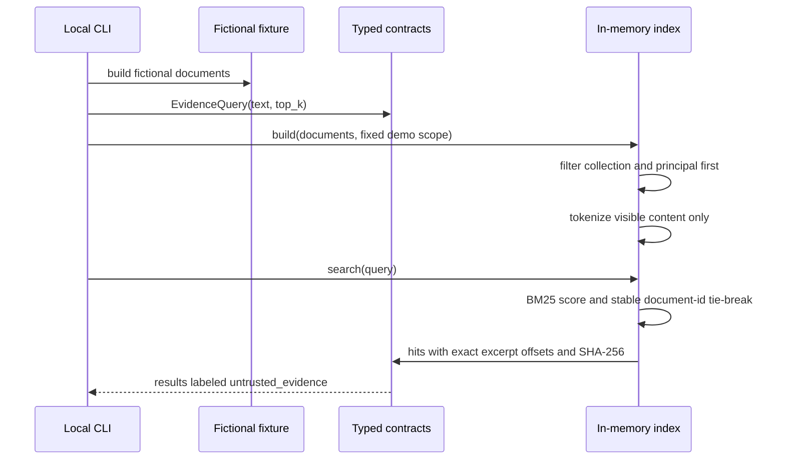

# M2-01 — local fictional evidence retrieval

This walkthrough follows the M2-01 source in
[`modules/retrieval`](../../src/mirrormind/modules/retrieval/) and the local
example in [`m2_evidence_retrieval.py`](../../examples/m2_evidence_retrieval.py).
It describes one deterministic in-memory search over generated fictional
documents. It does not describe an authenticated service, real-source
retrieval, RAG with an LLM or agent behavior.

## 1. Goal and boundary

M1 already stages and validates caller-supplied evidence. M2-01 adds the next
usable step: find relevant text in a small collection and return a citation
that can be checked against the exact source bytes. The first version uses a
plain lexical ranker, so engineers can inspect every input and score without
an embedding service, model provider, database or external network.

The capability is `local_fictional_evidence_retrieval` with status
`experimental`. The broader `evidence_and_rag` capability stays `planned`.
The local access context exercises scope filtering; it is **not** an identity
system or source permission. The CLI fixes that context to a fictional demo
principal, and no retrieval API route is exposed while the scaffold has no
authentication.

## 2. Architecture and execution flow



`contracts.py` owns the immutable Pydantic v2 request/result shapes.
`fictional_fixture.py` supplies deterministic documents and a fixed demo
scope. `index.py` builds the visible in-memory index, ranks matches, and binds
each excerpt to source references and exact offsets. The CLI validates one
query, serializes one result, and exits without network or persistent writes.

The current source graph also shows the separation from M1 staging:
`modules/evidence/snapshots.py` accepts caller-provided bytes and
`intake_review.py` creates review-only declarations. M2-01 does not call
either module or claim that its fixture references authenticate a publisher.

## 3. Contracts and bounds

All models are frozen, strict and reject extra fields.

| Contract | Input or output | Guard |
| --- | --- | --- |
| `EvidenceDocument` | One generated source record | IDs are bounded; content is 1–12,000 characters; scope has at most 32 principals; source status is exactly `fictional_fixture` |
| `EvidenceAccessContext` | Trusted-caller principal and allowed collections | At most 16 collections; an empty collection scope is valid and returns no hits |
| `EvidenceQuery` | Query text, optional collection subset and `top_k` | Text is 1–512 characters; `top_k` is a strict integer from 1–10 |
| `EvidenceCitation` | Source/snapshot refs and excerpt span | Nonempty Python Unicode code-point offsets and a 64-character excerpt SHA-256 |
| `RetrievedEvidence` | Excerpt, lexical score and citation | At most 480 characters; span length must equal excerpt length; trust label is fixed to `untrusted_evidence` |
| `EvidenceRetrievalResult` | Versioned search result | Algorithm is `bm25_lexical_v1`; status must agree with whether hits exist |

`InMemoryEvidenceIndex.build(documents, access)` accepts at most 100 typed
documents. Before scope filtering it rejects duplicate document identifiers
across the supplied batch with a generic message. It then filters by
collection and principal and tokenizes only the visible documents. A caller
can create `EvidenceAccessContext` in code;
therefore this local boundary is useful for deterministic tests but does not
replace server-owned identity or authorization.

The response omits the input query and all denied-record IDs, counts, content
and citations. Empty scope or no matching terms returns `status="no_matches"`
with an empty hit list.

## 4. Ranking and citation algorithm

`_token_spans` finds Unicode letter/number words and stores each token's
start/end offsets in the original text. Terms are case-folded for matching;
the original text and offsets remain unchanged. Repeated query terms count
once. Each fixture document is one retrieval unit; there is no hidden chunker.

For each visible document and unique query term, the implementation uses
BM25 with `k1 = 1.2` and `b = 0.75`:

```text
idf(t) = ln(1 + (N - df(t) + 0.5) / (df(t) + 0.5))
score(d, q) = sum_t idf(t) * tf(t,d) * (k1 + 1)
             / (tf(t,d) + k1 * (1 - b + b * |d| / avgdl))
```

`N`, document frequency, term frequency and document length are all computed
from the already filtered corpus. A denied record cannot affect the score or
top-k order. Matches sort by descending score, then ascending document ID for
stable ties. Scores are rounded to six decimal places; they are lexical
ordering values, **not** calibrated relevance probabilities or confidence.

For each result, `_make_hit` chooses the first matching token and returns a
window of up to 480 characters around it. The citation offsets index the
original Python string by Unicode code points, and `excerpt_sha256` is
calculated over the excerpt's UTF-8 bytes. The hash checks excerpt equality;
it does not prove source origin, publisher identity or permission.

Search cost is bounded by the 100-document and 12,000-character limits.
Indexing tokenizes only visible content; query scoring is proportional to
visible documents times distinct query terms. The index is in memory and is
discarded when the process ends.

## 5. Reproduce the example

From the repository root:

```powershell
uv run --no-sync --extra dev python -m examples.m2_evidence_retrieval `
  --query "availability publication cutoff" --top-k 3
```

The command emits deterministic compact JSON. One observed local result is:

```json
{"algorithm":"bm25_lexical_v1","hits":[{"citation":{"collection_id":"retail-methods","document_id":"fixture-availability","end_offset":162,"excerpt_sha256":"3c94e522b09673bcc4933920428635478e4503285c5b3b4faba23bba3d8977be","snapshot_ref":"sha256:aaaaaaaaaaaaaaaaaaaaaaaaaaaaaaaaaaaaaaaaaaaaaaaaaaaaaaaaaaaaaaaa","source_ref":"synthetic://m2/availability-note","start_offset":0},"excerpt":"Fictional method note: observed event time and publication availability time are separate. A retrospective query must exclude evidence published after its cutoff.","score":2.826844,"trust_label":"untrusted_evidence"}],"status":"results"}
```

The fixture is constructed in Python on each run. Its source and snapshot
references are labels in synthetic examples, not verified content hashes for
an external file. `--top-k 0`, booleans passed to the library model, blank or
oversized text are rejected. The CLI reports a generic validation message to
stderr and exits with code 2 without echoing an oversized query.

## 6. Security and failure handling

- The CLI can search only the fictional fixture and a hard-coded demo scope.
  Its principal is not chosen from user input.
- No HTTP endpoint, filesystem scan, URL fetch, database, provider or tool
  executor is called. The capability endpoint only reports the experimental
  local-library capability.
- A retrieved injection-like sentence remains source text labeled
  `untrusted_evidence`. Retrieval never converts it into a system/developer
  instruction, tool call or approval.
- Access context and document ACLs are caller assertions. Do not pass customer
  or private records to this example and do not treat the filter as production
  authorization.
- Citation spans and hashes establish a reproducible excerpt mapping only.
  They do not establish authenticity, rights, freshness, tenant isolation or
  truth.
- Pydantic validation errors stay inside the local process. The CLI emits a
  short generic error; there is no raw query/content logging.

## 7. Tests and what they establish

| Claim ID | Test | What it proves | What it does not prove |
| --- | --- | --- | --- |
| `MM-RETR-001` | `tests/unit/test_evidence_retrieval.py::test_query_filters_documents_before_ranking_and_never_discloses_denied_records` | Denied content is not tokenized, ranked or returned for the supplied scope | Authenticated identity or an external access-control boundary |
| `MM-RETR-002` | `tests/unit/test_evidence_retrieval.py::test_retrieval_citation_span_matches_source_and_digest` | Every emitted excerpt exactly matches its source substring and digest | Publisher authenticity or external snapshot integrity |
| `MM-RETR-003` | `tests/unit/test_evidence_retrieval.py::test_retrieved_instruction_like_fixture_remains_untrusted_evidence` | Injection-like fixture text retains fixed untrusted labeling and has no instruction/tool fields | Safety of a future model or executor consuming the text |
| — | `tests/unit/test_evidence_retrieval.py::test_retrieval_is_deterministic_and_ties_use_document_id` | Repeated results and equal-score tie ordering are stable | Retrieval quality or user relevance |
| — | `tests/unit/test_evidence_retrieval.py::test_query_document_and_corpus_bounds_fail_closed` | Query, document, scope and corpus limits reject unsafe bounds; empty scope returns no hits | CPU/memory limits for a persistent or multi-tenant service |
| `MM-RETR-005` | `tests/unit/test_evidence_retrieval.py::test_duplicate_ids_are_rejected_before_permission_filtering` | A duplicate across visible and denied documents fails with a generic error and does not echo hidden content | Record authenticity or upstream identity |
| `MM-RETR-006` | `tests/unit/test_evidence_retrieval.py::test_contracts_reject_extra_fields_coercion_oversized_text_invalid_refs_and_mutation` | Strict models reject unknown fields, coercion, oversized queries and invalid citation identifiers, and reject mutation | Correctness of future wire contracts or an authenticated authorization boundary |
| `MM-RETR-004` | `tests/integration/test_m2_evidence_retrieval_cli.py::test_evidence_retrieval_cli_replays_cited_results_and_rejects_oversized_query` | CLI output replays exactly, includes citations, omits query text and rejects oversized input generically | Deployment, authentication, external data or provider behavior |
| — | `tests/integration/test_api.py::test_live_api_claims_equal_reviewed_capability_ledger` | `/v1/capabilities` matches the reviewed capability statuses when the HTTP test runs | The semantics of retrieval or successful official CI |

The test paths and limitations are also indexed as `MM-RETR-001` through
`MM-RETR-006` in [`EVIDENCE_MAP.json`](EVIDENCE_MAP.json). Guards verify
references and structure; pytest execution is separate evidence.

## 8. Debugging and maintenance

For a valid query with no hits, first confirm that fixture content contains a
matching token, then confirm that the caller context includes the fixture's
collection and principal. Do not add denied-record IDs or hidden text to a
debug log. For a citation mismatch, compare `content[start_offset:end_offset]`
to `excerpt` and recompute SHA-256 over UTF-8 bytes; check Unicode code-point
offsets rather than byte offsets. A changed lexical score should be traced to
tokenization, corpus filtering, BM25 constants or the deterministic tie-break.

Future real-source work must add reviewed rights/provenance and a source
adapter before indexing. M2-02 should evaluate recall, abstention and citation
support using a declared query set. M2-03 must preserve the untrusted-evidence
label and add prompt-injection tests before any tool-using model can consume
retrieval output. If a persistent index or HTTP route is proposed, first add
reviewed identity, tenant, retention, deletion and authorization contracts.

## 9. Learning exercises

1. Trace `EvidenceAccessContext` through `InMemoryEvidenceIndex.build` and
   verify that `_token_spans` runs only after both scope predicates match.
2. Change the query to `"seasonal naive"`; compare the cited excerpt and
   source substring without treating its score as probability.
3. Add a Unicode word before a matching token, update the citation test, and
   verify that offsets count Python characters while the digest counts UTF-8
   bytes.
4. Write a test proving an empty collection scope cannot produce a hit. Keep
   `evidence_and_rag` planned until authenticated sources, retrieval evaluation
   and a real consumer pass their separate acceptance criteria.
