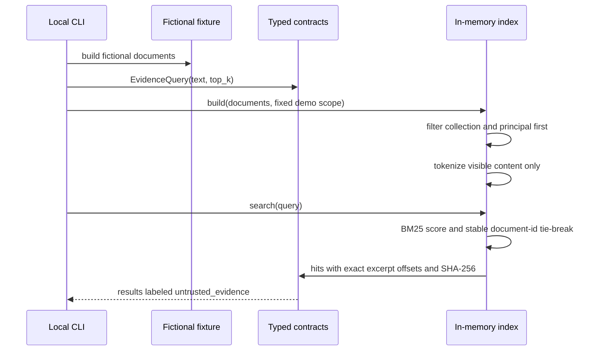
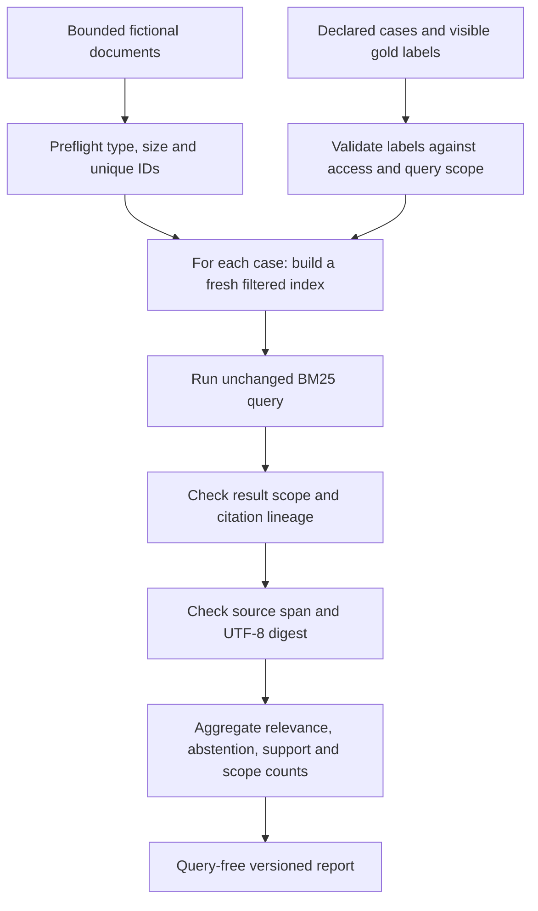

# M2-01 / M2-02 — fictional evidence retrieval and evaluation

This walkthrough follows the M2-01 and M2-02 sources in
[`modules/retrieval`](../../src/mirrormind/modules/retrieval/) and the local
examples in [`m2_evidence_retrieval.py`](../../examples/m2_evidence_retrieval.py)
and [`m2_evidence_retrieval_evaluation.py`](../../examples/m2_evidence_retrieval_evaluation.py).
It describes deterministic in-memory lexical retrieval and a bounded test-set
evaluation over generated fictional documents. It does not describe an
authenticated service, real-source retrieval, RAG with an LLM or agent behavior.

## 1. Goal and boundary

M1 already stages and validates caller-supplied evidence. M2-01 adds the next
usable step: find relevant text in a small collection and return a citation
that can be checked against the exact source bytes. The first version uses a
plain lexical ranker, so engineers can inspect every input and score without
an embedding service, model provider, database or external network.

The capability is `local_fictional_evidence_retrieval` with status
`experimental`. The broader `evidence_and_rag` capability stays `planned`.
The local access context exercises scope filtering; it is **not** an identity
system or source permission. The CLI fixes that context to a fictional demo
principal, and no retrieval API route is exposed while the scaffold has no
authentication.

## 2. Architecture and execution flow



`contracts.py` owns the immutable Pydantic v2 request/result shapes.
`fictional_fixture.py` supplies deterministic documents and a fixed demo
scope. `index.py` builds the visible in-memory index, ranks matches, and binds
each excerpt to source references and exact offsets. The CLI validates one
query, serializes one result, and exits without network or persistent writes.

The evaluation runner is deliberately separate from the ordinary one-query
CLI. It constructs a fresh scope-filtered index for every declared case,
verifies each returned citation against the visible fixture, then emits
aggregate counts and only verified citation references. It does not tune the
BM25 ranker or feed evaluation results back into retrieval.

The current source graph also shows the separation from M1 staging:
`modules/evidence/snapshots.py` accepts caller-provided bytes and
`intake_review.py` creates review-only declarations. M2-01 does not call
either module or claim that its fixture references authenticate a publisher.

## 3. Contracts and bounds

All models are frozen, strict and reject extra fields.

| Contract | Input or output | Guard |
| --- | --- | --- |
| `EvidenceDocument` | One generated source record | IDs are bounded; content is 1–12,000 characters; scope has at most 32 principals; source status is exactly `fictional_fixture` |
| `EvidenceAccessContext` | Trusted-caller principal and allowed collections | At most 16 collections; an empty collection scope is valid and returns no hits |
| `EvidenceQuery` | Query text, optional collection subset and `top_k` | Text is 1–512 characters; `top_k` is a strict integer from 1–10 |
| `EvidenceCitation` | Source/snapshot refs and excerpt span | Nonempty Python Unicode code-point offsets and a 64-character lowercase excerpt SHA-256 |
| `RetrievedEvidence` | Excerpt, lexical score and citation | At most 480 characters; span length must equal excerpt length; every model validation recomputes SHA-256 over the exact excerpt's UTF-8 bytes; trust label is fixed to `untrusted_evidence` |
| `EvidenceRetrievalResult` | Versioned search result | Algorithm is `bm25_lexical_v1`; status must agree with whether hits exist |

`InMemoryEvidenceIndex.build(documents, access)` accepts at most 100 typed
documents. Before scope filtering it rejects duplicate document identifiers
across the supplied batch with a generic message. It then filters by
collection and principal and tokenizes only the visible documents. A caller
can create `EvidenceAccessContext` in code;
therefore this local boundary is useful for deterministic tests but does not
replace server-owned identity or authorization.

The response omits the input query and all denied-record IDs, counts, content
and citations. Empty scope or no matching terms returns `status="no_matches"`
with an empty hit list.

## 4. Ranking and citation algorithm

`_token_spans` finds Unicode letter/number words and stores each token's
start/end offsets in the original text. Terms are case-folded for matching;
the original text and offsets remain unchanged. Repeated query terms count
once. Each fixture document is one retrieval unit; there is no hidden chunker.

For each visible document and unique query term, the implementation uses
BM25 with `k1 = 1.2` and `b = 0.75`:

```text
idf(t) = ln(1 + (N - df(t) + 0.5) / (df(t) + 0.5))
score(d, q) = sum_t idf(t) * tf(t,d) * (k1 + 1)
             / (tf(t,d) + k1 * (1 - b + b * |d| / avgdl))
```

`N`, document frequency, term frequency and document length are all computed
from the already filtered corpus. A denied record cannot affect the score or
top-k order. Matches sort by descending score, then ascending document ID for
stable ties. Scores are rounded to six decimal places; they are lexical
ordering values, **not** calibrated relevance probabilities or confidence.

For each result, `_make_hit` chooses the first matching token and returns a
window of up to 480 characters around it. The citation offsets index the
original Python string by Unicode code points, and `excerpt_sha256` is
calculated over the excerpt's UTF-8 bytes. `RetrievedEvidence.require_excerpt_integrity`
recomputes that digest during Pydantic validation, so a deserialized envelope
with a same-length altered excerpt or a well-formed but unrelated digest is
rejected. This catches internal excerpt/digest mismatch; it cannot authenticate
the source, prove that offsets resolve against the original document, or prove
publisher identity or permission. An attacker who can replace both excerpt
and digest can still create a self-consistent but untrusted envelope.

Search cost is bounded by the 100-document and 12,000-character limits.
Indexing tokenizes only visible content; query scoring is proportional to
visible documents times distinct query terms. The index is in memory and is
discarded when the process ends.

## 5. Reproduce the example

From the repository root:

```powershell
uv run --no-sync --extra dev python -m examples.m2_evidence_retrieval `
  --query "availability publication cutoff" --top-k 3
```

The command emits deterministic compact JSON. One observed local result is:

```json
{"algorithm":"bm25_lexical_v1","hits":[{"citation":{"collection_id":"retail-methods","document_id":"fixture-availability","end_offset":162,"excerpt_sha256":"3c94e522b09673bcc4933920428635478e4503285c5b3b4faba23bba3d8977be","snapshot_ref":"sha256:aaaaaaaaaaaaaaaaaaaaaaaaaaaaaaaaaaaaaaaaaaaaaaaaaaaaaaaaaaaaaaaa","source_ref":"synthetic://m2/availability-note","start_offset":0},"excerpt":"Fictional method note: observed event time and publication availability time are separate. A retrospective query must exclude evidence published after its cutoff.","score":2.826844,"trust_label":"untrusted_evidence"}],"status":"results"}
```

The fixture is constructed in Python on each run. Its source and snapshot
references are labels in synthetic examples, not verified content hashes for
an external file. `--top-k 0`, booleans passed to the library model, blank or
oversized text are rejected. The CLI reports a generic validation message to
stderr and exits with code 2 without echoing an oversized query.

## 6. Security and failure handling

- The CLI can search only the fictional fixture and a hard-coded demo scope.
  Its principal is not chosen from user input.
- No HTTP endpoint, filesystem scan, URL fetch, database, provider or tool
  executor is called. The capability endpoint only reports the experimental
  local-library capability.
- A retrieved injection-like sentence remains source text labeled
  `untrusted_evidence`. Retrieval never converts it into a system/developer
  instruction, tool call or approval.
- Access context and document ACLs are caller assertions. Do not pass customer
  or private records to this example and do not treat the filter as production
  authorization.
- Citation spans and hashes establish a reproducible excerpt mapping only.
  They do not establish authenticity, rights, freshness, tenant isolation or
  truth.
- `RetrievedEvidence` rejects a digest mismatch even when the excerpt length
  and 64-character lowercase digest shape are valid. The contract has no source
  document bytes, so it cannot independently resolve absolute offsets or
  verify that a self-consistent excerpt came from the cited snapshot.
- Pydantic validation errors stay inside the local process. The CLI emits a
  short generic error; there is no raw query/content logging.

## 7. Tests and what they establish

| Claim ID | Test | What it proves | What it does not prove |
| --- | --- | --- | --- |
| `MM-RETR-001` | `tests/unit/test_evidence_retrieval.py::test_query_filters_documents_before_ranking_and_never_discloses_denied_records` | Denied content is not tokenized, ranked or returned for the supplied scope | Authenticated identity or an external access-control boundary |
| `MM-RETR-002` | `tests/unit/test_evidence_retrieval.py::test_retrieval_citation_span_matches_source_and_digest` | Every emitted excerpt exactly matches its source substring and digest | Publisher authenticity or external snapshot integrity |
| `MM-RETR-003` | `tests/unit/test_evidence_retrieval.py::test_retrieved_instruction_like_fixture_remains_untrusted_evidence` | Injection-like fixture text retains fixed untrusted labeling and has no instruction/tool fields | Safety of a future model or executor consuming the text |
| — | `tests/unit/test_evidence_retrieval.py::test_retrieval_is_deterministic_and_ties_use_document_id` | Repeated results and equal-score tie ordering are stable | Retrieval quality or user relevance |
| — | `tests/unit/test_evidence_retrieval.py::test_query_document_and_corpus_bounds_fail_closed` | Query, document, scope and corpus limits reject unsafe bounds; empty scope returns no hits | CPU/memory limits for a persistent or multi-tenant service |
| `MM-RETR-005` | `tests/unit/test_evidence_retrieval.py::test_duplicate_ids_are_rejected_before_permission_filtering` | A duplicate across visible and denied documents fails with a generic error and does not echo hidden content | Record authenticity or upstream identity |
| `MM-RETR-006` | `tests/unit/test_evidence_retrieval.py::test_contracts_reject_extra_fields_coercion_oversized_text_invalid_refs_and_mutation` | Strict models reject unknown fields, coercion, oversized queries and invalid citation identifiers, and reject mutation | Correctness of future wire contracts or an authenticated authorization boundary |
| `MM-RETR-007` | `tests/unit/test_evidence_retrieval.py::test_contract_rejects_same_length_excerpt_tampering` | Deserialization rejects an altered excerpt of the exact cited length when its prior digest is retained | Source authenticity, snapshot permission or absolute-offset verification without source bytes |
| `MM-RETR-008` | `tests/unit/test_evidence_retrieval.py::test_contract_rejects_wrong_well_formed_excerpt_digest` | Deserialization rejects a shape-valid SHA-256 digest that does not hash the exact UTF-8 excerpt | Authentication of an external source or an envelope where an attacker replaces both excerpt and digest |
| `MM-RETR-004` | `tests/integration/test_m2_evidence_retrieval_cli.py::test_evidence_retrieval_cli_replays_cited_results_and_rejects_oversized_query` | CLI output replays exactly, includes citations, omits query text and rejects oversized input generically | Deployment, authentication, external data or provider behavior |
| — | `tests/integration/test_api.py::test_live_api_claims_equal_reviewed_capability_ledger` | `/v1/capabilities` matches the reviewed capability statuses when the HTTP test runs | The semantics of retrieval or successful official CI |

The test paths and limitations are also indexed as `MM-RETR-001` through
`MM-RETR-008` in [`EVIDENCE_MAP.json`](EVIDENCE_MAP.json). Guards verify
references and structure; pytest execution is separate evidence.

## 8. Debugging and maintenance

For a valid query with no hits, first confirm that fixture content contains a
matching token, then confirm that the caller context includes the fixture's
collection and principal. Do not add denied-record IDs or hidden text to a
debug log. For a citation mismatch, compare `content[start_offset:end_offset]`
to `excerpt` and recompute SHA-256 over UTF-8 bytes; check Unicode code-point
offsets rather than byte offsets. `RetrievedEvidence` performs this digest
comparison on construction/deserialization. When the reported source slice
still differs, the local contract cannot prove source provenance because it
does not carry source bytes; inspect the generated fixture or use a separately
authorized source-verification layer. A changed lexical score should be
traced to tokenization, corpus filtering, BM25 constants or the deterministic
tie-break.

Future real-source work must add reviewed rights/provenance and a source
adapter before indexing. The M2-02 fictional evaluation is described below;
its scores must not be used as real-corpus retrieval quality. M2-03 must
preserve the untrusted-evidence label and add prompt-injection tests before any
tool-using model can consume retrieval output. If a persistent index or HTTP
route is proposed, first add reviewed identity, tenant, retention, deletion and
authorization contracts.

## 9. Learning exercises

1. Trace `EvidenceAccessContext` through `InMemoryEvidenceIndex.build` and
   verify that `_token_spans` runs only after both scope predicates match.
2. Change the query to `"seasonal naive"`; compare the cited excerpt and
   source substring without treating its score as probability.
3. Add a Unicode word before a matching token, update the citation test, and
   verify that offsets count Python characters while the digest counts UTF-8
   bytes.
4. Change one character of a serialized excerpt without changing its length;
   verify Pydantic rejects the old digest. Then replace only the digest with
   another valid 64-character SHA-256 and verify rejection again. Explain why
   changing both excerpt and digest still does not authenticate a source.
5. Write a test proving an empty collection scope cannot produce a hit. Keep
   `evidence_and_rag` planned until authenticated sources, retrieval evaluation
   and a real consumer pass their separate acceptance criteria.

## 10. M2-02 — evaluate a declared synthetic query set

M2-02 adds a local evaluation harness, not a new retrieval algorithm. The
declared set in `fictional_evaluation_cases()` contains two relevant queries,
one lexical no-match and one query for a document that the demo principal may
not access. Expected document IDs act as gold labels for this fixture only.
Each case is immutable and bounded; duplicate case IDs or relevance labels,
missing labels, hidden labels and labels outside the query's collection filter
fail before a score is produced.



`RetrievalEvaluationCase` binds one stable label, strict access/query
contracts and its visible gold document IDs. `RetrievalCaseOutcome` contains
one query-free ordinal, counts, bounds and verified citations.
`RetrievalEvaluationReport` combines those immutable outcomes into versioned
counts and finite rates. `_rate` returns a six-decimal descriptive fraction
or `null` for an undefined denominator.

`run_retrieval_evaluation(documents, cases)` first calls the existing index
builder with empty scope to reuse type, document-count and duplicate-ID
checks without tokenizing content. It then validates that every gold label
resolves inside both the case's caller-declared principal/collection scope
and its optional query collection filter. For each case, it rebuilds
`InMemoryEvidenceIndex`; this preserves the existing order where access
filtering precedes tokenization and document-frequency calculation.

For each hit, `_is_visible` checks the caller scope and query collection
subset. The evaluator also requires the search implementation to return the
exact versioned result contract and rejects more hits than the case's declared
`top_k`. Scope-violating or unknown hits increment one aggregate counter and
their identifiers and refs are never serialized. Visible citations pass
`_matches_document_lineage` only when document, collection, source and snapshot
refs match the exact fixture. `_citation_is_supported` additionally checks
the Python code-point slice, exact excerpt text and SHA-256 of its UTF-8 bytes.
Only citations satisfying both checks appear in `verified_citations`; query
text, excerpt content and input `case_id` are omitted. `case_index` preserves
the declared order without exposing caller case labels.

The immutable `RetrievalEvaluationReport` uses schema version
`m2_retrieval_eval_v1` and records numerator counts alongside rates:

| Field | Numerator / denominator | Meaning and undefined case |
| --- | --- | --- |
| `recall_at_k` | supported relevant document hits / expected relevant labels | Micro recall over all cases; `null` when test set has no relevant labels |
| `relevant_query_hit_rate` | relevant cases with at least one supported relevant hit / cases with relevant labels | Query-level hit rate; `null` when no query has relevant labels |
| `correct_abstention_rate` | expected no-answer cases with no returned hits / expected no-answer cases | Correct empty-result rate; `null` when test set has no no-answer case |
| `abstention_rate` | cases whose result contains no hit / all cases | Descriptive empty-result frequency; case count is required nonzero |
| `lineage_match_rate` | hits whose citation refs match the visible source record / all hits | Out-of-scope and unknown hits do not match; `null` when there are no hits |
| `citation_support_rate` | hits with matching lineage, exact source slice and digest / all hits | A usable supported citation rate; `null` when there are no hits |
| `scope_compliance_rate` | hits in the declared visible scope / all hits | Out-of-scope and unknown hits count as violations; `null` when there are no hits |

`missed_relevant_query_count` and `unexpected_hit_query_count` make abstention
failures visible even when a rate is undefined. `_rate` rounds defined
fractions to six decimal places and uses `null`, not zero, when no denominator
exists. These are descriptive metrics for the supplied fixed cases; there is
no confidence interval, significance test, calibration claim or inference to
another corpus. In particular, an irrelevant visible hit for a no-answer case
is an unexpected hit, even if the denied document itself was filtered.

### Reproduce and inspect

From the repository root:

```powershell
uv run --no-sync --extra dev python -m examples.m2_evidence_retrieval_evaluation
```

The command reads no files and makes no network calls. It emits a stable JSON
report. A selected excerpt from the generated run is:

```json
{
  "case_count": 4,
  "expected_relevant_document_count": 2,
  "relevant_retrieved_document_count": 2,
  "recall_at_k": 1.0,
  "expected_abstention_count": 2,
  "correct_abstention_count": 2,
  "citation_count": 2,
  "supported_citation_count": 2,
  "out_of_scope_hit_count": 0
}
```

The actual report also contains each case's ordinal, counts, `top_k`, and only
verified synthetic citation refs. Do not interpret `1.0` on four generated
cases as a general retrieval-quality estimate. The example's two empty results
show behavior on declared negative cases, not a calibrated abstention threshold.

### Tests and evidence

| Claim ID | Test | What it establishes | What it does not establish |
| --- | --- | --- | --- |
| `MM-RETR-009` | `tests/unit/test_evidence_retrieval_evaluation.py::test_declared_fixture_set_reports_relevance_abstention_and_lineage` | Exact counts/rates for two relevant and two no-answer generated cases; report omits query, case labels and content | Real-corpus ranking quality, calibration or statistical confidence |
| `MM-RETR-010` | `tests/unit/test_evidence_retrieval_evaluation.py::test_out_of_scope_hit_is_counted_without_returning_hidden_metadata` | A simulated hidden hit increments only aggregate scope violation; hidden IDs, refs and text stay out of the report | Authenticated authorization or a deployed isolation boundary |
| `MM-RETR-011` | `tests/unit/test_evidence_retrieval_evaluation.py::test_source_lineage_mismatch_is_not_counted_as_supported` | A citation with a mismatched source ref is not a supported result | External publisher identity, permission, freshness or integrity of real source bytes |
| `MM-RETR-012` | `tests/integration/test_m2_evidence_retrieval_evaluation_cli.py::test_retrieval_evaluation_cli_replays_query_free_aggregate_report` | The example command deterministically replays the versioned report without echoing query or hidden fixture content | A service endpoint, persistence, RAG or retrieval quality outside these fixtures |
| `MM-RETR-013` | `tests/unit/test_evidence_retrieval_evaluation.py::test_unknown_hit_is_counted_without_returning_its_metadata` | An unknown citation ID and source ref are reduced to an aggregate scope violation | Authentication or prevention of a malicious retrieval implementation |
| `MM-RETR-014` | `tests/unit/test_evidence_retrieval_evaluation.py::test_retrieval_result_cannot_exceed_declared_top_k` | The evaluator rejects a result that violates the case's declared retrieval bound | Behavior of a future alternate retriever not exercised by this test |
| `MM-RETR-015` | `tests/unit/test_evidence_retrieval_evaluation.py::test_verified_excerpt_requires_exact_source_span_and_digest` | A citation must match the exact source slice and UTF-8 digest to be counted as supported | External publisher identity, rights, freshness or integrity of real source bytes |
| `MM-RETR-016` | `tests/unit/test_evidence_retrieval_evaluation.py::test_retriever_must_return_exact_result_contract` | An incompatible result object fails closed before report construction | A malicious implementation that returns a valid but fabricated contract result |

Other evaluator regressions reject hidden or query-filtered relevance labels,
duplicate case IDs, empty/oversized sets and duplicate relevance labels. The
test selectors and limitations are indexed in [EVIDENCE_MAP](EVIDENCE_MAP.json).
The evaluator accepts only `EvidenceDocument`, whose source status is a fixed
`fictional_fixture` literal. That label is still caller supplied and does not
inspect or prove the content's origin. Keep automated tests and the example on
the generated fixture; never pass private queries or real records to this demo.

### Debugging and learning

If `recall_at_k` drops while `citation_support_rate` stays high, compare each
declared relevant label with the case access/query scopes, then inspect BM25
tokenization, tie-breaking and `top_k`. If citation support drops, inspect in
order: returned document ID, collection/source/snapshot refs, code-point
offsets, exact source substring, and UTF-8 digest. A rise in
`unexpected_hit_query_count` means a declared no-answer case received some
visible or violating result; it does not mean the ranker was calibrated.
`out_of_scope_hit_count` must remain zero for the actual index. The regression
that injects a hidden hit tests report redaction only; it does not make the
evaluator an authorization mechanism.

Exercise: run `test_declared_fixture_set_reports_relevance_abstention_and_lineage`,
then hand-calculate recall (2/2), relevant query hit rate (2/2), correct
abstention rate (2/2) and citation support (2/2). Change one gold label to a
visible but irrelevant fixture and predict each affected numerator. Then set
its collection outside the case scope and verify the evaluator rejects the
label before scoring without echoing its ID.
