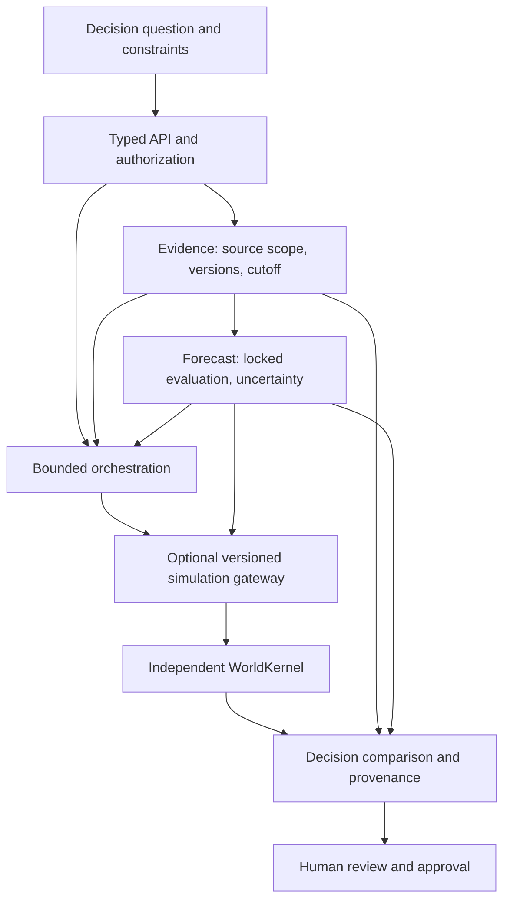

# MirrorMind master execution plan

This is the cross-milestone execution index, **not** a claim of delivered
capabilities. Read [the agent handoff](CODEX_HANDOFF.md), [current project
status](PROJECT_STATUS.md), [task backlog](TASK_BACKLOG.md), [definition
of done](DEFINITION_OF_DONE.md) and [blockers](BLOCKERS.md) together.
The [accepted decisions](../DECISIONS.md) and [AGENTS.md](../../AGENTS.md)
govern changes; this plan does not silently approve new architecture,
external permissions, financial expenditure or deployment.

## 1. Product goal and scope

MirrorMind is a domain-neutral, evidence-driven decision intelligence
platform. A user poses a decision question, supplies or selects
authorized evidence, evaluates forecasts, compares alternative scenarios
under explicit assumptions and receives a traceable decision report
for human review. The first reference problem is retail inventory:
compare at least three replenishment policies over 28 days, considering
modeled stockout proxies, stock and ordering/cost tradeoffs.

WorldKernel is an optional, independently released simulation engine.
MirrorMind must remain bootable without it. Do not embed WorldKernel
inside the package, make it import MirrorMind, or silently edit its
repository. Statistical/ML models, not generative text, produce numeric
forecasts. Simulation results are conditional on a world model and are
not observations or guarantees.

See [architecture](../ARCHITECTURE.md), [retail MVP](../RETAIL_MVP.md),
[scenario contracts](../CONTRACTS.md), and the detailed
[M1 delivery plan](M1_EXECUTION_PLAN.md).

## 2. Architecture and intended data flow

The following is a **target flow**, not a diagram of today's running API.

Cross-cutting governance supplies trust, provenance, budgets, isolation,
audit and recovery. HTTP adapters remain thin; shared contracts belong
in `core/`, domain-neutral logic in `modules/`, source/domain-specific
semantics in `domains/`. Keep the modular monolith until a measured
operational requirement justifies a boundary. Technologies proposed in
the decision log are candidates, not compulsory dependencies.

For **actual** code paths start with the [system map](SYSTEM_MAP.md),
[semantic coverage](SEMANTIC_COVERAGE.md), [repository atlas](REPOSITORY_ATLAS.md)
and [generated symbols](generated/SYMBOLS.md). Read definitions, callers
and tests before changing a contract.

## 3. Delivery sequence and parallel work

| Track | Intended result | Work can proceed now | Gate for closure |
| --- | --- | --- | --- |
| M0 / engineering | Stable scaffold and truthful docs | Reconcile drift, preserve regressions | M0 definition of done |
| G / M1b governance | Bounded checkpoint service experiment with actual client integration | Synthetic signatures, authenticated update tests, recovery | Scoped service acceptance; external trust separately reviewed |
| M1a-b | Validated evidence and authorized acquisition | Synthetic composition, source due diligence, adapter tests | Reviewed actual permission/provenance/availability before real ingestion |
| M1c-d | Evaluated forecasting and uncertainty | Deterministic synthetic baselines, empirical evaluation design | Approved data and predeclared temporal holdout |
| M1e-f | Executable decision workflow | Version mapping, exact-pin local runner for the synthetic inventory demo and one code-owned synthetic policy world, plus the decision trace | Authorized temporal/data evidence, empirical forecast evaluation and any separately required service authentication/isolation |
| M2 | Grounded retrieval, orchestration and usable workflow | Contracts, fake-provider tests, safety controls | End-to-end evaluated RAG/tool workflow and human review |
| M3 | Operational readiness | Isolation, budget, durable job and recovery design/tests | Measured operational and security gates |
| M4 | Generalization | Domain-neutral boundary tests, candidate domain analysis | Second complete reference workflow and optional engine compatibility |

Dependencies are enumerated by ID in [TASK_BACKLOG](TASK_BACKLOG.md).
The governance lane must not become a serial prerequisite for all
synthetic product work. Complete a bounded experimental server/client
slice; then prioritize the runnable vertical decision slice. When a
legal, infrastructure or credential blocker is encountered, mark it in
[BLOCKERS](BLOCKERS.md) and choose an independent unblocked task.
Do not add another speculative authority layer without stating which
concrete acceptance criterion it advances.

### First deliverable to demonstrate

1. A runnable, explicitly synthetic local scenario using existing
   staging and availability-aware backtesting.
2. Two evaluated baseline/model choices and honest uncertainty,
   including missing/late-data abstention.
3. Three conditional replenishment strategies through a verified
   simulation model that represents the declared synthetic inventory/lead-time
   assumptions. The upstream `retail.inventory.demo` proves local SDK
   compatibility only. The M1E-04 MirrorMind-owned handler runs the reviewed
   paired policy rules through the same pinned engine and must exactly match
   the reference transition implementation; it remains experimental and
   does not validate real policies.
4. A decision trace showing observations versus forecasts versus
   simulations, exact assumptions, seeds, versions, cost and review.
5. A simple CLI/API/UI demonstration as appropriate, reproducible by
   a different engineer without privileged credentials.

A synthetic runner does not close the approved-data or actual engine
gates. Do not fabricate empirical performance or simulation results.
Move toward the permitted-data demonstration only once the owner has
reviewed the relevant evidence.

## 4. Source-of-truth ownership

- [Decision log](../DECISIONS.md): accepted architecture and explicit
  changes to design; do not mark proposals accepted automatically.
- [Roadmap](../ROADMAP.md): milestone scope and meaningful release history.
- [Task backlog](TASK_BACKLOG.md): one maintained task ID/status/dependency
  registry; avoid copying the same mutable checklist into other docs.
- [Project status](PROJECT_STATUS.md): dated, commit-pinned synthesis.
- [Blockers](BLOCKERS.md): actual blockers, evidence required to unblock,
  owner and safe workarounds; not a permission grant.
- [Definition of done](DEFINITION_OF_DONE.md): stable acceptance gates.
- [Capability ledger](CAPABILITY_LEDGER.json) plus live
  `GET /v1/capabilities`: reviewed runtime status vocabulary.
- [Evidence map](EVIDENCE_MAP.json): precise source/test-backed claims
  with limitations; existence of a test selector is not a passing run.
- [Engineering hub](README.md): navigation to detailed source walkthroughs.

Update the relevant owner document in each PR, not six duplicative
status reports. Correct stale introductory prose where necessary while
preserving dated historic evidence. If design, docs and code disagree,
record the discrepancy, verify actual behavior and apply the correct
review process; do not resolve it by silently weakening a contract.

## 5. Delivery and review cadence

Each PR implements one coherent bounded slice with a change request,
source-linked guide, positive/adverse regressions, a reproducible
quality receipt, explicit limits and a backlog update. See
[DEFINITION_OF_DONE](DEFINITION_OF_DONE.md) for evidence requirements
and [CODEX_HANDOFF](CODEX_HANDOFF.md) for safe concurrency and the
documentation style. Passing structural guards is necessary but not
sufficient. Do not represent the whole platform as complete while an
essential milestone or human acceptance remains open.
