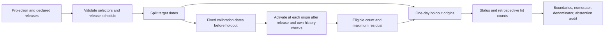

# MM-M1c — prequential residual envelope (synthetic, uncalibrated)

## What is being tested

[`residual_envelope.py`](../../src/mirrormind/domains/retail/residual_envelope.py)
performs a **retrospective diagnostic** over fictional daily positive-invoice
lines and **caller-declared, unauthenticated** release dates. It reuses the
fixed seven-day seasonal-naive estimate from the existing baseline module,
then asks whether the observed target falls inside a *heuristic envelope*
based on the **maximum absolute error** of previously released, historically
eligible forecasts in one fixed calibration interval before the holdout.

**This is not conformal prediction, a calibrated prediction interval, a
confidence interval or a nominal coverage guarantee.** No nominal level
is estimated or output. The immutable input projection is not declared
complete demand, and no calendar gap is filled with zeros.

## Contract and execution path

`evaluate_retail_residual_envelopes` accepts an immutable
`UciRetailProjection`, an exact tuple of `DeclaredProductRelease` declarations,
a product selector, an exact `date` cutoff and bounded integer settings:
2–30 holdout origins, 5–60 calibration dates, and at least three required
residuals not exceeding the calibration window. It returns an aggregate
`dict[str, object]`; the function is a local offline diagnostic, not an API
route. `audit_declared_releases_as_of` validates the complete release schedule
before evaluation. Invalid selector/date/window types, unknown product and
incomplete release declarations fail with `ValueError`.

The evaluator builds the product's positive-line day/value and release-date
lookups, then calculates the two date intervals. `_predict_on(target)` checks
the seven consecutive feature dates against the release map at `target - 1`
and calls the shared seasonal-naive `_predict` baseline only when all seven
are available. The calibration sweep sorts observed targets inside the fixed
interval by declared publication date; each holdout origin activates newly
available candidates and maintains eligible count plus maximum absolute
residual. Holdout targets are classified in order as missing, late,
history-unavailable, insufficiently calibrated or retrospectively evaluated.
The final receipt aggregates exact hit numerator and evaluated-origin
denominator and returns dates/statuses only. It does not return source values,
identifiers, residuals, forecasts or interval bounds.



## Exact temporal rules

For a target on day T, the forecast origin is T-1. The forecast requires
seven *consecutive* positive product-days recorded and declared available
no later than T-1. A retrospective outcome is eligible for scoring only
when declared released by the final evaluation cutoff.

The requested holdout is the consecutive target interval ending at
`evaluation_on`. Calibration dates are a fixed calendar interval immediately
before that holdout: `[first_holdout_target - calibration_days,
first_holdout_target - 1 day]` (default 21 days, bounded 5–60). For every
one-day holdout origin, a candidate residual in this fixed interval enters
the envelope only if:

1. Its outcome was declared available by the current forecast origin, not
   merely by the final evaluation cutoff.
2. Its own seven historical feature dates were available before **its
   own forecast origin**, not retrospectively backfilled with future data.
3. It has a positive-line target present. Missing data, cancellations,
   returns and stockouts are never imputed as zeros.
4. Its target date is in the fixed pre-holdout interval. A holdout target
   label never becomes a calibration residual at a later holdout origin.

The diagnostic remains prequential for the holdout: a published earlier
holdout observation may be a feature for a later one-day forecast, subject
to that feature's release date, but its target label remains outside
calibration for the entire run.

At least five qualifying past residuals are required by default (minimum
configurable 3, never greater than the candidate window). The maximum
absolute eligible residual determines the envelope radius around the
seasonal-naive point estimate; the lower bound is clipped to zero.
The result includes both target-window boundaries and an explicit Boolean
that the calibration and holdout target intervals are disjoint. Only an
aggregate retrospective hit counter and an explicit denominator are
returned. No per-product, customer or invoice identifiers, residual values,
per-origin predictions or per-origin envelope bounds leave the function.
Origin audit rows contain only dates and abstention statuses.

The denominator is the number of **evaluated** origins, not every
requested day. An empty denominator is reported as zero with no percentage
or calibrated interval. Selection bias, dependence, source licensing,
producer provenance, later revisions and empirical future performance
remain unmeasured.

The returned contract names its date boundaries
`calibration_target_window_start/end` and `holdout_target_window_start/end`;
`calibration_holdout_targets_disjoint` is true by construction.
`retrospective_coverage_numerator` is the number of evaluated origins whose
observed target fell inside the heuristic envelope, and
`retrospective_coverage_denominator` is `evaluated_origins`. The latter may
be smaller than `requested_origins` because of explicit abstentions. The
`origin_audit` exposes only `target_on`, `origin_on` and a status string.

## Negative controls and invented example

The [unit regression suite](../../tests/unit/test_retail_residual_envelope.py)
generates entirely invented positive-line histories. A normal 70-day case
can evaluate seven last-day origins. A second version declares day 60
published only on day 70: its value cannot be used in forecast features
or calibration residuals at origins before day 70. Mutating that hidden
value from 4 to 999,999 leaves the full result unchanged. With an
unpublished final target, that fixture evaluates two origins, abstains on
four missing forecast histories and withholds one unpublished target.

A separate case forces **insufficient calibration** and checks that
zero origins are evaluated rather than making up an interval. Missing
positive-line targets remain missing, not zero; incomplete release
declarations and invalid date/window inputs fail closed.

Curated behavior claim **MM-RENV-001**:
`tests/unit/test_retail_residual_envelope.py::test_delayed_historical_value_is_unavailable_for_forecast_and_calibration`.

```bash
python -m pytest -q tests/unit/test_retail_residual_envelope.py
python -m pytest -q
python -m ruff check src tests
python scripts/docs/catalog.py --check
python scripts/docs/coverage.py --check
python scripts/docs/evidence.py --check
python scripts/docs/capabilities.py --check
```

## What remains blocked

Source-authenticated publisher vintages and lawful ingestion, complete
product/store observation and exposure calendars, independent untouched
holdouts, empirical interval calibration, distribution-shift analysis,
per-store dependency adjustment, and statistical coverage guarantees.
Do not compare this toy empirical coverage to an arbitrary claimed 80%
confidence level; no such level exists in this method. No real inference
endpoint, WorldKernel decision execution, or model deployment is enabled.

## Fixed split, disjoint labels and release-aware activation

The evaluator forms two target-date sets once per call: a fixed calibration
interval strictly before the requested holdout and the holdout interval
itself. The intervals cannot overlap, even when an early holdout observation
has been published by a later holdout origin. This prevents using a scored
holdout label to set the later holdout envelope while still allowing released
observations to be used as later forecast features when their own as-of
checks pass.

Within the fixed calibration interval, release declarations schedule when a
candidate may activate. The evaluator reads its value and computes its
seasonal-naive forecast only after the target release is available at the
current holdout origin; the candidate's seven feature days must also have
been available at its own forecast origin. Missing dates do not activate.
Because the calibration date interval does not slide, an activation heap
tracks the maximum absolute eligible residual and an integer tracks the
active count. No expiration heap or cache is used. Each distinct calibration
and holdout target is forecast once during the call. For the complete
fictional 21-day calibration plus seven-day holdout, that is 28 baseline
forecast calls; this is a structural count, not a latency benchmark.

Evidence **MM-RENV-002**:
`tests/unit/test_retail_residual_envelope.py::test_fixed_split_predicts_each_distinct_target_once`.
The call count demonstrates one visit per target under this split, not an
optimization speedup or scientific property.

The separate quadratic test oracle recomputes each holdout origin's eligible
residuals from the fixed date interval and compares the full dated origin
audit and retrospective hit count. Adversarial fictional histories vary
release delays, missing positive-line dates, products, cutoffs and window
lengths; output checks also ensure identifiers do not escape.

Evidence **MM-RENV-003**:
`tests/unit/test_retail_residual_envelope.py::test_fixed_split_matches_independent_oracle_under_adversarial_publication_schedules`.
This checks implementation-level date eligibility against an independent
test-only oracle. It cannot establish authentic publisher vintages, source
rights, true demand, statistical calibration or forecast accuracy.

Evidence **MM-RENV-004**:
`tests/unit/test_retail_residual_envelope.py::test_disjoint_calibration_exactly_matches_naive_reference`.
The broader parameterized oracle also checks fixed window boundaries,
non-overlap, abstention statuses and explicit uncalibrated outputs. These
synthetic code-level checks do not establish an empirical coverage guarantee.

Evidence **MM-RENV-005**:
`tests/unit/test_retail_residual_envelope.py::test_holdout_targets_never_enter_later_calibration_windows`.
The regression delays a calibration target until a later holdout origin and
proves that published holdout target labels still cannot refill the fixed
calibration window. The generated fixture proves date-label disjointness and
declared eligibility only; it does not prove unit/source provenance,
calibrated uncertainty or empirical coverage.

## Historical implementation evidence (superseded)

Earlier PR #34 work added call-local forecast memoization and a rolling
release-aware residual window. Its fictional 154-to-28 prediction count was
an implementation-specific comparison. M1D-01 supersedes that rolling
target-label policy with a fixed, disjoint calibration/holdout split. The
current implementation has no memoization or expiration heap, and the
current tests do not claim the old cache differential or call-count result.
The historical change and benchmark protocol remain useful for understanding
why the current fixed split visits each target once, but they are not
evidence of calibrated uncertainty or measured performance.

## Reproducible synthetic timing experiment

For a two-revision comparison using the same full retrospective evaluator
and input data, see the [measurement protocol](RETAIL_RESIDUAL_BENCHMARK.md).
It separates repeated timing samples from a distinct Python-allocation
measurement and requires identical full report hashes. This is only a
synthetic engineering observation, not a claim about demand forecasting,
source rights, calibrated uncertainty or production memory/latency.
