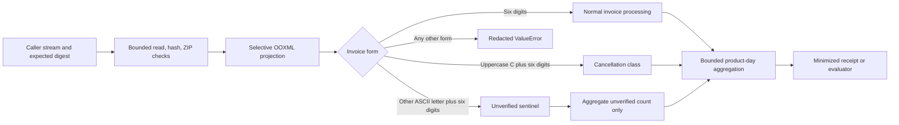

# M1b — bounded local UCI-shaped XLSX reader (experimental)

**Scope:** a narrow, optional, offline read-only stage for a
**caller-selected, pre-authorized local binary stream**, with synthetic-only
automated tests. A separately approved UCI #352 call passed workbook metadata
preflight, then failed closed when the corrected source-specific projection
exceeded its approved 250,000 product-day group cap. It is **not** a source
permission gate, an external connector, a guarantee that hostile
workbooks are safe, or support for the entire original UCI dataset.

Source: [`domains/retail/uci_workbook.py`](../../src/mirrormind/domains/retail/uci_workbook.py).
Reused transformation:
[`domains/retail/uci_transactions.py`](../../src/mirrormind/domains/retail/uci_transactions.py).
Tests: [unit](../../tests/unit/test_uci_workbook.py),
[integration](../../tests/integration/test_uci_workbook_flow.py).
The [original UCI source review](datasets/UCI_ONLINE_RETAIL_SOURCE_REVIEW.md),
[fictional workbook card](datasets/SYNTHETIC_UCI_XLSX_CARD.md),
[transaction projection guide](UCI_RETAIL_PROJECTION.md) and
[permission gates](CAPABILITY_GATES.md) are mandatory context.

## 1. Explicit trust and input contract

The operator is responsible for **choosing and opening an authorized
local file**. The reader never opens arbitrary paths or URLs, makes
network requests, persists input data, downloads UCI, authenticates
licenses, verifies customer consent or sends rows to AI services.

Callers must provide an independently approved **expected SHA-256**
of the *complete compressed workbook bytes*. The parser compares the
value but **does not establish its independent origin**; computing
the digest directly from an untrusted file and then accepting that
same file is not provenance verification.

The `openpyxl` dependency is optional for basic MirrorMind:
`pip install -e ".[uci]"`. Development/CI installs it through the
`dev` extra. The reader rejects workbooks outside these fixed
experimental budgets rather than truncating them:

| Guard | Current experimental ceiling |
| --- | --- |
| Compressed XLSX stream | **32 MiB**, read in 64 KiB-or-smaller chunks with one sentinel byte |
| ZIP archive | **256 entries** total |
| Individual uncompressed ZIP entry | **64 MiB** |
| Total advertised uncompressed ZIP entry sizes | **128 MiB** |
| Declared uncompressed/compressed size ratio | **200:1** per entry |
| Transaction rows parsed by the projection | Default **10,000**; explicit local maximum **600,000**, not silently truncated |
| Product-day output groups | Default **2,000**; generic maximum **100,000**; approved UCI-workbook call maximum **250,000** |

These checks reduce obvious resource abuse but **do not** provide a
general hostile-file sandbox or runtime CPU/memory metering. The parser and
its upstream reader remain inside the caller's trust boundary. The approved
local UCI snapshot passed compressed-size, archive, worksheet/header,
required-field, event-date and StockCode preflight. The first call stopped at
the generic 100,000-group ceiling. The corrected MM-021 invoice classifier
then exceeded the approved UCI-only 250,000-group ceiling. Both calls failed
closed without partial projections or metrics; the exact count was not
retained. MM-022 later narrowed the classifier to treat only uppercase `C` as
cancellation; lowercase `c` is now synthetically tested as unverified. This
clarification was not applied to the source, and does not authorize another
read. Reader defaults remain 10,000 rows/2,000 groups, and direct/generic
projection remains capped at 100,000. Generic ZIP defaults remain 64/128 MiB.
The larger ZIP profile is an explicit per-call request within the supported
192/224 MiB ceilings. Do not retry or partition this source under the current
scope.

## 2. Method-by-method contracts and unsafe inputs

| Symbol | Observable behavior | Important boundary |
| --- | --- | --- |
| `UciWorkbookReadResult` | Frozen `sha256_hex` and an existing immutable `UciRetailProjection` | No signed source manifest, customer approval or verified publication times |
| `UciWorkbookReadResult.receipt()` | Digest plus aggregate accepted, cancelled, excluded and unverified-prefix counts and `uci_xlsx_projection_not_authorized` | No raw invoice, customer, price, description or category keys; the transient in-memory projection still contains `StockCode` keys |
| `_bounded_read(stream)` | Cooperative binary reads up to one byte above compressed cap | Short read is not mistaken for EOF; no file opener, URL fetcher or guaranteed cancellation of arbitrary custom readers |
| `_check_zip_members(raw)` | Rejects unsupported entry counts, duplicate names, advertised sizes, high compression ratios, encryption, parent paths and external-link/macro/embedded active parts | ZIP metadata preflight is **not** complete malicious XML or decompression isolation |
| `_resolve_worksheet(archive, sheet_name)` | Resolves the sole named worksheet through bounded workbook relationships and reads the date-system flag | Rejects multiple sheets, external/escaping relationships and unsupported worksheet paths |
| `_selected_shared_string_indices(...)` | First worksheet pass collects shared-string indexes only from the eight header cells and data columns A, B, D and E | The data `Description` column is not selected; only its header name is checked as schema metadata |
| `_read_required_shared_strings(archive, indexes)` | Streams the shared-string table and retains only referenced strings, with finite per-string/count/total byte limits | Python character callbacks are disabled for unreferenced strings, including Description-only strings |
| `_iter_worksheet_rows(...)` | Expat scans worksheet XML and captures header cells plus the four approved projection columns; a per-row set rejects duplicate coordinates across every schema column in both worksheet passes | Only eight column coordinates can be retained for one row; excluded cell text remains uncaptured, but its coordinate is still checked |
| `_decode_cell(...)` | Enforces field-specific OOXML cell types, strict numeric lexical syntax, finite conversion and date conversion using workbook epoch/style | Error and unknown types, malformed numeric text, numeric overflow/underflow and formulas fail with redacted errors; this is not a hostile-file sandbox |
| `_normalize_uci_workbook_invoice(value)` | Accepts six-digit numeric IDs, preserves only exact uppercase `C` plus six digits as the cancellation class, and maps lowercase `c` or another one-letter ASCII prefix to a private sentinel | Only the aggregate unverified-prefix count survives; original IDs are discarded before grouping. Every other format fails closed. |
| `read_uci_workbook(stream, expected_sha256, sheet_name='Online Retail', max_rows, max_groups, max_zip_entry_bytes, max_zip_total_bytes)` | Verifies hash and ZIP bounds, classifies the scoped invoice forms, then streams approved projection fields into the bounded transaction projection | UCI-only invoice policy and 250,000-group cap; generic behavior remains unchanged. ZIP overrides are exact integers within 192/224 MiB supported ceilings. Parsing is not hostile-file isolation. |

The source-specific classification occurs at the workbook adapter boundary;
the shared row projector remains strict and unchanged:



The data path has two worksheet passes. The first obtains the shared-string
indexes required by selected columns without retaining data values. The
shared-string pass then captures only those indexes. The second worksheet pass
decodes only header metadata and `InvoiceNo`, `StockCode`, `Quantity` and
`InvoiceDate`. In particular, the `Description` body column is omitted from
both the selected-index set and the cell-value decoder. The shared row iterator
checks each cell coordinate before storing any selected value. It resets a set
of at most eight `(row, column)` pairs at each row boundary, so it rejects a
duplicate header, selected data cell or excluded-column cell before a later
cell can overwrite dictionary state. Because both worksheet passes use this
iterator, the same structural rule applies during shared-string discovery and
value decoding. Expat still scans the enclosing XML stream but does not retain
or interpret nonselected cell content. `openpyxl` supplies Excel date-format
and serial-date utilities only; `load_workbook` is not used.

Formula text is not evaluated; a formula in any selected required field is
rejected before decoding. `_decode_cell` also applies a field-specific type
contract: invoice and stock-code cells may be numeric or textual, quantities
must be numeric, and dates may be numeric serials or OOXML ISO dates. Error
cells (`t="e"`) and unknown cell types never fall back to their raw text.
Numeric cells must match a decimal/scientific lexical grammar before parsing;
non-finite values and nonzero values that underflow to zero are rejected.
This prevents malformed numeric payloads such as `12_345` or `SKU-X` from
being accepted as a category after a failed numeric conversion. These checks
raise fixed, redacted `ValueError` messages without including cell contents.

The parser demands one sheet named `Online Retail` and the exact columns:

```text
InvoiceNo,StockCode,Description,Quantity,InvoiceDate,UnitPrice,CustomerID,Country
```

The projection uses only `InvoiceNo`, `StockCode`, `Quantity`
and `InvoiceDate` to build a `StockCode`-category/day count. The UCI reader
normalizes exact positive five-digit integer cells to decimal text and, only
for this source policy, accepts bounded internal ASCII spaces without
trimming. It does not infer keys from `Description`; results describe units per
category, not verified physical-SKU demand. Six-digit invoice IDs enter the
existing projection; only uppercase `C` plus six digits remains a cancellation
record. Lowercase `c` and other one-letter ASCII prefixes plus six digits are
excluded before grouping and recorded only in the aggregate
`unverified_invoice_prefix_rows` count. Other invoice formats fail closed.
This MM-022 clarification supersedes MM-021's lowercase-`c` cancellation rule
for the UCI reader only; it does not change generic row projection behavior.
The synthetic generic rejection regression is
`tests/unit/test_uci_retail_projection.py::test_invalid_invoice_format_does_not_get_treated_as_regular_sale`.
Excluding those rows may lower category-day totals,
change the fit cohort and alter zero targets and metrics. The workbook may
contain personal data; the reader cannot verify customer-data rights.

The existing transaction projection records excluded
`C` cancellations, negative returns and zero lines separately; the UCI
workbook adapter adds a separate aggregate count for unverified prefixes.
It
does not automatically deduplicate indistinguishable
invoice lines and does not decide whether a `StockCode`
is a sellable merchandise item.

## 3. Purely fictional reproduction

A local exercise can generate a small workbook in memory
without downloading the original UCI dataset:

```python
from datetime import datetime
from hashlib import sha256
from io import BytesIO
from openpyxl import Workbook
from mirrormind.domains.retail.uci_workbook import read_uci_workbook

wb = Workbook()
ws = wb.active
ws.title = "Online Retail"
ws.append([
    "InvoiceNo", "StockCode", "Description", "Quantity",
    "InvoiceDate", "UnitPrice", "CustomerID", "Country"
])
ws.append(["536365", "SKU-A", "FICTIONAL ITEM", 2,
           datetime(2011, 1, 5, 9), 1.5, 12345, "fictional"])
raw = BytesIO()
wb.save(raw)
wb.close()
original = raw.getvalue()

# Toy demonstration ONLY; expected digest comes from the same generated bytes.
result = read_uci_workbook(
    BytesIO(original),
    expected_sha256=sha256(original).hexdigest()
)
assert result.receipt()["accepted_rows"] == 1
assert result.receipt()["status"] == "uci_xlsx_projection_not_authorized"
assert result.receipt()["publication_time_status"].startswith("unknown_")
```

This example exercises the parser, **not data-source approval**.
An explicitly bounded caller may test a reviewed larger ZIP profile on a
synthetic archive without changing defaults:

```python
result = read_uci_workbook(
    BytesIO(original),
    expected_sha256=sha256(original).hexdigest(),
    max_zip_entry_bytes=192 * 1024 * 1024,
    max_zip_total_bytes=224 * 1024 * 1024,
)
```

This remains a resource-bound example, not permission to open another source.
The approved UCI snapshot preflight is recorded in the path-free
[manifest](datasets/UCI_ONLINE_RETAIL_352_SNAPSHOT_MANIFEST.json). The first
call exceeded the generic group budget; after the approved UCI-specific
invoice classification and larger cap, the corrected call also exceeded its
250,000-group budget. Both calls failed closed. No complete projection,
exclusion count or real-source metric is available. A new scope decision is
required before another run or partitioning strategy.

## 4. Curated claims, tests and limits

| ID | Test selector | What remains unproved |
| --- | --- | --- |
| **MM-XLSX-001** | `tests/unit/test_uci_workbook.py::test_xlsx_stage_projects_positive_units_and_never_copies_sensitive_values` | Fixture-only output minimization does not prove permission, true demand or secure upstream handling |
| **MM-XLSX-002** | `tests/unit/test_uci_workbook.py::test_zip_compression_ratio_bomb_header_rejected` | Metadata compression guard alone is not a proof of hostile-file isolation |
| **MM-XLSX-003** | `tests/unit/test_uci_workbook.py::test_bounded_row_and_group_limits_do_not_truncate` | Refusal of excess test rows is not full real-UCI-workbook ingest support |
| **MM-XLSX-004** | `tests/integration/test_uci_workbook_flow.py::test_synthetic_local_xlsx_file_to_product_day_projection` | No real dataset used; `InvoiceDate` is **not** proven first availability or a true point-in-time feature |
| **MM-XLSX-005** | `tests/unit/test_uci_workbook.py::test_description_shared_string_is_not_extracted_for_projection` | The synthetic tracker proves excluded Description text is not delivered to application character callbacks; Expat still scans worksheet structure, and this does not prove source permission or hostile-file isolation |
| **MM-XLSX-006** | `tests/unit/test_uci_workbook.py::test_uci_non_c_alpha_invoice_prefixes_are_counted_and_excluded`; `tests/unit/test_uci_workbook.py::test_uci_invoice_formats_outside_scoped_classes_fail_without_echo` | Synthetic fixtures prove the approved source-specific classification, aggregate-only exclusion and fail-closed remainder; no empirical run completed and generic callers remain unchanged |
| **MM-XLSX-007** | `tests/unit/test_uci_retail_projection.py::test_invalid_invoice_format_does_not_get_treated_as_regular_sale` | A synthetic generic-row regression confirms lowercase `c` remains invalid and is not echoed outside the UCI reader; it does not establish source rights or real-dataset behavior |
| **MM-XLSX-008** | `tests/unit/test_uci_workbook.py::test_all_single_ascii_letter_prefixes_have_one_aggregate_exclusion_class` | A generated workbook covers all 52 ASCII letters and proves one aggregate exclusion count with no retained invoice values; it does not establish the source's full count, row semantics or empirical metrics |
| **MM-XLSX-009** | `tests/unit/test_uci_workbook.py::test_duplicate_quantity_cell_is_rejected_instead_of_overwriting_original` | A generated duplicate D2 cell proves the reader rejects an attempted overwrite; it does not show that the private workbook contains duplicate coordinates or prove general hostile-file isolation |
| **MM-XLSX-010** | `tests/unit/test_uci_workbook.py::test_duplicate_header_selected_and_excluded_cells_fail_in_both_passes` | Generated fixtures prove duplicate coordinate rejection for header, selected and excluded columns in both worksheet passes; they do not establish any source-level anomaly |
| **MM-XLSX-011** | `tests/unit/test_uci_workbook.py::test_error_and_unknown_selected_cell_types_fail_without_echo` | Synthetic error and unknown cell types prove fixed redacted rejection for selected cells only; they do not validate arbitrary OOXML or hostile-file containment |
| **MM-XLSX-012** | `tests/unit/test_uci_workbook.py::test_malformed_numeric_cell_encodings_fail_without_becoming_stock_codes` | Synthetic malformed, overflowing and underflowing numeric tokens prove strict decoding on fixture cells; they do not demonstrate how often such tokens occur in the private source or establish empirical results |
| **MM-UCIE-004** | `tests/unit/test_uci_event_time.py::test_event_time_evaluator_accepts_approved_uci_group_limit` | A synthetic 100,001-group projection exercises the evaluator bound; the real workbook exceeded 250,000 groups, so this does not prove full-source compatibility |
| **MM-UCIE-005** | `tests/unit/test_uci_event_time.py::test_event_time_result_exposes_aggregate_unverified_invoice_exclusions` | Synthetic output preserves a count and target semantics only; no complete real-source exclusion count or empirical score exists |
| ZIP profile regressions | `tests/unit/test_uci_workbook.py::test_zip_expansion_profile_is_explicit_bounded_and_defaults_stay_unchanged`; `test_zip_expansion_budgets_must_be_exact_bounded_and_consistent` | Verify caller override bounds and unchanged defaults on generated archives only; no runtime resource metering |
| StockCode regressions | `tests/unit/test_uci_workbook.py::test_numeric_and_textual_five_digit_stock_codes_share_one_exact_group`; `test_internal_ascii_spaces_are_preserved_as_distinct_stock_code_keys`; `test_unsupported_stock_code_encoding_fails_without_echoing_value` | Verify approved representation rules on synthetic cells, not physical product identity |

Other adverse tests cover wrong digest, unsupported
workbook layout, malformed quantity, unsupported formula
cell, forbidden external-link ZIP part, oversized streams,
partial reads, generic OSError redaction and
invalid row settings.

Review regressions additionally reproduce a duplicate `D2` quantity that used
to replace the original value, then verify rejection of duplicate header,
selected and excluded-column coordinates in both worksheet passes. Separate
fixtures prove error/unknown selected types and malformed numeric encodings
fail without echoing their payloads. These synthetic cases verify parser
behavior only; they do not assert that the private UCI workbook contains such
corruption or establish source-level counts.

```bash
python -m pip install -e ".[dev]"
python -m pytest -q tests/unit/test_uci_workbook.py
python -m pytest -q tests/integration/test_uci_workbook_flow.py
python -m pytest -q
python -m ruff check src tests
python scripts/docs/catalog.py --check
python scripts/docs/coverage.py --check
python scripts/docs/evidence.py --check
python scripts/docs/capabilities.py --check
```

## 5. Independent exercise and remaining gate

Add a second **invented** product-day record, then
a cancellation and a negative return. Explain why
the positive-line total changes differently from
the excluded-row counters. Change the header
`Quantity` to `Amount`: the reader must refuse
to reinterpret it silently. Add a new worksheet:
the reader must fail closed instead of guessing
which sheet to use.

Next, explain why a valid SHA-256 of bytes read
from disk is insufficient to prove the workbook
came from the official UCI source with an approved
use. Why is its `InvoiceDate` not an authenticated
`available_on` for real-time as-of backtesting?

**Not delivered:** complete projection of the acquired workbook because the
approved call exceeded 250,000 product-day groups; validation/holdout scores,
verified historical release vintages, trained
forecasting, customer-facing inference or WorldKernel integration. The
scope-specific local approval is not a production promotion or point-in-time
claim. Do not retry, chunk or widen the cap without a new owner decision.
Source retention is bounded by the manifest deletion deadline.
