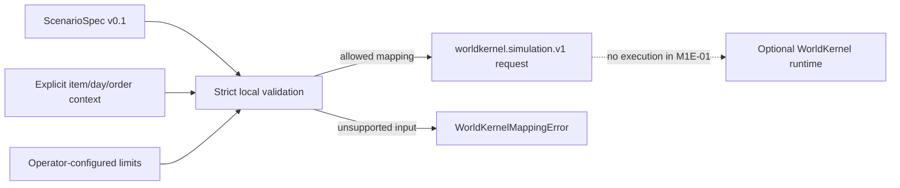

# WorldKernel request mapping — source walkthrough

## Purpose and current boundary

MirrorMind's `ScenarioSpec` is a local Pydantic input contract. WorldKernel
defines its own versioned JSON exchange. The two shapes are not equivalent:
MirrorMind names a retail world `retail.inventory` at version `0.1`, while
WorldKernel's reviewed trusted demo is `retail.inventory.demo` at registration
revision `demo-1`. M1E-01 adds a pure translation boundary for this one pair.

The mapper returns a request object. It does not call `execute_exchange`,
import WorldKernel, start a process, parse an engine result, or make the API
world-capable. `SimulationGateway` remains an interface, and the capability
ledger keeps `worldkernel_adapter` planned until later execution and runtime
acceptance criteria pass.

## Architecture and data flow



1. The caller constructs `ScenarioSpec` using existing MirrorMind fields.
2. The trusted composition root supplies `WorldKernelOperatorLimits`
   separately. Scenario fields cannot increase those ceilings.
3. The caller supplies an explicit `InventoryWorldUnitContext`. These unit
   labels are assertions; the mapper cannot authenticate their source.
4. `build_worldkernel_exchange_request` checks the exact world/version pair,
   references, interventions, units, state/parameter allowlists and resource
   ceilings. It then copies only accepted values into WorldKernel v1 fields.
5. A later M1E-02 runtime adapter may send the request. That step is not
   implemented here.

## Implementation and contracts

Source: [`worldkernel_mapping.py`](../../src/mirrormind/modules/simulation/worldkernel_mapping.py).

### `SUPPORTED_WORLD_MAPPINGS`

An immutable mapping permits only `("retail.inventory", "0.1")` and fixes
its target to `("retail.inventory.demo", "demo-1")`. The target revision is
WorldKernel trusted-registration metadata; it is not a package digest,
signature, immutable release or proof that the remote source is installed.

### `WorldKernelOperatorLimits`

This frozen value object takes positive ceilings for `max_steps`, `max_runs`
and `max_total_transitions`. Its hard upper bounds mirror the existing
MirrorMind scenario schema (366 days and 10,000 runs). The mapper separately
checks `horizon_days`, `runs` and `horizon_days * runs` against these values.
The resulting exchange request carries the same configured limits. A trusted
composition root must create this object from operator configuration, not
copy values from an untrusted request. The type itself does not authenticate
the composition root or enforce a worker/server resource quota.

### `InventoryWorldUnitContext`

The reviewed handler has integer item counts and a daily step. The caller must
declare `quantity_unit="item"`, `step_unit="day"`, and
`order_unit="order"`. Other values fail closed. This is explicit unit context,
not evidence that the original data source actually used those units.

### `build_worldkernel_exchange_request`

The function has no I/O and depends only on MirrorMind's existing
`ScenarioSpec` plus Python standard library. It creates a fresh JSON-compatible
object with the exact v1 root keys. Seed, run count, step count, initial state,
parameters and operator limits are copied explicitly; unknown scenario fields
are never forwarded.

The WorldKernel inventory handler reads `stock`, `sold`, `unmet`, `orders`,
`daily_demand`, `reorder_point` and `reorder_quantity`. Mapping requires
non-negative integer `stock`, daily demand and reorder parameters. The
cumulative counters may be omitted because the inspected handler initializes
them to zero; if provided, they are validated and copied. Boolean and float
values are rejected even though Python treats `bool` as an integer subtype.
All unrecognized state and parameter keys fail.

The mapper rejects every intervention because MirrorMind does not yet define
a reviewed transformation from `Intervention` to this world's parameter
semantics. It also rejects `EvidenceRef` and `ForecastRef`: v1 cannot resolve
or authenticate them. It does not synthesize missing demand or initial stock.

## Reproducing the request

From the repository root:

```bash
python examples/m1e_01_worldkernel_mapping.py
python -m pytest -q tests/unit/test_worldkernel_mapping.py
```

The example uses fictional values and prints the request only. Its result
contains `steps=28`, `runs=3`, a fixed seed and explicit operator ceilings. It
does not prove that an engine executed or that any retail policy is valid.

The existing [`examples/retail-scenario.json`](../../examples/retail-scenario.json)
is intentionally not directly mappable: it includes a `reorder_policy`
intervention and omits required `daily_demand`. A mapping failure is safer
than silently treating a different default as approved scenario input.

## WorldKernel contract reviewed

Read these independent-project sources alongside the mapper:

- [Exchange v1 contract](https://github.com/GustavoMFDS/WorldKernel/blob/main/docs/EXCHANGE.md)
- [Trusted world revisions](https://github.com/GustavoMFDS/WorldKernel/blob/main/docs/TRUSTED_WORLD_VERSIONS.md)
- [Exchange validator](https://github.com/GustavoMFDS/WorldKernel/blob/main/src/worldkernel/adapters/exchange.py)
- [Retail inventory handler](https://github.com/GustavoMFDS/WorldKernel/blob/main/src/worldkernel/examples/inventory.py)

The v1 request requires a schema version, world, world version, steps, runs
and three declared limits; optional fields are seed, state and parameters.
Unknown root fields are rejected. Strict registered-version enforcement is an
optional WorldKernel SDK behavior. The inventory demo uses daily demand,
immediate replenishment and no lead-time model. Its outputs are conditional on
that simplified handler.

## Failure, security and limitations

`WorldKernelMappingError` is raised before any external call for unsupported
world/version pairs, units, interventions, references, state/parameter shapes,
or operator-limit violations. Invalid operator configuration raises
`ValueError`. No request is logged and there is no payload persistence.

The caller still owns source rights, data validation and unit provenance.
The request's `limits` are caller-declared when consumed by WorldKernel's
local SDK; they are not independently enforced server limits. This mapping
does not enforce timeout, memory, CPU, concurrency or cancellation. It does
not validate result shape or actual registered code. B-04 remains open for a
pinned compatible runtime and real SDK integration. The synthetic handler is
not a calibrated demand model or business recommendation.

## Tests and what they prove

[`test_worldkernel_mapping.py`](../../tests/unit/test_worldkernel_mapping.py)
contains these focused checks:

- `test_supported_inventory_scenario_maps_to_exact_v1_request`: proves one
  synthetic allowlisted request's exact fields and target identifiers.
- `test_mapping_is_deterministic_and_uses_operator_limits`: proves repeated
  pure construction is stable and limits come from separate operator input.
- `test_unrepresentable_scenario_fields_are_rejected`: proves aliases,
  revisions, interventions, evidence and forecast references fail closed.
- `test_state_requires_stock_and_rejects_unknown_fields` and
  `test_parameters_are_explicit_and_allowlisted`: prove no default starting
  stock/demand or unknown model fields are silently invented or forwarded.
- Numeric, unit and limit tests reject invalid values and excessive work.
- `test_mapping_module_imports_without_worldkernel_package` blocks any
  `worldkernel` import while reloading this module. It proves this boundary
  has no direct runtime package import; it is not an API deployment test.

All fixtures are generated and local. They do not prove cross-repository SDK
compatibility, engine execution, result validity, source authorization,
forecast accuracy or performance.

The evidence map claim `MM-WKMAP-001` points to
`test_supported_inventory_scenario_maps_to_exact_v1_request` and retains this
synthetic-only limitation.

## Learning and investigation exercises

1. Trace `ScenarioSpec` through `_scenario` in the unit test and explain why a
   scenario can validate yet still be unmappable.
2. Add `lead_time_days` to an input and predict which allowlist rejects it.
   Do not add a target mapping unless the reviewed handler supports it.
3. Lower `max_total_transitions` while keeping `max_steps` and `max_runs`
   unchanged. Explain why the product of scenario steps and runs still fails.
4. Remove the unit context and consider whether integer values alone identify
   physical quantities. Explain what evidence would be needed to establish
   units from a real source.
5. Inspect the WorldKernel inventory handler and identify why immediate
   replenishment cannot establish a real supplier lead time or stock policy.

## Maintenance and evolution

When the external exchange or trusted handler changes, inspect its source and
revision again, update the allowlist only with a matching compatibility test,
and keep the cross-repository edit separate. Do not reuse `demo-1` as a
cryptographic code identity. An execution adapter must separately pin its
package, enable strict registered-version checking, enforce trusted operator
budgets, validate results, isolate failures and preserve scenario provenance.
Only actual runtime evidence may close M1E-02 or promote
`worldkernel_adapter`.
