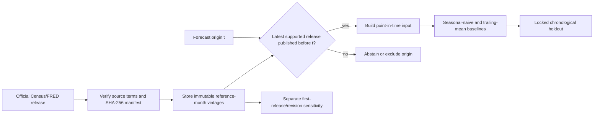

# UCI Online Retail (352) — licensed-source candidate, not approved ingestion

**Review date:** 2026-11-25.
**Status:** `license-published / privacy-and-use-review-pending`.
**Operational decision:** **NO-GO** for unattended source downloads,
commit of transaction records, model training, customer-level
analytics or a claim of historically available forecasts until
the applicable attribution, privacy and provenance review is
signed off. This document records source information and
risk boundaries; it is not a legal opinion or access authorization.

## 1. Original evidence (not a third-party mirror)

| Item | Official source / directly visible evidence |
| --- | --- |
| Dataset | [UCI Online Retail (ID 352)](https://archive.ics.uci.edu/dataset/352/online-retail) |
| Citation / DOI | Chen, D. (2015). *Online Retail* [Dataset]. UCI Machine Learning Repository. [doi:10.24432/C5BW33](https://doi.org/10.24432/C5BW33) |
| License shown by UCI | [Creative Commons Attribution 4.0 International](https://creativecommons.org/licenses/by/4.0/) — UCI's official page explicitly labels **this dataset** CC BY 4.0 |
| Published license scope | CC BY 4.0 allows copying/adaptation, including commercial use, **provided its attribution, license link and change notice obligations are respected**; it does not waive unrelated privacy, publicity, contract, database or security obligations |
| File | UCI lists `Online Retail.xlsx`, about 22.6 MB; this is **larger** than the 1 MiB MirrorMind local parser budget |
| Rows and period | UCI reports 541,909 transactions, dated 2010-12-01 through 2011-12-09, for a UK non-store retailer |
| Source fields | `InvoiceNo`, `StockCode`, `Description`, `Quantity`, `InvoiceDate`, `UnitPrice`, `CustomerID`, `Country` |

These facts were rechecked on the official UCI page and the
official Creative Commons license summary on 2026-11-25.
They **do not imply** that all records are complete, that
customer-identifying fields are safe to redistribute,
or that the dataset contains inventory, lead times,
stockouts, counterfactual demand or source publication
history. The UCI page's dataset license statement
is stronger evidence than a license claim on a mirror,
but a reviewer must still confirm the intended
product processing and attribution requirements.

### Recheck evidence and limits

The [official UCI record](https://archive.ics.uci.edu/dataset/352/online-retail)
continues to list 541,909 transactions, event dates from 2010-12-01 through
2011-12-09, the 22.6 MB workbook and a CC BY 4.0 license. It gives a catalog
donation date of 2015-11-05; that date is not a row-level release timestamp or
evidence of when a forecaster could first observe each value. The visible
catalog metadata has no versioned publication vintages or source-byte digest.

The official [CC BY 4.0 deed](https://creativecommons.org/licenses/by/4.0/)
permits sharing and adaptation for any purpose, including commercially, when
its terms are followed. Attribution must include appropriate credit, a link
to the license and an indication of changes; the license forbids adding
restrictions to the licensed material. The deed also states that it may not
provide every permission needed for an intended use, including privacy or
publicity rights. UCI's license statement is therefore a useful license
source, but it does not complete customer-data, contractual or product-use
review.

The separate [Online Retail II record](https://archive.ics.uci.edu/dataset/502/online+retail)
lists 1,067,371 transactions, a 43.5 MB workbook and missing values. Keep its
license entry, snapshot and transformations separate from ID 352; it is not a
drop-in substitute.

No workbook was downloaded during this recheck. There is no acquired snapshot
hash, local acquisition timestamp or original-byte verification to record.
The visible UCI metadata describes transaction event time, not row-level
first availability or historical release revisions. Do not synthesize those
fields from `InvoiceDate`.

**Interim candidate recommendation:** retain UCI Online Retail ID 352 as the
preferred source for a future, narrowly scoped permission decision because
its original UCI record states the license. This is a review recommendation,
not permission to acquire, retain, transform or use the records. M5 remains
NO-GO pending its original terms. M1B-01 due diligence is complete; B-01 and
B-02 still gate any real-source adapter or empirical evaluation.

An alternative, longer version is
[UCI Online Retail II (ID 502)](https://archive.ics.uci.edu/dataset/502/online+retail)
with its own UCI-published CC BY 4.0 entry and
about 1.07 million transactions from 2009–2011.
**Do not silently mix the two datasets or their snapshots.**

## B-01/B-02 decision paths

These are source candidates and evaluation proposals only. No external data
was downloaded for this review, no source terms were accepted on behalf of the
project, and no data-use permission is inferred from public access.

| Candidate | Intended use | Permission and handling gate | Temporal evidence and limitation |
| --- | --- | --- | --- |
| UCI Online Retail (ID 352) | Product-level *retrospective* research if the owner accepts the customer-data and use limits | UCI states CC BY 4.0. Before acquisition, an accountable owner must approve the research/commercial scope, attribution and change notice, privacy review, minimal field projection, retention/deletion and a dataset card. The workbook exceeds the current parser limit; an approved source-specific streaming adapter and snapshot manifest would be a separate change. | The catalog donation date and `InvoiceDate` do not provide row-level first-availability vintages. This source cannot support a claim that historical predictions used only information known at each origin. Keep results explicitly retrospective; do not fabricate `available_on`. |
| U.S. Census Bureau Monthly Retail Trade releases (MARTS/MRTS) | Aggregate retail series to test release-aware evaluation behavior, not item-level demand or inventory policy | Review the applicable Census publication terms, attribution, retention and redistribution with the project owner. Use aggregate published tables only; no confidential microdata. Record each accepted release URL, retrieval time, original bytes and SHA-256 in a reviewed manifest; keep raw files out of Git, prompts and CI. | The Census release schedule identifies reference month and publication date. Its methodology describes an advance estimate followed by a revision from the larger monthly survey. Treat every published release as a separate immutable vintage; verify historical archive completeness before choosing evaluation dates. |
| FRED/ALFRED `RSAFS` (Census-sourced monthly retail sales series) | Alternative machine-readable check of vintage reconstruction for the aggregate retail method | The FRED API terms and series owner's restrictions both apply. FRED states that its API availability does not override third-party data rights; check the series notes and contact the owner before non-personal use. An API key is required for API requests and must not be placed in Git or a fixture. | ALFRED real-time periods and vintage-date endpoints can identify what series values were recorded for historical periods. Confirm that the chosen series has complete vintages and align each vintage date with the official Census release calendar; the FRED date boundary is date-granular, so use a conservative post-release cutoff rather than inventing an intraday timestamp. |

Primary-source references reviewed on 2026-11-25:

- [UCI Online Retail #352](https://archive.ics.uci.edu/dataset/352/online-retail) and the [CC BY 4.0 deed](https://creativecommons.org/licenses/by/4.0/).
- Census [Monthly Retail Trade release schedule](https://www.census.gov/retail/release_schedule.html) and [MARTS collection/revision methodology](https://www.census.gov/retail/marts/how_surveys_are_collected.html).
- FRED [RSAFS source and series metadata](https://fred.stlouisfed.org/data/RSAFS), [FRED API terms](https://fred.stlouisfed.org/docs/api/terms_of_use.html), [API key instructions](https://fred.stlouisfed.org/docs/api/fred/v2/api_key.html), [real-time periods](https://fred.stlouisfed.org/docs/api/fred/realtime_period.html) and [series vintage dates](https://fred.stlouisfed.org/docs/api/fred/series_vintagedates.html).

### Proposed temporal evaluation protocol

For the Census/ALFRED aggregate option, first freeze a source manifest and
prove that every selected monthly release has an original, hash-verified
vintage. Keep `reference_month` separate from `published_at`; never replace an
original or revised estimate in place. At forecast origin `t`, select only the
latest complete release whose documented publication timestamp is strictly
earlier than `t`. If only a release date is available, use a conservative
next-day boundary.

Before examining forecast scores, register the exact eligible date range,
source vintage policy and split in a model card. Use the earliest complete
period for fitting, the preceding 24 eligible monthly origins for method
selection, and the final 24 complete release origins as a locked holdout;
verify archive coverage before fixing those calendar dates. Evaluate 1-, 3-
and 6-month horizons against seasonal-naive (lag 12) and 12-month trailing-mean
baselines on identical eligible origins. Report MAE, RMSE, zero-safe WAPE,
coverage and abstention counts. Compare scores against first-release outcomes
and final revised values in separate tables; revisions must not leak back into
the as-of inputs. No interval-calibration or inventory-policy claim follows
from this aggregate pilot.

For UCI #352, use a predeclared chronological retrospective holdout only and
label its availability-time limitation in every result. It cannot pass B-02's
point-in-time acceptance without independent source-vintage evidence.

### Proposed vintage contract and flow

| Field | Meaning and validation |
| --- | --- |
| `series_id` | Owner-approved Census series or aggregate `RSAFS`; do not mix series or definitions |
| `reference_month` | Period the observation measures; never use it as its publication time |
| `published_at` | Official release timestamp with timezone, or a conservative next-day date boundary when only a date is published |
| `vintage_id` | Immutable first, monthly revision or annual revision identity |
| `value`, `unit` | Published aggregate and its source-declared unit |
| `source_uri`, `snapshot_sha256`, `retrieved_at` | Reproducible link and identity of the exact release artifact, plus local retrieval time |

Reject missing or conflicting manifest identities, mismatched hashes, and
vintages without a supported publication boundary. A proposed evaluation
receipt records the origin cutoff, the selected release hashes, target vintage
policy, horizon, baseline, metric eligibility and abstentions. It must keep
first-release and final-revision targets separate and contain no business or
customer identifiers.



Required later regression cases include late and same-day release exclusion,
revision visibility only after its publication boundary, missing release
abstention, duplicate/conflicting vintage rejection, snapshot digest mismatch
and parity against a simple independent as-of selector. These are acceptance
requirements for a future adapter; no such adapter or data-backed test ran in
this documentation proposal.

### Owner decision requested

Choose one path for a separately scoped, reviewed change: (A) a
privacy-minimized UCI #352 retrospective research pilot, with no point-in-time
forecast claim; (B) the aggregate Census/ALFRED release-vintage pilot, with no
SKU-level or inventory-policy claim; or (C) defer both sources and continue
using fictional fixtures. Any choice leaves M5 at NO-GO until its original
terms and redistribution rights are independently verified.

## 2. Required human review before source adapter operation

- [ ] Verify the original UCI dataset page and linked CC BY 4.0
  license are still applicable to the exact downloaded file.
- [ ] Name an accountable reviewer and intended use:
  research-only, commercial product, or both.
- [ ] Plan and implement attribution for dataset
  source, authors, DOI, license, and transformed
  artifacts, including a changes notice.
- [ ] Review whether `CustomerID`, invoice IDs,
  description, price, country or other fields
  raise privacy or contractual restrictions.
  **Do not move customer IDs into MirrorMind's
  model inputs, prompts or CI fixtures.**
- [ ] Specify the minimal feature projection:
  product (`StockCode`), **transaction date**,
  signed/positive quantity and cancellation policy.
  Exclude all fields unnecessary for the approved task.
- [ ] Approve a local snapshot procedure with an
  independently recorded SHA-256, acquisition timestamp,
  storage scope, retention/deletion policy and no raw
  data committed to Git.
- [ ] Fix the train/test cutoff *before* any model tuning,
  record canceled invoices, invalid and missing keys,
  refunds, returns, possible duplicate rows and product
  coverage explicitly; do not silently count a return
  as negative demand or missing sales as zero demand.
- [ ] Distinguish `InvoiceDate` (transaction event time)
  from historical **first availability or release time**,
  which the UCI page does not supply at row level.
  Do **not** manufacture `available_on=InvoiceDate`
  and call that verified as-of provenance.
- [ ] Independent redacted acceptance tests and a
  complete [dataset card](../DATASET_CARD_TEMPLATE.md)
  must accompany a source-specific converter PR.

## 3. Why this data cannot directly feed today's parser

`read_staged_csv` accepts a **caller-opened**, at-most-1-MiB
CSV containing exactly:

```text
series_id,observed_on,available_on,units
```

The official UCI source is an approximately 22.6 MB
Excel workbook, not this daily CSV contract.
It contains transaction records including customer
and invoice identifiers. A future source-specific
adapter must be a **separate, opt-in and tested**
component that:

1. Opens a locally reviewed, approved, size-bounded
   workbook using a streaming parser and a
   snapshot hash from a trusted reviewed manifest.
2. Drops customer-level fields **before any output**
   and explains cancellation, quantity and aggregation
   semantics; it must not fabricate inventory or
   customer-level facts.
3. Records publication-time uncertainty explicitly.
   The event date is **not** documentary proof that
   the same value was knowable by a forecaster then.
4. Emits a deliberately bounded normalized daily
   subset with tracked transformations and a
   reviewed data card. Never invent or backfill
   missing dates to make the forecast work.
5. Keeps all real raw data **out of Git, example
   fixtures, model prompts and CI** unless a separate
   scoped data/privacy review explicitly approves
   the handling.
6. Marks results as **retrospective research under
   stated assumptions**, not production forecasts or
   policy-grade inventory decisions.

## 4. Scientific interpretation / no-go assumptions

A transaction ledger records sales/returns,
not true unconstrained customer demand, on-hand
stock, lost sales, supplier lead times, inventory
replenishment policy or causal intervention effects.

Historical **release vintages** are not equivalent
to transaction timestamps. Without a verified
feed availability schedule, MirrorMind should
not claim leakage-free real-time backtesting.
A legally usable snapshot can still be
scientifically unsuitable for a particular
forecasting claim.

## Next action

An accountable human reviewer should select the
specific intended research/commercial task and
approve the license attribution and data-minimization
plan. Then a separate source adapter PR can consume
only that approved local source, with negative tests
for mixed datasets, cancellations, time assumptions,
privacy fields, size limits and reproducible output.

**Current result:** a better-documented source
candidate with an official license statement.
**Not yet delivered:** downloaded/verified original
bytes, source-specific adapter, customer-data
review, real historical publication times,
held-out real-data predictive results,
calibrated uncertainty or WorldKernel integration.
